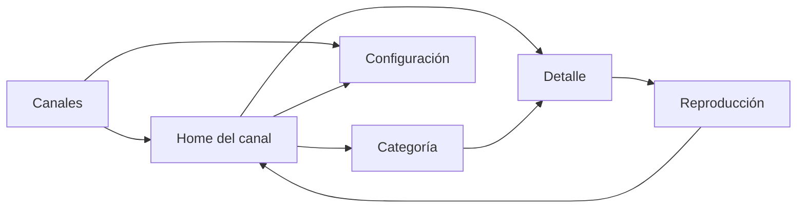

# FLIK — Páginas

Blueprint funcional de las pantallas. Define qué se ve, qué datos se consumen, qué estados existen y dónde cae el foco. No define implementación ni contratos: eso vive en las specs `CMP-*`.

---

## 1. Mapa de navegación

Reglas:

- No existe Home global: siempre hay un canal activo.
- Canales es la raíz: `Back` en esa pantalla cierra la aplicación.
- `Back` en el Home del canal vuelve a Canales; en Categoría y Detalle vuelve al origen; en Reproducción cierra la sesión y vuelve al Detalle.
- Configuración se alcanza desde Canales y desde el Home del canal, nunca desde Reproducción.
- Perfiles no forma parte de v1: `CMP-10` queda especificado pero sin implementar hasta que el producto lo reactive.

---

## 2. Perfiles — `CMP-10`

**Propósito:** identificar quién usa el dispositivo sin cuentas ni red.

> **No implementado en v1.** Los canales son la raíz de la aplicación; los perfiles se reactivan cuando exista progreso por perfil que justifique la selección.

| Aspecto | Definición |
|---|---|
| Entrada | Arranque de la app sin perfil activo |
| Salida | Espacios del perfil elegido |
| Datos | `Profile`: id, nombre, avatar de catálogo local, `lastUsedAt` |
| Secciones | Fila de perfiles + acción «Crear perfil» |
| Estados | Cargando (caché local), con perfiles, vacío (primer arranque), error de almacenamiento |
| Foco inicial | Último perfil usado; si no existe, el primero |
| Foco de salida | `Back` no hace nada: es la raíz de la app |
| Límite | Máximo de perfiles declarado en la spec; valor inicial 5 |
| Sin contraseña | v1 no admite PIN ni autenticación |

Crear perfil abre un diálogo con nombre y selección de avatar. El nombre es obligatorio y único en el dispositivo.

---

## 3. Canales — `CMP-33`

**Propósito:** elegir el canal con el que se quiere entrar. Es la raíz de la aplicación.

| Aspecto | Definición |
|---|---|
| Entrada | Arranque de la aplicación |
| Salida | Home del canal, Configuración |
| Datos | `Channel`: id, nombre, descripción, arte, fuente y estado, orden, último abierto |
| Secciones | Barra con «Crear canal», cabecera centrada `DS-PAGE-HEADER`, carrusel `DS-CHANNEL-CAROUSEL`, bloque de información del canal, `DS-PAGE-INDICATOR` |
| Estados | Cargando desde manifiesto, disponible, error de almacenamiento |
| Foco inicial | Canal abierto más recientemente; si no existe, el primero |
| Foco de salida | `Back` cierra la aplicación; `Up` desde el carrusel se absorbe porque la barra no tiene acciones enfocables en v1 |
| Límite | Cinco canales por defecto declarados en el manifiesto de arranque, no en el código de UI |

Reglas:

- Fondo con el degradado ambiente de `color.surface.ambientStart` a `color.surface.ambientEnd`; el resto de páginas no lo usa.
- El arte del canal es local: asset declarado o placeholder procedural. Nunca se descarga.
- Mover la selección actualiza el bloque de información bajo el carrusel.
- El contador muestra `0 títulos` cuando el canal no tiene fuente; el estado se comunica con badge.
- Sin acciones de explorar, favoritos, búsqueda ni perfiles.
- «Crear canal» está deshabilitado en v1 con explicación visible: la conexión de listas llega con `PRC-07`.
- Los cinco canales por defecto no son borrables en v1; el estado vacío de la pantalla no es alcanzable y se especifica junto al borrado.
- Activar una tarjeta abre el Home del canal; si no tiene fuente, se muestra su estado vacío con «Conectar una lista».
- El diseño no admite teclado en v1: no hay campos de texto en esta pantalla.

---

## 4. Home del canal — `CMP-12`

**Propósito:** consumir el catálogo del canal activo y decidir qué ver.

| Aspecto | Definición |
|---|---|
| Entrada | Canal elegido o `Back` desde Categoría/Detalle |
| Salida | Detalle, Categoría, Canales, Configuración |
| Datos | Ítems del canal, `collections` opcionales, progreso local, fuentes y su estado |
| Secciones | Hero, Continuar viendo, colecciones declaradas o filas derivadas, Top del canal |
| Estados | Cargando desde caché, disponible, vacío, sin red con caché, error de fuente |
| Foco inicial | CTA principal del hero |
| Foco de salida | `Up` desde el hero va a la barra; `Back` vuelve a Canales |

### 4.1 Orden de secciones

1. **Hero:** primer ítem de la primera colección o el primer ítem con `tag: featured`. Si no hay ninguno, se omite el hero y la primera fila sube.
2. **Continuar viendo:** solo ítems con progreso entre el 1 % y el 95 %; orden por `lastWatchedAt` descendente.
3. **Colecciones:** si el documento trae `collections`, se renderizan en su orden y con sus títulos. Los ids inexistentes se descartan sin romper la pantalla.
4. **Filas derivadas** (solo si no hay colecciones): Destacados (`featured`), Tendencias (`trending`), Por género (seis géneros con más ítems), Recién añadido (`added_at` o tag `new`), Top del espacio (`editorial_rank`).
5. **Pie:** estado de las fuentes y acceso a Configuración.

Si el canal no tiene fuente conectada, el Home muestra su estado vacío con el mensaje `channelEmptyTitle`, el cuerpo `channelEmptyBody` y la acción «Conectar una lista» en estado deshabilitado con explicación (`channelConnectHint`). No se pinta hero ni filas.

### 4.2 Reglas

- Ninguna fila se muestra vacía; si no hay datos, no se pinta.
- Un ítem puede aparecer en varias filas; no se deduplica entre secciones.
- Máximo de 20 ítems por carrusel; el resto se alcanza desde Categoría.
- Sin autoplay de hero ni de tráilers.
- «Continuar viendo» requiere progreso local; nunca se envía ni se consulta fuera del dispositivo.

---

## 5. Categoría — `CMP-13`

**Propósito:** explorar el catálogo del canal con filtros y orden.

| Aspecto | Definición |
|---|---|
| Entrada | Acción «Ver todo» de una fila, chip de género o barra de filtros |
| Salida | Detalle; `Back` vuelve a Home conservando filtros y posición |
| Datos | Ítems del canal y facetas calculadas (tipo, género, año, calidad) |
| Secciones | Barra de filtros, contador de resultados, rejilla paginada |
| Estados | Cargando, con resultados, sin resultados, error de consulta |
| Foco inicial | Primer filtro activo; si no hay filtros, el primer póster |
| Foco de salida | `Up` desde la primera fila sube a filtros; `Back` sale |

### 5.1 Filtros

| Filtro | Tipo | Regla |
|---|---|---|
| Tipo | Chips | Películas, Series, Todas |
| Género | Chips | Solo géneros presentes en el canal |
| Año | Selector | Década o año concreto |
| Calidad | Chips | Solo calidades presentes en las variantes |
| Orden | Selector | Título A-Z, año descendente, valoración descendente, añadido recientemente |

- Los filtros se combinan con AND.
- El contador refleja el resultado combinado.
- Se conserva el estado al volver del detalle.
- Sin filtros activos no se muestra el botón de limpiar.

### 5.2 Rejilla

- Paginación incremental por bloques; nunca se materializa la lista completa.
- Columnas según breakpoint (`03-layout.md` §5.4).
- Al cambiar de filtro, la rejilla vuelve al inicio y el foco al primer resultado.
- Estado vacío con acción «Limpiar filtros» enfocada.

---

## 6. Detalle — `CMP-14`

**Propósito:** decidir qué variante reproducir y conocer el título.

| Aspecto | Definición |
|---|---|
| Entrada | Póster, hero o resultado de Categoría |
| Salida | Reproducción; `Back` vuelve al origen |
| Datos | Ítem completo, variantes, progreso local, ítems similares, extras (solo metadatos en v1) |
| Secciones | Backdrop e identidad, tabs, cuerpo principal, lateral de idiomas, extras, similares |
| Estados | Cargando, disponible, error de ítem, sin variantes reproducibles |
| Foco inicial | CTA «Ver ahora» o «Reanudar» si hay progreso |
| Foco de salida | `Back` vuelve al origen conservando su foco |

### 6.1 Identidad

- `eyebrow` de tipo («PELÍCULA» / «SERIE») y, si existe, `editorial_rank`.
- Título `headline` y título original en `caption` si difiere.
- Fila de metadatos: valoración, año, clasificación por edad, duración o temporadas, calidad máxima, códecs de audio.
- Sinopsis `body` con máximo tres líneas y acción para expandir.
- CTA primario y secundario. El secundario «Ver tráiler» solo aparece si el extra existe y es reproducible.

### 6.2 Tabs

| Tab | Contenido | Visibilidad |
|---|---|---|
| Información general | Reparto, paneles de metadatos | Siempre |
| Episodios | Temporadas y episodios | Solo series |
| Tráilers y extras | Tarjetas 16:9 con metadatos | Solo si existen extras |
| Títulos similares | Carrusel de pósters | Si hay similares |
| Reparto completo | Rejilla de personas | Si hay más de seis personas |

- El tab activo se marca con `DS-CHIP` en estado `selected`.
- Cambiar de tab conserva el foco en el tab, no salta al contenido.

### 6.3 Lateral de idiomas y accesibilidad

- Derivado de las variantes del ítem: idiomas de audio, idiomas de subtítulos, accesibilidad declarada.
- Se muestra el badge `ORIGINAL` solo si el catálogo lo declara.
- Sin afinidad de audiencia en v1.

### 6.4 Series

- Selector de temporada con chips; por defecto, la temporada del último episodio visto.
- Lista de episodios con número, título, duración, sinopsis breve y progreso.
- Acción principal por episodio: reproducir o reanudar.
- Cambiar de temporada no pierde el foco del selector.

### 6.5 Reglas

- Los bloques sin datos no se pintan.
- Prohibido inventar match, premios o idiomas no declarados.
- Si no hay variantes reproducibles, el CTA se deshabilita con explicación y se ofrece reintentar la sincronización.

---

## 7. Reproducción — `CMP-15`

**Propósito:** ver el contenido con control total desde el mando.

| Aspecto | Definición |
|---|---|
| Entrada | Play desde Detalle o reanudación desde Home |
| Salida | `Back` cierra sesión y vuelve al Detalle |
| Datos | Estado del reproductor (fase, posición, duración, pistas), estado P2P (progreso, pares) |
| Secciones | Superficie de vídeo, OSD superior, OSD inferior |
| Estados | Preparando, buffering, reproduciendo, pausado, completado, error, cerrado |
| Foco inicial | Zona de controles; el OSD arranca visible y se auto-oculta |
| Foco de salida | `Back` cierra; `Up`/`Down` mueven entre controles |

### 7.1 Reglas del OSD

- Visible al entrar y tras cualquier entrada; se oculta a los 3 s.
- Permanece visible en pausa y mientras se navega por pistas o subtítulos.
- Mientras prepara o hace buffering, los controles de reproducción se ocultan para no tapar el indicador de estado.
- En móvil y escritorio, tocar la superficie muestra u oculta el OSD.
- `Select` reproduce o pausa; `Left`/`Right` hacen seek de 10 s.
- La barra superior es plana: cierre `X`, título/subtítulo y acciones CC, volumen y detalles.
- El volumen vive en un popover con mute + barra; no hay barra permanente en el OSD.
- Los detalles muestran calidad, pares, progreso P2P y velocidad; no se inventan datos.
- La timeline usa tiempos a los lados y progreso blanco; sin buffer, capítulos ni miniaturas inventadas.
- `Back` cierra primero el overlay abierto y después sale.
- Los errores de códec o de flujo se muestran con acción de reintento o salida, nunca como traza.
- Sin transcodificación: si el códec no es compatible, se informa y se ofrece otra variante.

### 7.2 Estados de sesión

| Estado | Qué ve el usuario | Acción disponible |
|---|---|---|
| Preparando | Fondo y título, indicador de carga | Cancelar |
| Buffering | Indicador sobre el último fotograma | Esperar o salir |
| Reproduciendo | Vídeo y OSD auto-oculto | Todas |
| Pausado | Vídeo congelado y OSD visible | Todas |
| Completado | OSD con «Volver a ver» y «Volver» | Ambas |
| Error | Mensaje claro y detalle local | Reintentar o salir |

---

## 8. Configuración — `CMP-16`

**Propósito:** ajustar la experiencia local sin cuentas ni telemetría.

| Aspecto | Definición |
|---|---|
| Entrada | Acción desde Espacios o desde Home |
| Salida | `Back` vuelve al origen |
| Datos | Ajustes persistidos en `shared_preferences`; uso de caché en SQLite |
| Secciones | General, Reproducción, Apariencia, Red P2P, Catálogo, Almacenamiento, Acerca de |
| Estados | Cargando, disponible, error de persistencia, valor restablecido |
| Foco inicial | Primera fila de la primera sección |
| Guardado | Inmediato al cambiar; sin botón «Guardar» |

### 8.1 Ajustes

| Sección | Ajuste | Tipo | Regla |
|---|---|---|---|
| General | Idioma de la interfaz | Selector | Sistema, Español, English |
| General | Perfil activo | Acción | Vuelve a Perfiles |
| Reproducción | Idioma de audio preferido | Selector | Solo idiomas presentes en las variantes |
| Reproducción | Idioma de subtítulos preferido | Selector | Incluye «Desactivado» |
| Reproducción | Reproducir siguiente episodio | Toggle | Solo series |
| Reproducción | Calidad preferida | Selector | Máxima, equilibrada, ahorro |
| Apariencia | Escala de texto | Slider | 100–130 % |
| Apariencia | Reducir animaciones | Toggle | Equivale a `disableAnimations` |
| Red P2P | Límite de subida | Slider | Valores discretos definidos en la spec |
| Red P2P | Tamaño de búfer | Selector | Valores discretos con límite de dispositivo |
| Red P2P | Puerto local | Solo lectura | Fijo en `127.0.0.1:8888`, no editable |
| Catálogo | Fuentes del espacio activo | Acción | Abre la gestión de fuentes |
| Catálogo | Actualizar ahora | Acción | Fuerza sincronización |
| Catálogo | Última sincronización | Solo lectura | Fecha y hora local |
| Almacenamiento | Uso de caché | Solo lectura | Tamaño real en disco |
| Almacenamiento | Borrar caché de catálogo | Acción | Confirmación previa |
| Almacenamiento | Borrar progreso de visualización | Acción | Confirmación previa |
| Acerca de | Versión y licencias | Solo lectura | Datos del build |
| Acerca de | Privacidad | Solo lectura | Texto local; sin enlaces de analítica |

### 8.2 Reglas

- Ningún ajuste envía datos fuera del dispositivo.
- Los valores por defecto se aplican si el almacén está corrupto o vacío.
- Un cambio de idioma se aplica de inmediato sin reiniciar.
- Los ajustes que afectan a una sesión en curso (búfer, subida) se aplican al reiniciar la sesión, y la fila lo indica.

---

## 9. Matriz de datos por página

| Página | Datos del catálogo | Datos locales | Fuente de verdad |
|---|---|---|---|
| Perfiles | — | `Profile`, perfil activo | `CMP-10` (no en v1) |
| Canales | — | `Channel` (nombre, arte, fuente y estado), orden, último abierto | `CMP-33`, `CMP-04` |
| Home del canal | `items`, `collections`, `tags`, `added_at`, `editorial_rank` | progreso, ajustes | `CMP-12`, `CMP-01` v1.1 |
| Categoría | `items`, facetas (género, año, calidad) | filtros de sesión | `CMP-13` |
| Detalle | ítem completo, `variants`, `cast`, `crew`, `awards`, `extras`, `accessibility` | progreso por ítem/episodio | `CMP-14` |
| Reproducción | variante elegida | posición, ajustes de pista | `CMP-15`, `PRC-01` |
| Configuración | — | `Settings`, uso de caché | `CMP-16`, `CMP-17` |

Ninguna página consulta red directamente: todas consumen la API pública de `catalog` o de `player`.

---

## 10. Orden de construcción

1. F0: sistema de diseño, tokens, localización base.
2. F0.5: contrato v1.1 y repositorio de catálogo.
3. F1: Canales con shell y foco.
4. F2: Home del canal.
5. F3: Categoría.
6. F4: Detalle.
7. F5: Reproducción.
8. F6: Configuración.

> La F5 (reproducción) se adelantó por decisión de producto y está verificada en emulador. El resto conserva el orden anterior.

Cada página se implementa con sus componentes, sus estados y una prueba de recorrido completo con D-Pad. Una página no se cierra si algún estado (vacío, error, cargando) no es navegable.

