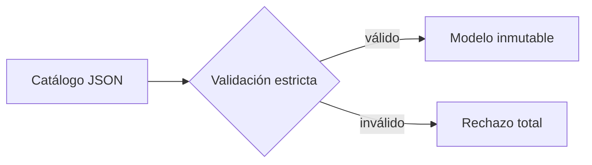
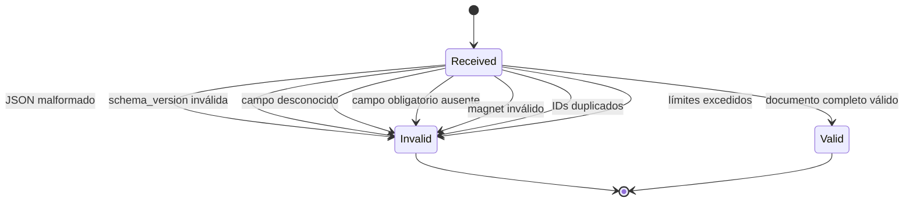

# 📦 CMP-01 — Catalog JSON Contract

---
spec_id: CMP-01
spec_type: CMP
layer: backend
name: Catalog JSON Contract
target: lib/features/catalog/domain/catalog_contract.dart
block: catalog
status: APPROVED
version: 1.1
owner: Architecture
last_reviewed: 2026-10-24
approved_at: 2026-10-24
approved_by: Architecture
supersedes: []
superseded_by: []
user_story: user_story.md
processes: []
depends_on: [CMP-00]
consumed_by: []
---

`CMP-01` · `APPROVED` · `v1.1` · `JSON` · `catalog`

| 🧩 Tipo | 🚦 Estado | 🧭 Bloque | 📦 Artefacto |
|---|---|---|---|
| `CMP` | `APPROVED` | `catalog` | `catalog.schema.json` |

> [!IMPORTANT]
> **Contrato cerrado, sin validación parcial.** El JSON solo admite los campos de esta spec; cualquier campo desconocido invalida el documento completo.
>
> **Archivo:** `CMP-01-catalog-json-contract.spec.md` · **Target:** `lib/features/catalog/domain/catalog_contract.dart`
>
> **Contrato normativo:** [`catalog.schema.json`](catalog.schema.json) · **Fixture canónico:** [`catalog-v1-movies-series.json`](../../../../fixtures/catalogs/valid/catalog-v1-movies-series.json)

> [!WARNING]
> **Fuera del MVP:** YAML y canales de TV en directo. No implementar `kind: channel` ni parsers YAML.

> [!TIP]
> **Ruta de lectura:** §4 requisitos → §8 contratos → §10 trazabilidad → §11 pruebas. Si falta un dato, ve a §15 y detén la implementación.

### 🗺️ Mapa de lectura

| Bloque | Qué encontrarás |
|---|---|
| §1–§3 | Problema, alcance y actores |
| §4–§6 | Requisitos, reglas, estados y errores |
| §7–§9 | UI, contratos y dependencias |
| §10–§12 | Trazabilidad, pruebas y BDD |
| §13–§15 | Cierre, decisiones y preguntas |



---

## 🧭 0. Protocolo de lectura y no invención

1. Leer esta spec, `catalog.schema.json` y el fixture canónico.
2. Implementar solo los campos, reglas y errores definidos aquí.
3. No añadir campos, tipos, enums ni calidades que no estén en el contrato.
4. Si un dato no aparece, registrar una pregunta y detener la implementación.
5. No implementar todavía el parser, la descarga HTTP, la persistencia ni la UI.
6. Un documento con cualquier violación se rechaza completo; no hay validación parcial.

**Jerarquía de verdad:** `architecture_rules.md` → esta spec y `catalog.schema.json` → código.

---

## 🎯 1. Contexto y objetivo

FLIK necesita un contrato único para catálogos de películas y series. Hoy no existe una estructura validada y cada módulo podría interpretar el JSON de forma distinta.

Esta spec define:

- la forma canónica del documento JSON;
- los campos obligatorios y opcionales;
- las reglas de magnet e info-hash;
- las reglas de normalización;
- los límites;
- los errores de validación.

No define cómo se descarga, se cachea o se sincroniza el catálogo.

### Objetivo medible

Un desarrollador o una IA puede construir el modelo de dominio y el validador JSON sin consultar otra fuente que esta spec, su JSON Schema y los fixtures.

---

## 📐 2. Alcance y límites

**Incluye:**

- JSON de catálogo con `schema_version`, `catalog_id`, `generated_at` e `items`.
- Películas con variantes.
- Series con temporadas, episodios y variantes por episodio.
- Metadatos MVP: título, sinopsis, año, géneros, carátulas, rating, duración, IDs externos, reparto, dirección y tags.
- Magnet por variante.
- `info_hash` derivado del magnet.
- Reglas de validación, normalización, errores y límites.

**Excluye:**

- YAML.
- Canales de TV en directo.
- Descarga HTTP/HTTPS.
- Caché Hive/SQLite.
- Sincronización, reintentos o prioridad entre fuentes.
- Progreso de visualización.
- Selección de calidad en pantalla.
- Apertura de sesiones P2P.
- Reproducción, pistas o OSD.

---

## 👤 3. Actores e historia de usuario

> [!NOTE]
> **Brief de producto:** [`user_story.md`](user_story.md). La historia explica el *por qué*; esta spec define el *qué* y el *cómo*.

> **Como** usuario de FLIK,
> **quiero** que el catálogo tenga una estructura JSON fija y validada,
> **para** que la app muestre siempre los mismos títulos, variantes y magnets sin ambigüedad.

### 🔗 Trazabilidad de negocio

| Criterio `US-*` | Requisitos que lo cubren |
|---|---|
| `US-01` | `FR-01`, `FR-02` |
| `US-02` | `FR-04`, `FR-13` |
| `US-03` | `FR-05`, `FR-06` |
| `US-04` | `FR-07`, `INV-01` |
| `US-05` | `FR-08`, `FR-09`, `FR-12`, `FR-14` |
| `US-06` | Alcance §2, `INV-03` |

---

## ✅ 4. Requisitos funcionales

| ID | Requisito | Prioridad | Criterio de aceptación | Regla |
|---|---|---|---|---|
| `FR-01` | Aceptar un documento JSON con `schema_version`, `catalog_id`, `generated_at` e `items`. | Must | `AC-01` | `BR-01`, `BR-02` |
| `FR-02` | Rechazar versiones de esquema distintas de `"1.0"`. | Must | `AC-02` | `BR-02` |
| `FR-03` | Aceptar únicamente ítems `movie` o `series`. | Must | `AC-03` | `BR-03` |
| `FR-04` | Exigir al menos una variante en cada película. | Must | `AC-04` | `BR-04` |
| `FR-05` | Exigir al menos una temporada y un episodio en cada serie. | Must | `AC-05` | `BR-05` |
| `FR-06` | Exigir al menos una variante en cada episodio. | Must | `AC-06` | `BR-06` |
| `FR-07` | Validar el magnet y derivar el `info_hash`. | Must | `AC-07` | `BR-07`, `INV-01` |
| `FR-08` | Rechazar campos desconocidos en cualquier nivel. | Must | `AC-08` | `BR-08` |
| `FR-09` | Rechazar IDs de ítem duplicados y IDs de variante duplicados dentro de su ámbito. | Must | `AC-09` | `BR-09` |
| `FR-10` | Normalizar IDs, calidades, códecs, idiomas y URLs. | Must | `AC-10` | `BR-10` |
| `FR-11` | Aplicar los límites de tamaño, items, variantes, temporadas y episodios. | Must | `AC-11` | `BR-11` |
| `FR-12` | Rechazar el documento completo si cualquier ítem, temporada, episodio o variante es inválido. | Must | `AC-12` | `INV-02` |
| `FR-13` | Aceptar `file_index` opcional y no exigirlo en variantes de un solo archivo. | Should | `AC-13` | `BR-12` |
| `FR-14` | Rechazar `kind: channel` y cualquier tipo fuera del MVP. | Must | `AC-14` | `BR-03` |

---

## ⚖️ 5. Reglas de negocio e invariantes

| ID | Regla / invariante | Fuente canónica | Verificación |
|---|---|---|---|
| `BR-01` | El catálogo canónico es JSON. YAML queda fuera del MVP. | Esta spec | `TC-01` |
| `BR-02` | `schema_version` debe ser exactamente `"1.0"`. | Esta spec | `TC-05` |
| `BR-03` | `kind` solo admite `movie` o `series`. `channel` se rechaza. | Esta spec | `TC-12` |
| `BR-04` | Una película requiere `variants` con al menos 1 elemento. | Esta spec | `TC-08` |
| `BR-05` | Una serie requiere `seasons` con al menos 1 temporada y 1 episodio. | Esta spec | `TC-03` |
| `BR-06` | Cada episodio requiere `variants` con al menos 1 elemento. | Esta spec | `TC-14` |
| `BR-07` | Cada variante requiere `id`, `quality`, `magnet_uri`; el `info_hash` se deriva del magnet. | Esta spec | `TC-04`, `TC-09`, `TC-10` |
| `BR-08` | `additionalProperties: false` en todos los objetos; un campo desconocido invalida el documento. | `catalog.schema.json` | `TC-02` |
| `BR-09` | `id` de ítem único; `id` de variante único dentro de su ítem o episodio. | Esta spec | `TC-06`, `TC-07` |
| `BR-10` | IDs, calidades, códecs e idiomas se normalizan antes de persistir. | Esta spec | `TC-09`, `TC-15` |
| `BR-11` | Límites: 20 MiB, 20 000 ítems, 50 variantes por ítem/episodio, 50 temporadas, 500 episodios por temporada, 32 niveles. | Esta spec | `TC-11` |
| `BR-12` | `file_index` es opcional. Si falta, el motor P2P aplica su política de selección. | Esta spec y futura spec P2P | `TC-16` |
| `BR-13` | `generated_at` es ISO-8601 UTC y no puede estar más de 24 h en el futuro. | Esta spec | `TC-13` |
| `INV-01` | El JSON nunca incluye un campo `info_hash`. | Esta spec | `TC-04` |
| `INV-02` | No existe aceptación parcial: si un elemento falla, falla el documento completo. | Esta spec | `TC-02`, `TC-03` |
| `INV-03` | Esta spec no define descarga, caché, persistencia ni reproducción. | `architecture_rules.md` | Revisión de límites |

---

## 🔄 6. Estados, comportamiento y errores

### 6.1 Resultado de validación



No existe estado intermedio de “válido con advertencias”. Una violación de contrato produce rechazo.

### 6.2 Errores

| Código | Condición | Resultado | Recuperable |
|---|---|---|---|
| `invalidJson` | JSON no parseable | Rechazo total | Sí, corrigiendo la fuente |
| `schemaViolation` | Tipo, rango o formato inválido | Rechazo total | Sí |
| `unknownField` | Campo no declarado en el esquema | Rechazo total | Sí |
| `missingField` | Campo obligatorio ausente | Rechazo total | Sí |
| `invalidSchemaVersion` | `schema_version` distinto de `1.0` | Rechazo total | No sin nueva versión de contrato |
| `unsupportedKind` | `kind` distinto de `movie` o `series` | Rechazo total | No en el MVP |
| `duplicateItemId` | Dos ítems con el mismo `id` | Rechazo total | Sí |
| `duplicateVariantId` | Dos variantes con el mismo `id` en el mismo ámbito | Rechazo total | Sí |
| `invalidMagnet` | Magnet ausente, malformado o sin `xt=urn:btih` | Rechazo total | Sí |
| `unsupportedMagnet` | Múltiples `xt`, `btmh` o esquema no soportado | Rechazo total | No en el MVP |
| `invalidQuality` | Calidad fuera del enum | Rechazo total | Sí |
| `invalidUri` | URL de carátula/backdrop/still no permitida | Rechazo total | Sí |
| `limitExceeded` | Tamaño, items o profundidad fuera de límite | Rechazo total | Sí |
| `futureGeneratedAt` | `generated_at` supera 24 h en el futuro | Rechazo total | Sí |

---

## 🎨 7. UX/UI y foco

**No aplica.** `CMP-01` es un contrato de datos. No define pantallas, colores, tipografía, foco ni interacción. Cualquier decisión visual pertenece a `ui-design-system.md` y a las specs `CMP`.

---

## 🔌 8. Contratos de datos (`CT-*`)

### 8.1 Artefacto normativo

> [!IMPORTANT]
> **`catalog.schema.json` es normativo.** Si esta spec y el esquema discrepan, se corrigen ambos en el mismo cambio; no se elige uno arbitrariamente.

El esquema canónico es:

```text
catalog.schema.json
```

Ubicado en esta misma carpeta. Cualquier discrepancia entre esta spec y el esquema se resuelve actualizando ambos en el mismo cambio. El esquema usa JSON Schema Draft 2020-12.

### 8.2 Documento e ítem

```text
CatalogDocument
├── schema_version: "1.0"
├── catalog_id: string
├── generated_at: ISO-8601 UTC
└── items: Item[1..20000]
```

| Campo | Tipo | Obligatorio | Regla |
|---|---|---|---|
| `schema_version` | string | Sí | Exactamente `"1.0"` |
| `catalog_id` | string | Sí | `^[a-z0-9][a-z0-9._-]{0,63}$` |
| `generated_at` | string | Sí | ISO-8601 UTC; no más de 24 h en el futuro |
| `items` | array | Sí | 1–20 000 elementos |

Cada ítem comparte estos campos:

| Campo | Tipo | Obligatorio | Regla |
|---|---|---|---|
| `id` | string | Sí | `^[a-z0-9][a-z0-9._-]{0,63}$`; único en el documento |
| `kind` | enum | Sí | `movie` o `series` |
| `title` | string | Sí | 1–200 caracteres |
| `original_title` | string | No | ≤200 caracteres |
| `synopsis` | string | No | ≤5 000 caracteres; texto plano |
| `year` | integer | No | 1888–2100 |
| `genres` | array | No | ≤20 elementos; minúsculas |
| `poster_uri` | string | No | `http`, `https` o `asset` |
| `backdrop_uri` | string | No | `http`, `https` o `asset` |
| `rating` | number | No | 0.0–10.0 |
| `runtime_minutes` | integer | No | 1–600; solo película |
| `external_ids` | object | No | ≤10 claves; clave `[a-z0-9_]{1,16}`, valor 1–64 |
| `cast` | array | No | ≤50 nombres de 1–100 caracteres |
| `directors` | array | No | ≤50 nombres de 1–100 caracteres |
| `tags` | array | No | ≤20 tags `[a-z0-9][a-z0-9-]{0,31}` |
| `variants` | array | Condicional | Obligatorio en `movie`; prohibido en `series` |
| `seasons` | array | Condicional | Obligatorio en `series`; prohibido en `movie` |

**Condición de tipo:**

- `kind: movie` → requiere `variants`; no puede tener `seasons`.
- `kind: series` → requiere `seasons`; no puede tener `variants`.
- `kind: channel` → inválido en el MVP.

### 8.3 Variante y magnet

| Campo | Tipo | Obligatorio | Regla |
|---|---|---|---|
| `id` | string | Sí | `^[a-z0-9][a-z0-9._-]{0,63}$`; único en su ítem/episodio |
| `quality` | enum | Sí | `2160p`, `1080p`, `720p`, `480p`, `unknown` |
| `magnet_uri` | string | Sí | Debe comenzar por `magnet:?xt=urn:btih:`; hash hex de 40 o base32 de 32; trackers opcionales |
| `file_index` | integer | No | ≥0; si falta, el motor P2P aplica su política de selección |
| `size_bytes` | integer | No | 1 byte–1 TiB |
| `video_codec` | enum | No | `h264`, `hevc`, `av1`, `vp9`, `unknown` |
| `audio_codecs` | array | No | ≤8; valores del enum de códecs |
| `audio_languages` | array | No | ≤20; `^[a-z]{2,3}$` |
| `subtitle_languages` | array | No | ≤20; `^[a-z]{2,3}$` |
| `release_label` | string | No | ≤64 caracteres |

**No existe `info_hash` en el JSON.** El parser lo deriva del `magnet_uri` y lo expone en el modelo como `MediaVariant.infoHash`.

### 8.4 Temporada y episodio

| Entidad | Campo | Tipo | Obligatorio | Regla |
|---|---|---|---|---|
| Temporada | `season_number` | integer | Sí | ≥1 |
| Temporada | `title` | string | No | ≤100 caracteres |
| Temporada | `episodes` | array | Sí | 1–500 episodios |
| Episodio | `id` | string | Sí | Patrón de ID; único en la serie |
| Episodio | `episode_number` | integer | Sí | ≥1 |
| Episodio | `title` | string | Sí | 1–200 caracteres |
| Episodio | `synopsis` | string | No | ≤5 000 caracteres |
| Episodio | `runtime_minutes` | integer | No | 1–600 |
| Episodio | `still_uri` | string | No | `http`, `https` o `asset` |
| Episodio | `variants` | array | Sí | 1–50 variantes |

Una serie debe tener al menos una temporada y cada temporada al menos un episodio. No se permiten temporadas vacías.

### 8.5 Modelos Dart

```dart
enum CatalogKind { movie, series }

enum CatalogQuality { unknown, sd480, hd720, fhd1080, uhd2160 }

final class CatalogDocument {
  const CatalogDocument({
    required this.schemaVersion,
    required this.catalogId,
    required this.generatedAt,
    required this.items,
  });

  final String schemaVersion;
  final String catalogId;
  final DateTime generatedAt;
  final List<CatalogItem> items;
}

sealed class CatalogItem {
  const CatalogItem({
    required this.id,
    required this.kind,
    required this.title,
    required this.originalTitle,
    required this.synopsis,
    required this.year,
    required this.genres,
    required this.posterUri,
    required this.backdropUri,
    required this.rating,
    required this.runtimeMinutes,
    required this.externalIds,
    required this.cast,
    required this.directors,
    required this.tags,
  });

  final String id;
  final CatalogKind kind;
  final String title;
  final String? originalTitle;
  final String? synopsis;
  final int? year;
  final List<String> genres;
  final Uri? posterUri;
  final Uri? backdropUri;
  final double? rating;
  final int? runtimeMinutes;
  final Map<String, String> externalIds;
  final List<String> cast;
  final List<String> directors;
  final List<String> tags;
}

final class MovieItem extends CatalogItem {
  const MovieItem({
    required super.id,
    required super.title,
    required super.kind,
    required super.originalTitle,
    required super.synopsis,
    required super.year,
    required super.genres,
    required super.posterUri,
    required super.backdropUri,
    required super.rating,
    required super.runtimeMinutes,
    required super.externalIds,
    required super.cast,
    required super.directors,
    required super.tags,
    required this.variants,
  });

  final List<MediaVariant> variants;
}

final class SeriesItem extends CatalogItem {
  const SeriesItem({
    required super.id,
    required super.title,
    required super.kind,
    required super.originalTitle,
    required super.synopsis,
    required super.year,
    required super.genres,
    required super.posterUri,
    required super.backdropUri,
    required super.rating,
    required super.runtimeMinutes,
    required super.externalIds,
    required super.cast,
    required super.directors,
    required super.tags,
    required this.seasons,
  });

  final List<SeriesSeason> seasons;
}
```

`MovieItem` se construye con `kind: CatalogKind.movie`; `SeriesItem` con `kind: CatalogKind.series`. El parser debe garantizar esa correspondencia.

```dart
final class MediaVariant {
  const MediaVariant({
    required this.id,
    required this.quality,
    required this.magnetUri,
    required this.infoHash,
    required this.fileIndex,
    required this.sizeBytes,
    required this.videoCodec,
    required this.audioCodecs,
    required this.audioLanguages,
    required this.subtitleLanguages,
    required this.releaseLabel,
  });

  final String id;
  final CatalogQuality quality;
  final Uri magnetUri;
  final String infoHash; // 40 hex minúsculas, derivado del magnet
  final int? fileIndex;
  final int? sizeBytes;
  final String? videoCodec;
  final List<String> audioCodecs;
  final List<String> audioLanguages;
  final List<String> subtitleLanguages;
  final String? releaseLabel;
}

final class SeriesSeason {
  const SeriesSeason({
    required this.seasonNumber,
    required this.title,
    required this.episodes,
  });

  final int seasonNumber;
  final String? title;
  final List<SeriesEpisode> episodes;
}

final class SeriesEpisode {
  const SeriesEpisode({
    required this.id,
    required this.episodeNumber,
    required this.title,
    required this.synopsis,
    required this.runtimeMinutes,
    required this.stillUri,
    required this.variants,
  });

  final String id;
  final int episodeNumber;
  final String title;
  final String? synopsis;
  final int? runtimeMinutes;
  final Uri? stillUri;
  final List<MediaVariant> variants;
}

enum CatalogErrorCode {
  invalidJson,
  schemaViolation,
  unknownField,
  missingField,
  invalidSchemaVersion,
  unsupportedKind,
  duplicateItemId,
  duplicateVariantId,
  invalidMagnet,
  unsupportedMagnet,
  invalidQuality,
  invalidUri,
  limitExceeded,
  futureGeneratedAt,
}

final class CatalogContractError {
  const CatalogContractError({
    required this.code,
    required this.message,
    required this.path,
  });

  final CatalogErrorCode code;
  final String message;
  final String path;
}
```

### 8.6 Derivación de `info_hash`

El JSON no incluye `info_hash`. El parser debe:

1. Extraer `xt` del magnet.
2. Exigir exactamente un `xt=urn:btih:<hash>`.
3. Aceptar hash hex de 40 caracteres o base32 de 32.
4. Normalizar a 40 hex minúsculas.
5. Rechazar `btmh`, múltiples `xt`, hash ausente o malformado.
6. Conservar el `magnet_uri` original validado en `MediaVariant.magnetUri`.

El `dn` del magnet es informativo y nunca sustituye a `title`.

### 8.7 `file_index`

`file_index` es opcional en el contrato. Su ausencia no invalida la variante.

La política de selección del archivo dentro del torrent pertenece al motor P2P y se fijará en su spec:

1. Si `file_index` existe, se usa.
2. Si no existe, se selecciona el archivo de vídeo de mayor tamaño.
3. Si hay ambigüedad, el motor falla con `fileSelectionRequired`.

Esta spec solo declara que el campo puede faltar.

### 8.8 Entrada pública de validación

La validación estricta del contrato vive en el target de esta spec y no depende de Flutter, red ni almacenamiento:

```dart
final class CatalogContract {
  static CatalogValidationResult validate(
    String source, {
    DateTime? now,
    int maxDocumentBytes = kCatalogMaxDocumentBytes,
  });
}

final class CatalogValidationResult {
  final CatalogDocument? document;
  final List<CatalogContractError> errors;
  bool get isValid;
}
```

Reglas de la entrada:

1. `validate` acepta el texto JSON completo, no un objeto ya decodificado.
2. Devuelve `CatalogValidationResult.valid` solo si el documento completo es válido y normalizado.
3. Ante cualquier violación devuelve `invalid` con `document == null`; nunca hay modelo parcial.
4. `now` existe para inyectar el reloj en pruebas y aplica a la regla de `generated_at`.
5. `maxDocumentBytes` solo se reduce en pruebas de límite; su valor por defecto es 20 MiB.
6. Las constantes `kCatalogMax*` exponen los límites de `BR-11` para que los consumidores no los dupliquen.

---

## 🧱 9. Interfaces y dependencias

### 9.1 Dependencias permitidas

- Dart SDK (`Uri`, `DateTime`, colecciones).
- Ninguna dependencia de Flutter.
- Ninguna dependencia de red.
- Ninguna dependencia de almacenamiento.
- Ninguna dependencia de `media_kit` ni del motor P2P.

### 9.2 Dependencias prohibidas

- `dart:io`, HTTP, sockets o `HttpServer`.
- Hive, SQLite, drift o cualquier persistencia.
- `media_kit`, MPV o el motor BitTorrent.
- Widgets, rutas, foco o temas.
- YAML o formatos alternativos.

### 9.3 Dirección de dependencias

```text
CMP-02 Catalog Parser  ──consume──▶  CMP-01 Catalog JSON Contract
CMP-03 Catalog Repository ──consume──▶  CMP-01
CMP-* TV Experience      ──consume──▶  CMP-01
P2P Engine                  ──consume──▶  MediaVariant.magnetUri
```

Este contrato no conoce a sus consumidores.

---

## 🗺️ 10. Mapa de implementación y trazabilidad

> [!NOTE]
> Implementado en `lib/features/catalog/domain/catalog_contract.dart` con tests de contrato en `test/unit/catalog/catalog_contract_test.dart`. Cada `FR-*` tiene código y prueba en verde; `FR-08` se materializa en el validador estricto, que aplica las mismas reglas que `catalog.schema.json`.

| Requisito | Contrato | Implementación (archivo::símbolo) | Test | Estado |
|---|---|---|---|---|
| `FR-01` | `CT-01`, `CT-02` | `lib/features/catalog/domain/catalog_contract.dart::CatalogDocument` | `TC-01` | Verified |
| `FR-02` | `CT-01`, `CT-02` | `lib/features/catalog/domain/catalog_contract.dart::CatalogDocument.schemaVersion` | `TC-05` | Verified |
| `FR-03` | `CT-02`, `CT-03` | `lib/features/catalog/domain/catalog_contract.dart::CatalogKind` | `TC-12` | Verified |
| `FR-04` | `CT-03` | `lib/features/catalog/domain/catalog_contract.dart::MovieItem.variants` | `TC-08` | Verified |
| `FR-05` | `CT-03`, `CT-05` | `lib/features/catalog/domain/catalog_contract.dart::SeriesItem.seasons` | `TC-03` | Verified |
| `FR-06` | `CT-05` | `lib/features/catalog/domain/catalog_contract.dart::SeriesEpisode.variants` | `TC-14` | Verified |
| `FR-07` | `CT-04` | `lib/features/catalog/domain/catalog_contract.dart::MediaVariant.infoHash` | `TC-04`, `TC-09`, `TC-10` | Verified |
| `FR-08` | `CT-01` | `catalog.schema.json` | `TC-02` | Verified |
| `FR-09` | `CT-02`, `CT-04` | `lib/features/catalog/domain/catalog_contract.dart::CatalogDocument.items` | `TC-06`, `TC-07` | Verified |
| `FR-10` | `CT-02`, `CT-03`, `CT-04` | `lib/features/catalog/domain/catalog_contract.dart::CatalogQuality` | `TC-09`, `TC-15` | Verified |
| `FR-11` | `CT-01`, `CT-02` | `catalog.schema.json::maxItems` · `lib/features/catalog/domain/catalog_contract.dart::kCatalogMaxItems` | `TC-11` | Verified |
| `FR-12` | `CT-02` | `lib/features/catalog/domain/catalog_contract.dart::CatalogDocument` | `TC-02`, `TC-03` | Verified |
| `FR-13` | `CT-04` | `lib/features/catalog/domain/catalog_contract.dart::MediaVariant.fileIndex` | `TC-16` | Verified |
| `FR-14` | `CT-02`, `CT-03` | `lib/features/catalog/domain/catalog_contract.dart::CatalogKind` | `TC-12` | Verified |

**Estados:** `Pending`, `Implemented`, `Verified`. Este contrato no puede estar `Verified` hasta que exista código y tests en verde.

---

## 🧪 11. Plan de pruebas

| ID | Tipo | Qué verifica | Entrada | Criterio |
|---|---|---|---|---|
| `TC-01` | Contract | Documento canónico completo | `fixtures/catalogs/valid/catalog-v1-movies-series.json` | Válido; 2 ítems; 5 variantes totales |
| `TC-02` | Contract | Campo desconocido | `fixtures/catalogs/invalid/unknown-field.json` | Rechazo `unknownField` |
| `TC-03` | Contract | Serie sin temporadas | `fixtures/catalogs/invalid/series-without-seasons.json` | Rechazo `missingField` o `schemaViolation` |
| `TC-04` | Contract | Magnet inválido | `fixtures/catalogs/invalid/invalid-magnet.json` | Rechazo `invalidMagnet` |
| `TC-05` | Contract | Versión desconocida | Fixture canónico con `schema_version: "2.0"` | Rechazo `invalidSchemaVersion` |
| `TC-06` | Contract | ID de ítem duplicado | Fixture canónico con dos ítems con el mismo `id` | Rechazo `duplicateItemId` |
| `TC-07` | Contract | ID de variante duplicado | Fixture canónico con dos variantes con el mismo `id` | Rechazo `duplicateVariantId` |
| `TC-08` | Contract | Película sin variantes | Fixture canónico sin `variants` en `movie` | Rechazo `missingField` |
| `TC-09` | Contract | Normalización base32 → hex | Magnet con hash base32 de 32 caracteres | `infoHash` de 40 hex minúsculas |
| `TC-10` | Contract | Múltiples `xt` | Magnet con dos `xt=urn:btih` | Rechazo `unsupportedMagnet` |
| `TC-11` | Contract | Límites | 20 001 ítems y documento >20 MiB | Rechazo `limitExceeded` |
| `TC-12` | Contract | `kind: channel` | Fixture canónico con `kind: "channel"` | Rechazo `unsupportedKind` |
| `TC-13` | Contract | Fecha futura | `generated_at` con +25 h | Rechazo `futureGeneratedAt` |
| `TC-14` | Contract | Episodio sin variantes | Serie canónica con episodio sin `variants` | Rechazo `missingField` |
| `TC-15` | Contract | Normalización | IDs, `quality`, códigos de idioma y códecs | Todos en minúsculas/enum canónico |
| `TC-16` | Contract | `file_index` omitido | Variante canónica sin `file_index` | Aceptada; `fileIndex == null` |

> [!TIP]
> Los fixtures viven en `.ai-harness/fixtures/catalogs/`. El fixture canónico es la entrada de `TC-01`; los inválidos deben fallar por la causa indicada, no por un error colateral.

No se permiten tests con red, P2P, player ni base de datos. Los tests de esta spec son de contrato y se ejecutan en Dart puro.

---

## 🥒 12. Criterios de aceptación BDD

```gherkin
@TC-01
Scenario: Aceptar un catálogo canónico
  Given un catálogo JSON con schema_version 1.0
  And una película con dos variantes
  And una serie con una temporada y dos episodios
  When se valida el documento contra el contrato
  Then el documento es válido
  And la película expone dos variantes
  And cada episodio expone al menos una variante
```

```gherkin
@TC-02
Scenario: Rechazar un campo desconocido
  Given un catálogo JSON con un campo no declarado en una variante
  When se valida el documento contra el contrato
  Then el documento es rechazado
  And el error es unknownField
  And no se devuelve ningún modelo parcial
```

```gherkin
@TC-04
Scenario: Rechazar un magnet inválido
  Given un catálogo JSON con una variante cuyo magnet no empieza por magnet:?xt=urn:btih:
  When se valida el documento contra el contrato
  Then el documento es rechazado
  And el error es invalidMagnet
```

---

## 🏁 13. Definition of Done

> [!IMPORTANT]
> No se cambia a `APPROVED` mientras exista un `FR-*` sin contrato, prueba o entrada en el mapa. No se declara una implementación alineada mientras el target no exista y los tests no estén en verde.

- [x] `catalog.schema.json` es JSON válido y cubre todos los campos de esta spec.
- [x] El fixture canónico valida contra el esquema.
- [x] El fixture canónico no contiene `info_hash`.
- [x] Los fixtures inválidos fallan por la causa esperada.
- [x] Todos los `FR-*` tienen `CT-*`, `TC-*` y entrada en §10.
- [x] Los datos se exponen con modelos inmutables.
- [x] No hay YAML, HTTP, Hive/SQLite, P2P, player ni UI en esta spec.
- [x] `flutter analyze` y `flutter test` pasan cuando exista implementación.
- [x] `check_sdd` y `sync-sdd` reconocen la spec sin errores.
- [x] El estado se cambia a `APPROVED` solo tras revisión explícita.

> [!NOTE]
> Verificado el 2026-10-24: `flutter analyze` sin issues y `flutter test` en verde (42 tests). El fixture canónico se validó contra `catalog.schema.json` con un validador JSON Schema Draft 2020-12.

---

## 🧾 14. Decisiones

| Fecha | Decisión | Motivo | Impacto |
|---|---|---|---|
| 2026-10-23 | El formato canónico es JSON; YAML queda fuera del MVP. | El usuario fija una estructura JSON cerrada. | Elimina ambigüedad de parsing y fixtures. |
| 2026-10-23 | `info_hash` se deriva del magnet y no se incluye en el JSON. | Evita duplicación y contradicciones. | El parser calcula y normaliza el hash. |
| 2026-10-23 | `file_index` es opcional; la política de selección pertenece al motor P2P. | No todos los torrents multiarchivo necesitan un índice explícito. | El contrato no impone selección de archivo. |
| 2026-10-23 | Canales en directo quedan fuera del MVP. | El streaming P2P secuencial no está pensado para live. | `kind` solo admite `movie` y `series`. |
| 2026-10-23 | Películas y series comparten metadatos; las series anidan temporadas y episodios. | Permite una UI coherente y un contrato único. | `MovieItem` y `SeriesItem` son tipos separados. |
| 2026-10-23 | La descarga, caché y sincronización se especifican en `CMP-02` y `CMP-03`. | Mantener el contrato puro y testeable. | Esta spec no toca HTTP ni almacenamiento. |
| 2026-10-24 | La validación estricta vive en el propio contrato (`CatalogContract.validate`) y devuelve un resultado tipado en lugar de lanzar excepciones. | Los errores de contrato son un resultado esperado, no un fallo de flujo; los consumidores reciben la lista completa sin capturar excepciones. | `CMP-02` consume la validación en lugar de reimplementarla. |
| 2026-10-24 | El esquema describe la forma canónica ya normalizada; el validador acepta variantes de caja en IDs, calidades, códecs e idiomas y emite siempre la forma canónica. | `BR-10` exige normalización y el esquema fija la forma persistida; ambos artefactos no se contradicen. | Un `quality: "1080P"` se persiste como `1080p`; el documento normalizado siempre valida contra el esquema. |
| 2026-10-24 | Un ID de episodio duplicado dentro de la serie se reporta como `schemaViolation`. | `§8.4` exige unicidad, pero `§6.2` no define un código específico para episodios y no se inventan códigos nuevos. | Si se necesita un código propio, requerirá una revisión del contrato. |

---

## ❓ 15. Preguntas abiertas

No hay preguntas bloqueantes.

Canales en directo quedan explícitamente fuera del MVP. Si se incorporan en el futuro, requerirán una spec propia de contenido live y una revisión del motor P2P y del reproductor.

---

## 🧾 Historial de cambios

| Versión | Fecha | Tipo | Cambio | Aprobado por |
|---|---|---|---|---|
| 1.0 | 2026-10-23 | Inicial | Contrato JSON inicial. | Pendiente |
| 1.1 | 2026-10-24 | Implementación | Aprobación de la spec, entrada pública `CatalogContract.validate`, mapa de trazabilidad verificado y DoD cerrado. | Architecture |

