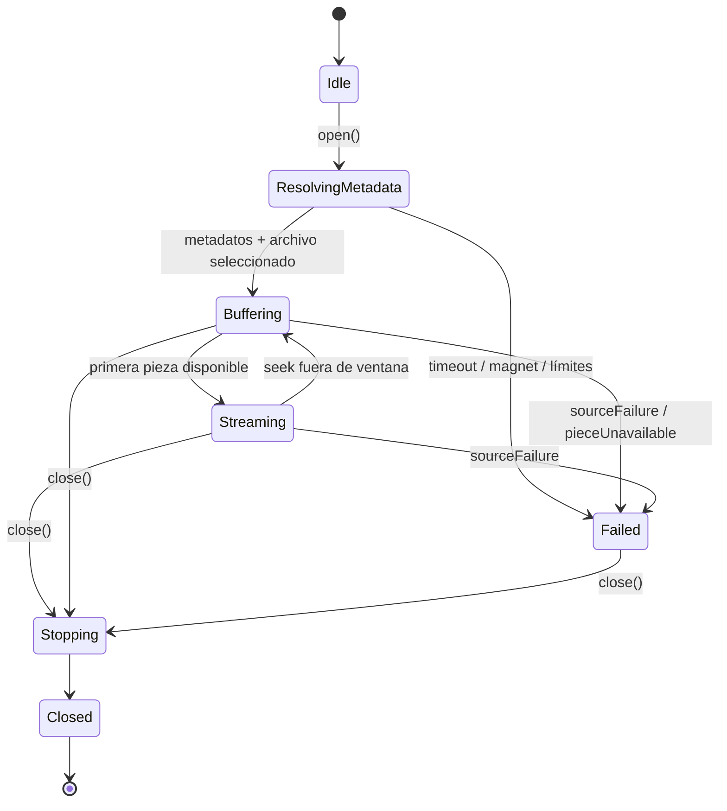

# 🧲 CMP-05 — P2P Engine

---

spec_id: CMP-05
spec_type: CMP
layer: backend
name: P2P Engine
target: lib/features/p2p_engine/application/p2p_stream_session.dart
block: p2p_engine
status: APPROVED
version: 1.6
owner: Architecture
last_reviewed: 2026-10-24
approved_at: 2026-10-24
approved_by: Architecture
supersedes: []
superseded_by: []
user_story: user_story.md
processes: [PRC-01]
depends_on: [CMP-00, CMP-01]
consumed_by: [CMP-06]
---

`CMP-05` · `APPROVED` · `v1.1` · `Dart` · `p2p_engine`

| 🧩 Tipo | 🚦 Estado | 🧭 Feature | 🎯 Target |
|---|---|---|---|
| `CMP` | `APPROVED` | `p2p_engine` | `lib/features/p2p_engine/application/p2p_stream_session.dart` |

> [!IMPORTANT]
> **Contrato de lectura rápida.** Esta spec es la fuente de verdad del motor P2P. El código no puede añadir estados, errores, límites ni endpoints fuera de aquí.
>
> **Archivo:** `CMP-05-p2p-engine.spec.md` · **Historia:** [`user_story.md`](user_story.md) · **Decisión de runtime:** [`ADR-0001`](../../../../memory/decisions/ADR-0001-libtorrent-runtime.md) · **Binding:** [`ADR-0002`](../../../../memory/decisions/ADR-0002-c-abi-dart-ffi-binding.md)
>
> **Diseño visual:** no aplica. Este componente no pinta nada.

> [!NOTE]
> **Implementado y verificado** en `lib/features/p2p_engine/` con 36 tests de P2P en verde. El binario nativo (`libflik_p2p.so`) está probado en `FLIK_TV` (ver `S0b`) y su empaquetado continuo queda como `Q-05`.

> [!TIP]
> **Ruta de lectura:** §4 requisitos → §6 estados → §8 contratos → §10 trazabilidad → §11 pruebas. Si falta un dato, ve a §15 y detén la implementación.

### 🗺️ Mapa de lectura

| Bloque | Qué encontrarás |
|---|---|
| §1–§3 | Problema, alcance y actores |
| §4–§6 | Requisitos, reglas, estados y errores |
| §7–§9 | UI (no aplica), contratos y dependencias |
| §10–§12 | Trazabilidad, pruebas y BDD |
| §13–§15 | Cierre, decisiones y preguntas |


---

## 🧭 0. Protocolo de lectura y no invención

1. Leer esta spec, `ADR-0001` y los scopes `block_p2p_engine.md` y `block_media_player.md`.
2. Implementar solo los `FR-*` y `CT-*` definidos aquí.
3. No añadir endpoints, códigos de error, límites ni dependencias que no aparezcan en §8 y §9.
4. Si un dato falta, registrarlo en §15 y detener la implementación.
5. Actualizar §10 y §11 en el mismo cambio que el código.
6. El trabajo nativo y el servidor HTTP nunca se ejecutan en el isolate de UI.

**Jerarquía de verdad:** contexto del proyecto → `architecture_rules.md` → `ADR-0001` → esta spec → código.

---

## 🎯 1. Contexto y objetivo

### 1.1 Problema

FLIK recibe un enlace magnet, pero no existe ningún componente que lo convierta en bytes servibles. El `Media Player` solo consume URLs locales, y el catálogo solo entrega magnets. Sin este componente no hay reproducción posible.

Además, el streaming P2P tiene tres restricciones duras del producto: no se descarga el archivo completo antes de reproducir, el almacenamiento no puede crecer sin límite y el endpoint no puede salir de loopback.

### 1.2 Objetivo medible

Con la sesión abierta y el torrent **incompleto**, una petición:

```http
GET /stream?token=<token> HTTP/1.1
Host: 127.0.0.1:8888
Range: bytes=0-1023
```

debe devolver `206 Partial Content`, `Content-Range: bytes 0-1023/<tamaño>` y exactamente 1 024 bytes del archivo seleccionado.

Y tras `close()`:

- el puerto `8888` vuelve a estar disponible;
- no quedan sockets, temporales ni recursos nativos;
- repetir 10 ciclos abrir/cerrar no incrementa el número de recursos vivos.

### 1.3 No objetivos

- Reproducir, decodificar, mostrar OSD o gestionar pistas (`CMP-06`).
- Decidir qué magnet o variante reproducir (`PRC-01`).
- Parsear, validar o persistir catálogo (`CMP-01`, `CMP-02`, `CMP-03`).
- Transcodificar, remuxear o descargar de forma permanente.
- Telemetría, analítica o cualquier salida a red no derivada del propio torrent.

---

## 📐 2. Alcance y límites

**Incluye:**

- Ciclo de vida de una sesión P2P: abrir, resolver metadatos, servir, cerrar.
- Selección del archivo del torrent que se va a servir.
- Descarga secuencial con prioridad de cabeceras y primeros megabytes.
- Búfer acotado con política de evicción explícita.
- Servidor HTTP local con `200`, `206`, `416`, `401`, `404` y `405`.
- Token de sesión efímero y verificación en tiempo constante.
- Estado operativo: peers, velocidad, progreso y bytes disponibles.
- Liberación determinista de puerto, sockets, memoria nativa y temporales.

**Excluye:**

- Cualquier interpretación del contenedor o de los códecs.
- Descarga de carátulas, metadatos de catálogo o progreso de usuario.
- Persistencia entre sesiones: el directorio de sesión se destruye al cerrar.
- Exposición del endpoint fuera de `127.0.0.1`.
- Procesos daemon, CLI externa o servicio del sistema.
- Reproducción en segundo plano.

**Invariantes de arquitectura aplicables:**

- `architecture_rules.md` §4.1 sin backend, §4.2 loopback único, §4.3 `206` obligatorio, §4.4 streaming secuencial, §4.5 búfer de anillo, §4.10 liberación determinista.
- `security_privacy.md` `SEC-01`–`SEC-05`, `SEC-09`, `SEC-10`.
- `platform_matrix.md` §2: memoria y almacenamiento acotados en Android TV.

---

## 👤 3. Actores e historia de usuario

> **Como** usuario de FLIK,
> **quiero** que un magnet se convierta en un flujo local que empiece pronto y permita seeking,
> **para** ver contenido sin esperar la descarga completa.

**Actores secundarios:** `Media Player` (consume la URL), `PRC-01` (abre y cierra la sesión), motor BitTorrent nativo (`ADR-0001`), sistema operativo (puerto y ficheros temporales).

### 🔗 Trazabilidad de negocio

| Criterio `US-*` | Requisitos que lo cubren |
|---|---|
| `US-01` | `FR-01`, `FR-04` |
| `US-02` | `FR-06`, `FR-07` |
| `US-03` | `FR-09` |
| `US-04` | `FR-10` |
| `US-05` | `FR-13` |
| `US-06` | `FR-04`, `FR-08` |
| `US-07` | §2, `INV-05` |

---

## ✅ 4. Requisitos funcionales

### 4.1 Requisitos

| ID | Requisito | Prioridad | Criterio | Regla |
|---|---|---|---|---|
| `FR-01` | Abrir una sesión a partir de un magnet válido y un token de sesión no vacío. | Must | `AC-01` | `BR-01`, `BR-02` |
| `FR-02` | Resolver metadatos del torrent y publicar la lista de archivos, con timeout de 30 s. | Must | `AC-02` | `BR-03` |
| `FR-03` | Seleccionar el archivo servido por `fileIndex` o, si falta, el archivo de vídeo de mayor tamaño; fallar si hay ambigüedad. | Must | `AC-03` | `BR-04` |
| `FR-04` | Exponer el flujo en `http://127.0.0.1:<port>/stream`, con `port` por defecto `8888`, solo en loopback. | Must | `AC-04` | `INV-01` |
| `FR-05` | Responder `200` con `Content-Length`, `Accept-Ranges: bytes` y `Content-Type` del contenedor cuando la petición no lleva `Range`. | Must | `AC-05` | `BR-05` |
| `FR-06` | Responder `206` con `Content-Range` y `Content-Length` exactos a un `Range` válido, sin esperar a descargar el archivo completo. | Must | `AC-06` | `INV-02` |
| `FR-07` | Responder `416` con `Content-Range: bytes */<length>` ante un rango fuera de límites o con sintaxis inválida. | Must | `AC-07` | `BR-05` |
| `FR-08` | Exigir el token de sesión en cada petición; ausente o incorrecto devuelve `401` sin servir bytes. | Must | `AC-08` | `INV-03` |
| `FR-09` | Descargar con prioridad secuencial: cabeceras del contenedor y primeros MiB antes que el resto del archivo. `prewarm()` confirma `kP2pPrewarmBytes` del inicio antes de abrir el reproductor. | Must | `AC-09` | `INV-02` |
| `FR-10` | Mantener un búfer con límite declarado y evicción de piezas reproducidas, sin desalojar la pieza en curso ni la ventana inmediata. | Must | `AC-10` | `INV-04` |
| `FR-11` | Publicar estado operativo: estado de sesión, peers, velocidad, progreso y bytes disponibles. | Must | `AC-11` | `BR-06` |
| `FR-12` | Rechazar torrents que excedan tamaño o número de archivos, y rutas que escapen del directorio de sesión. | Must | `AC-12` | `INV-01`, `BR-07` |
| `FR-13` | Cerrar la sesión de forma determinista e idempotente: descarga, servidor, sockets, puerto, memoria nativa y temporales. | Must | `AC-13` | `INV-06` |
| `FR-14` | Ejecutar descarga, verificación de piezas y servidor fuera del isolate de UI. | Must | `AC-14` | `BR-08` |
| `FR-15` | Si el magnet incluye `xs=` con una URL `http(s)` de un `.torrent`, descargarlo (máximo 16 MiB), abrir la sesión desde ese archivo y borrar el temporal. | Must | `AC-16` | `INV-02` |

### 4.2 Criterios de aceptación

| ID | Criterio observable |
|---|---|
| `AC-01` | `open()` devuelve una sesión con `streamUrl` y token; un magnet inválido devuelve `invalidMagnet`. |
| `AC-02` | Tras `open()`, `state.files` contiene al menos un archivo; si no hay metadatos en 30 s, la sesión pasa a `failed` con `metadataTimeout`. |
| `AC-03` | Con `fileIndex` válido se sirve ese archivo; sin `fileIndex` y con varios candidatos de vídeo del mismo tamaño máximo, la sesión falla con `fileSelectionRequired`. |
| `AC-04` | El servidor escucha en `127.0.0.1` y rechaza conexiones desde otra interfaz. |
| `AC-05` | `GET` sin `Range` devuelve `200`, `Accept-Ranges: bytes` y `Content-Length` igual al tamaño del archivo. |
| `AC-06` | `Range: bytes=0-1023` devuelve `206` con 1 024 bytes y `Content-Range: bytes 0-1023/<length>`; se responde sin tener el archivo completo. |
| `AC-07` | `Range: bytes=<length>-` y `Range: bytes=abc` devuelven `416` con `Content-Range: bytes */<length>`. |
| `AC-08` | Sin `?token=` o con token distinto, la respuesta es `401` y el cuerpo está vacío. |
| `AC-09` | La primera pieza solicitada a la fuente es la 0 (cabeceras); ninguna pieza posterior se prioriza sobre las que cubren los primeros `kP2pStreamingPriorityBytes`. |
| `AC-15` | `prewarm()` devuelve los bytes del inicio ya disponibles y nunca lanza; si la fuente falla o se agota `kP2pPrewarmTimeout`, devuelve lo conseguido y la sesión sigue viva. |
| `AC-10` | El búfer nunca supera `config.bufferBytes`; al llenarse, descarta piezas ya consumidas y nunca la que cubre la posición servida. |
| `AC-11` | `state` emite al menos un valor tras resolver metadatos y tras el primer `206`, con `peers` y `downloadRateBytesPerSecond` no negativos. |
| `AC-12` | Un torrent con más de `kP2pMaxFiles` archivos o más de `kP2pMaxTorrentBytes` falla con `torrentTooLarge` / `tooManyFiles`; una ruta con `..` o absoluta falla con `unsafePath`. |
| `AC-13` | Tras `close()`, el puerto queda libre, los `state` dejan de emitir y un segundo `close()` no lanza ni falla. |
| `AC-14` | Durante la descarga, un temporizador periódico del isolate de UI mantiene su desviación por debajo de 100 ms. |
| `AC-16` | Con `xs=` válido, la sesión abre con los metadatos del `.torrent` y el archivo temporal desaparece; con `xs=` inalcanzable o sin `200`, la apertura falla con `sourceFailure` y no se toca la sesión nativa. |

---

## ⚖️ 5. Reglas de negocio e invariantes

| ID | Regla / invariante | Fuente canónica | Verificación |
|---|---|---|---|
| `BR-01` | El único identificador aceptado es un magnet con exactamente un `xt=urn:btih` válido; la validación reutiliza el contrato de `CMP-01`. | `CMP-01` `BR-07` | `TC-01`, `TC-02` |
| `BR-02` | El token de sesión es obligatorio, se genera por sesión y nunca se registra en logs. | `SEC-02` | `TC-08` |
| `BR-03` | La resolución de metadatos tiene un timeout de 30 s y no bloquea el isolate de UI. | `FM-FLIK-006` | `TC-03` |
| `BR-04` | La selección de archivo sin `file_index` es determinista: el vídeo de mayor tamaño; empate ⇒ error explícito. | `CMP-01` §8.7 | `TC-04` |
| `BR-05` | El servidor implementa `200`, `206`, `416`, `401`, `404` y `405`; cualquier otro método o ruta se rechaza sin cuerpo. | `architecture_rules.md` §4.3 | `TC-06`, `TC-07`, `TC-11` |
| `BR-06` | El estado se publica como stream de solo lectura; los consumidores no pueden modificarlo. | `architecture_rules.md` §2.1 | `TC-11` |
| `BR-07` | Todo archivo descargado se escribe únicamente bajo el directorio de sesión. | `SEC-04` | `TC-12` |
| `BR-08` | El trabajo nativo corre fuera del isolate de UI y se comunica por mensajes inmutables. | `FM-FLIK-006` | `TC-14` |
| `BR-09` | El puerto por defecto es `8888`; si está ocupado, la sesión falla con `portUnavailable` y nunca reutiliza una sesión ajena. | `SEC-03` | `TC-05` |
| `BR-10` | UPnP está desactivado y el endpoint nunca se anuncia en la LAN. | `SEC-09` | `TC-04`, `TC-15` |
| `BR-11` | Límites: `kP2pMaxTorrentBytes` 64 GiB, `kP2pMaxFiles` 256, `kP2pBufferBytesDefault` 192 MiB, `kP2pBufferBytesMin` 32 MiB, `kP2pBufferBytesMax` 1 GiB, `kP2pStreamingPriorityBytes` 8 MiB. | Esta spec y `ADR-0001` | `TC-12` |
| `BR-12` | Ninguna métrica sale del dispositivo; el estado operativo es local y efímero. | `SEC-08`, `INV-05` | `TC-11` |
| `INV-01` | El endpoint escucha exclusivamente en `127.0.0.1` y sirve solo el archivo de la sesión. | `architecture_rules.md` §4.2 | `TC-04`, `TC-15` |
| `INV-02` | Prohibido descargar el archivo completo antes de servir el primer rango. | `architecture_rules.md` §4.4 | `TC-06`, `TC-09` |
| `INV-03` | Ninguna petición sin token válido recibe bytes del contenido. | `SEC-02` | `TC-08` |
| `INV-04` | El búfer nunca crece por encima de su límite configurado. | `architecture_rules.md` §4.5 | `TC-13` |
| `INV-05` | Cero telemetría de usuario, cero identificadores y cero historial. | `SEC-08` | `TC-11` |
| `INV-06` | Al cerrar se liberan puerto, sockets, recursos nativos y temporales, siempre. | `architecture_rules.md` §4.10 | `TC-05`, `TC-13` |

---

## 🔄 6. Estados, comportamiento y errores

### 6.1 Máquina de estados



`close()` es idempotente: invocarlo en `Closed` no produce error ni nuevo estado.

### 6.2 Tabla de estados

| Estado | Entrada | Salida | Efecto observable |
|---|---|---|---|
| `Idle` | Sesión creada | `open()` | Sin servidor, sin recursos |
| `ResolvingMetadata` | `open()` | metadatos o error | `files` vacío; timeout de 30 s activo |
| `Buffering` | metadatos y archivo elegido | primera pieza | Servidor escuchando en loopback; `availableBytes` crece |
| `Streaming` | primera pieza disponible | `close()` o error | Se sirven `200`/`206`; `progress` avanza |
| `Stopping` | `close()` | recursos liberados | Deja de aceptar conexiones |
| `Closed` | liberación completa | — | Puerto libre; `state` cerrado |
| `Failed` | error tipado | `close()` | `failure` no nulo; servidor detenido |

### 6.3 Errores de sesión

| Código | Condición | Resultado | Recuperable |
|---|---|---|---|
| `invalidConfig` | Token más corto que `kP2pMinTokenLength`, puerto fuera de rango o `bufferBytes` fuera de límites | Sesión no creada | Sí, corrigiendo la configuración |
| `invalidMagnet` | Magnet ausente, malformado o sin `xt=urn:btih` | Sesión `failed` | Sí, con otro magnet |
| `metadataTimeout` | Sin metadatos en `metadataTimeout` | Sesión `failed` | Sí, reintentando |
| `fileSelectionRequired` | Sin `fileIndex` y dos o más vídeos del mismo tamaño máximo | Sesión `failed` | Sí, indicando `fileIndex` |
| `portUnavailable` | Puerto ocupado o sin permisos | Sesión `failed` | Sí, con otro puerto |
| `torrentTooLarge` | Tamaño total > `kP2pMaxTorrentBytes` | Sesión `failed` | No |
| `tooManyFiles` | Más de `kP2pMaxFiles` archivos | Sesión `failed` | No |
| `unsafePath` | Ruta con `..`, absoluta o fuera del directorio de sesión | Sesión `failed` | No |
| `pieceUnavailable` | Pieza solicitada no disponible tras el timeout de lectura | Sesión `failed` | Sí, reintentando |
| `sourceFailure` | El runtime nativo reporta un fallo | Sesión `failed` | Depende del runtime |
| `alreadyClosed` | Operación sobre una sesión cerrada | `P2pFailure` | No |

### 6.4 Respuestas HTTP del endpoint

| Situación | Código | Cabeceras | Cuerpo |
|---|---|---|---|
| `GET` sin `Range` y token válido | `200` | `Content-Length`, `Accept-Ranges: bytes`, `Content-Type` | Bytes desde 0 |
| `GET` con `Range` válido | `206` | `Content-Range`, `Content-Length`, `Accept-Ranges: bytes` | Bytes del rango |
| `Range` inválido o fuera de límites | `416` | `Content-Range: bytes */<length>` | Vacío |
| Sin token o token distinto | `401` | — | Vacío |
| Ruta distinta de `/stream` | `404` | — | Vacío |
| Método distinto de `GET`/`HEAD` | `405` | `Allow: GET, HEAD` | Vacío |

`HEAD` devuelve las mismas cabeceras que `GET` sin cuerpo.

### 6.5 Casos borde obligatorios

- Magnet válido sin peers: la sesión permanece en `Buffering` y no sirve cuerpo; el timeout de lectura aplica.
- `Range` de un solo byte y `Range: bytes=0-` cubriendo el archivo completo.
- `Range` con sufijo (`bytes=-512`) cuando el tamaño es mayor que el sufijo; si el sufijo supera el tamaño, se sirve el archivo completo con `206`.
- Cierre durante `ResolvingMetadata` y durante una respuesta en curso.
- Cancelación del cliente a mitad de respuesta: el socket se libera y la sesión sigue viva.
- Dos sesiones simultáneas: la segunda sobre el mismo puerto falla con `portUnavailable`.

---

## 🎨 7. UX/UI y foco

**No aplica.** `CMP-05` es `layer: backend`: no define pantallas, colores, tipografía ni foco. Cualquier decisión visual pertenece a `ui-design-system.md` y a las specs de `tv_experience`.

---

## 🔌 8. Contratos de datos (`CT-*`)

Todo tipo público del componente se define aquí. Si el código necesita un campo que no está en esta sección, la spec está incompleta.

### 8.1 Constantes, estados y errores

```dart
// Ruta canónica: lib/features/p2p_engine/domain/p2p_session.dart
// Spec: CMP-05

const int kP2pDefaultPort = 8888;
const int kP2pMaxTorrentBytes = 64 * 1024 * 1024 * 1024;
const int kP2pMaxFiles = 256;
const int kP2pBufferBytesDefault = 192 * 1024 * 1024;
const int kP2pBufferBytesMin = 32 * 1024 * 1024;
const int kP2pBufferBytesMax = 1024 * 1024 * 1024;
const int kP2pStreamingPriorityBytes = 8 * 1024 * 1024;
const int kP2pMinTokenLength = 16;
const Duration kP2pMetadataTimeout = Duration(seconds: 30);
const Duration kP2pReadTimeout = Duration(seconds: 15);

enum P2pSessionStatus {
  idle,
  resolvingMetadata,
  buffering,
  streaming,
  stopping,
  closed,
  failed,
}

enum P2pErrorCode {
  invalidConfig,
  invalidMagnet,
  metadataTimeout,
  fileSelectionRequired,
  portUnavailable,
  torrentTooLarge,
  tooManyFiles,
  unsafePath,
  pieceUnavailable,
  sourceFailure,
  alreadyClosed,
}

final class P2pFailure implements Exception {
  const P2pFailure({
    required this.code,
    required this.message,
    this.cause,
  });

  final P2pErrorCode code;
  final String message;
  final Object? cause;

  @override
  String toString() => 'P2pFailure($code): $message';
}

final class P2pFileInfo {
  const P2pFileInfo({
    required this.index,
    required this.path,
    required this.lengthBytes,
    required this.isVideo,
  });

  final int index;
  final String path;
  final int lengthBytes;
  final bool isVideo;
}

final class P2pTorrentMetadata {
  const P2pTorrentMetadata({
    required this.infoHash,
    required this.name,
    required this.totalLengthBytes,
    required this.files,
  });

  final String infoHash;
  final String name;
  final int totalLengthBytes;
  final List<P2pFileInfo> files;
}

final class P2pSourceStats {
  const P2pSourceStats({
    required this.peers,
    required this.downloadRateBytesPerSecond,
    required this.availableBytes,
    required this.progress,
  });

  final int peers;
  final int downloadRateBytesPerSecond;
  final int availableBytes;

  /// Progreso de descarga del archivo seleccionado, en `[0.0, 1.0]`.
  final double progress;
}
```

### 8.2 Configuración y estado de sesión

```dart
final class P2pSessionConfig {
  const P2pSessionConfig({
    required this.magnetUri,
    required this.token,
    required this.sessionDirectory,
    this.port = kP2pDefaultPort,
    this.fileIndex,
    this.bufferBytes = kP2pBufferBytesDefault,
    this.metadataTimeout = kP2pMetadataTimeout,
  });

  final String magnetUri;

  /// Token opaco por sesión; mínimo `kP2pMinTokenLength`.
  final String token;

  /// Directorio de sesión: único destino de escritura.
  final String sessionDirectory;

  /// `0` solicita puerto efímero (solo pruebas).
  final int port;
  final int? fileIndex;
  final int bufferBytes;
  final Duration metadataTimeout;
}

final class P2pSessionState {
  const P2pSessionState({
    required this.status,
    required this.infoHash,
    required this.files,
    required this.selectedFileIndex,
    required this.peers,
    required this.downloadRateBytesPerSecond,
    required this.progress,
    required this.availableBytes,
    required this.streamUrl,
    required this.failure,
  });

  const P2pSessionState.idle()
    : status = P2pSessionStatus.idle,
      infoHash = null,
      files = const <P2pFileInfo>[],
      selectedFileIndex = null,
      peers = 0,
      downloadRateBytesPerSecond = 0,
      progress = 0.0,
      availableBytes = 0,
      streamUrl = null,
      failure = null;

  final P2pSessionStatus status;
  final String? infoHash;
  final List<P2pFileInfo> files;
  final int? selectedFileIndex;
  final int peers;
  final int downloadRateBytesPerSecond;
  final double progress;
  final int availableBytes;
  final String? streamUrl;
  final P2pFailure? failure;

  /// `true` cuando no se esperan más emisiones distintas de `closed`.
  bool get isTerminal => status == P2pSessionStatus.closed;
}
```

### 8.3 Tabla de campos y restricciones

| Campo | Tipo | Obligatorio | Restricción |
|---|---|---|---|
| `config.magnetUri` | `String` | Sí | Magnet válido según `CMP-01` §8.6 |
| `config.token` | `String` | Sí | Longitud ≥ `kP2pMinTokenLength`, sin espacios |
| `config.sessionDirectory` | `String` | Sí | Ruta absoluta bajo el directorio de datos de la app |
| `config.port` | `int` | No | `0`–`65535`; por defecto `kP2pDefaultPort` |
| `config.fileIndex` | `int?` | No | Índice existente en `files` |
| `config.bufferBytes` | `int` | No | Entre `kP2pBufferBytesMin` y `kP2pBufferBytesMax` |
| `config.metadataTimeout` | `Duration` | No | > 0; por defecto `kP2pMetadataTimeout` |
| `P2pFileInfo.path` | `String` | Sí | Relativa, sin `..` ni segmentos vacíos |
| `P2pSessionState.progress` | `double` | Sí | `[0.0, 1.0]` |
| `P2pSessionState.streamUrl` | `String?` | No | `http://127.0.0.1:<port>/stream` |

### 8.4 Política de búfer y resolución de rangos

```dart
final class P2pBufferPolicy {
  const P2pBufferPolicy({
    required this.maxBytes,
    required this.pieceLengthBytes,
  });

  final int maxBytes;
  final int pieceLengthBytes;

  int get capacityPieces => maxBytes ~/ pieceLengthBytes;

  /// Piezas a evictar, en orden ascendente, para admitir [incomingBytes].
  ///
  /// Nunca incluye `protectedPiece` ni `protectedPiece + 1`.
  /// Devuelve lista vacía si no hay candidatas suficientes.
  List<int> planEviction({
    required Set<int> resident,
    required int protectedPiece,
    required int incomingBytes,
  });
}

sealed class P2pRangeResolution {
  const P2pRangeResolution();
}

final class P2pFullRange extends P2pRangeResolution {
  const P2pFullRange();
}

final class P2pPartialRange extends P2pRangeResolution {
  const P2pPartialRange({required this.start, required this.end});

  /// Inclusivo.
  final int start;

  /// Inclusivo.
  final int end;
}

final class P2pUnsatisfiableRange extends P2pRangeResolution {
  const P2pUnsatisfiableRange();
}

final class P2pRangeRequest {
  const P2pRangeRequest._();

  /// Interpreta la cabecera `Range` para un recurso de [length] bytes.
  ///
  /// - Ausente o vacía → `P2pFullRange`.
  /// - `bytes=start-end` y `bytes=start-` → `P2pPartialRange` con `end` limitado a `length - 1`.
  /// - `bytes=-suffix` → últimos `suffix` bytes; si `suffix >= length`, rango completo.
  /// - Varios rangos, sintaxis inválida o `start >= length` → `P2pUnsatisfiableRange`.
  static P2pRangeResolution resolve(String? header, int length);
}
```

### 8.5 Fuente P2P y API pública de sesión

```dart
abstract interface class P2pTorrentSource {
  Future<P2pTorrentMetadata> open({
    required String magnetUri,
    required Duration metadataTimeout,
  });

  Future<void> selectFile(int fileIndex);

  /// Marca como prioritario el rango `[start, end)` para descarga secuencial.
  void prioritize(int start, int end);

  /// Devuelve los bytes de `[start, end)` del archivo seleccionado.
  Future<List<int>> read(int start, int end);

  Stream<P2pSourceStats> get stats;

  Future<void> close();
}

typedef P2pTorrentSourceFactory = Future<P2pTorrentSource> Function();

final class P2pEngine {
  const P2pEngine({required this.sourceFactory});

  final P2pTorrentSourceFactory sourceFactory;

  Future<P2pStreamSession> start(P2pSessionConfig config);
}

final class P2pStreamSession {
  static Future<P2pStreamSession> open({
    required P2pSessionConfig config,
    required P2pTorrentSource source,
  });

  P2pSessionConfig get config;
  String get streamUrl;
  String get infoHash;
  int get fileIndex;
  int get fileLengthBytes;
  P2pSessionState get currentState;
  Stream<P2pSessionState> get state;

  /// Idempotente. Libera descarga, servidor, sockets y temporales.
  Future<void> close();
}
```

### 8.6 Reglas del servidor local

1. **Bind:** `HttpServer.bind(InternetAddress.loopbackIPv4, config.port)`. Prohibido `anyIPv4` o similar.
2. **Token:** se lee de la query `token`; la comparación recorre todos los caracteres sin cortocircuito (tiempo constante).
3. **Streaming:** la respuesta se escribe por bloques a medida que `source.read` los entrega; prohibido acumular el archivo completo en memoria.
4. **Cabeceras:** `Accept-Ranges: bytes` en todas las respuestas de `/stream`; `Content-Length` siempre explícito.
5. **`Content-Type`:** `mkv` → `video/x-matroska`, `mp4`/`m4v` → `video/mp4`, `webm` → `video/webm`, resto → `application/octet-stream`.
6. **Desconexión del cliente:** se cancela la lectura y el socket; la sesión permanece `streaming`.
7. **Cierre:** deja de aceptar conexiones, espera la respuesta en curso como máximo `kP2pReadTimeout` y libera el puerto.
8. **El servidor nunca** sirve más de un archivo: cualquier ruta distinta de `/stream` es `404`.

### 8.7 Contratos expuestos

| ID | Símbolo público | Entrada | Salida | Errores |
|---|---|---|---|---|
| `CT-01` | `P2pEngine.start` | `P2pSessionConfig` | `Future<P2pStreamSession>` | `P2pFailure` |
| `CT-02` | `P2pStreamSession.open` / `close` / `state` | `P2pSessionConfig`, `P2pTorrentSource` | sesión y `Stream<P2pSessionState>` | `P2pFailure` |
| `CT-03` | `P2pSessionConfig`, `P2pSessionState`, `P2pFileInfo` | — | modelos inmutables | — |
| `CT-04` | `P2pBufferPolicy.planEviction` | piezas residentes, pieza protegida, bytes entrantes | `List<int>` | — |
| `CT-05` | `P2pRangeRequest.resolve` | cabecera `Range`, longitud | `P2pRangeResolution` | — |
| `CT-06` | `P2pTorrentSource` | magnet, rangos | metadatos, bytes, `P2pSourceStats` | errores del adaptador traducidos a `P2pFailure` |

---

## 🧱 9. Interfaces y dependencias

### 9.1 Dependencias permitidas

- `dart:io` (`HttpServer`, `HttpRequest`, `Socket`) exclusivamente dentro de `lib/features/p2p_engine/`.
- `dart:async` e `dart:isolate` para estado, timeouts y trabajo fuera del isolate de UI.
- Runtime BitTorrent nativo de `ADR-0001`, encapsulado en `lib/features/p2p_engine/data/native/`.
- Enlace con el runtime mediante **ABI C + `dart:ffi`** ([`ADR-0002`](../../../../memory/decisions/ADR-0002-c-abi-dart-ffi-binding.md)); `package:ffi` solo para conversión de cadenas y buffers.
- Acceso al directorio de sesión para piezas temporales.
- Tipos de `CMP-01` únicamente para validar el magnet y su `infoHash`.

### 9.2 Dependencias prohibidas

- `media_kit`, MPV o cualquier decodificador.
- `catalog`, `player` o `tv_experience` (imports entre features).
- `flutter/widgets`, `flutter/material` o cualquier API de UI.
- Clientes HTTP (`package:http`, `dio`) y servicios remotos.
- Persistencia de catálogo, progreso o preferencias.
- Analítica, publicidad o crash reporting remoto.
- `HttpServer.bind` sobre `anyIPv4`, `anyIPv6` o interfaces de red.
- Enlaces alternativos al runtime: JNI, canal de plataforma o `libtorrent4j` ([`ADR-0002`](../../../../memory/decisions/ADR-0002-c-abi-dart-ffi-binding.md)).

### 9.3 Ciclo de vida

- **Creación:** `PRC-01` construye `P2pSessionConfig` y llama a `P2pEngine.start`.
- **Suscripción:** el consumidor escucha `P2pStreamSession.state`; el stream es de solo lectura y se cierra en `close()`.
- **Cancelación:** al cerrar se cancelan `StreamSubscription`, timers de timeout y lecturas en curso.
- **Destrucción:** `close()` detiene el servidor, cierra sockets, libera el runtime nativo, borra el directorio de sesión y emite `closed`.

---

## 🗺️ 10. Mapa de implementación y trazabilidad

> [!NOTE]
> Implementado en `lib/features/p2p_engine/` con tests en `test/unit/p2p_engine/` y `test/integration/`. Cada `FR-*` tiene código y prueba en verde; el binario nativo se validó en el spike `S0b` y su empaquetado continuo es `Q-05`.

| Requisito | Contrato | Implementación (archivo::símbolo) | Test | Estado |
|---|---|---|---|---|
| `FR-01` | `CT-01`, `CT-02` | `lib/features/p2p_engine/application/p2p_stream_session.dart::P2pStreamSession.open` | `TC-01`, `TC-02` | Verified |
| `FR-02` | `CT-02` | `lib/features/p2p_engine/application/p2p_stream_session.dart::_resolveMetadata` | `TC-03` | Verified |
| `FR-03` | `CT-02`, `CT-03` | `lib/features/p2p_engine/domain/p2p_session.dart::P2pFileInfo` | `TC-04` | Verified |
| `FR-04` | `CT-02` | `lib/features/p2p_engine/application/p2p_http_server.dart::P2pHttpServer.start` | `TC-15` | Verified |
| `FR-05` | `CT-05` | `lib/features/p2p_engine/application/p2p_http_server.dart::_writeResponse` | `TC-06` | Verified |
| `FR-06` | `CT-05` | `lib/features/p2p_engine/domain/p2p_range_request.dart::P2pRangeRequest.resolve` | `TC-07` | Verified |
| `FR-07` | `CT-05` | `lib/features/p2p_engine/domain/p2p_range_request.dart::P2pUnsatisfiableRange` | `TC-07` | Verified |
| `FR-08` | `CT-02` | `lib/features/p2p_engine/application/p2p_http_server.dart::_isTokenValid` | `TC-08` | Verified |
| `FR-09` | `CT-06` | `lib/features/p2p_engine/domain/p2p_torrent_source.dart::P2pTorrentSource.prioritize` | `TC-09` | Verified |
| `FR-09` | `CT-02` | `lib/features/p2p_engine/application/p2p_stream_session.dart::P2pStreamSession.prewarm` | `TC-17` | Verified |
| `FR-10` | `CT-04` | `lib/features/p2p_engine/domain/p2p_buffer_policy.dart::P2pBufferPolicy.planEviction` | `TC-10` | Verified |
| `FR-11` | `CT-03` | `lib/features/p2p_engine/application/p2p_stream_session.dart::P2pStreamSession.state` | `TC-11` | Verified |
| `FR-12` | `CT-03` | `lib/features/p2p_engine/application/p2p_stream_session.dart::_validateLimits` | `TC-12` | Verified |
| `FR-13` | `CT-02` | `lib/features/p2p_engine/application/p2p_stream_session.dart::P2pStreamSession.close` | `TC-13` | Verified |
| `FR-14` | `CT-06` | `lib/features/p2p_engine/data/native/flik_p2p_ffi.dart::FlikP2pWorkerSource` | `TC-14` | Verified |
| `FR-15` | `CT-06` | `lib/features/p2p_engine/data/native/flik_p2p_ffi.dart::FlikP2pSource.open` (`xs=`) | `TC-18` | Verified |

**Estados:** `Pending`, `Implemented`, `Verified`. Este componente no puede estar `Verified` hasta que exista código y tests en verde.

---

## 🧪 11. Plan de pruebas

Los tests automatizados **nunca usan red real, trackers públicos ni torrents externos**: la fuente P2P se sustituye por un `P2pTorrentSource` fake determinista.

| ID | Tipo | Qué verifica | Fixture / entrada | Criterio |
|---|---|---|---|---|
| `TC-01` | Unit | `FR-01` magnet inválido | Magnet `https://…`, magnet sin `xt`, magnet con dos `xt` | `invalidMagnet`; la fuente fake no recibe `open` |
| `TC-02` | Unit | `FR-01` configuración inválida | Token de 8 caracteres, `bufferBytes` < mínimo, puerto `-1` | `invalidConfig` en los tres casos |
| `TC-03` | Unit | `FR-02` timeout de metadatos | Fuente fake que nunca resuelve; `metadataTimeout: 50 ms` | Estado `failed` y `metadataTimeout` |
| `TC-04` | Unit | `FR-03` selección de archivo | `fixtures/p2p/fake-torrent-multi-file.json` | `fileIndex` explícito se respeta; sin él se elige el vídeo mayor; empate ⇒ `fileSelectionRequired` |
| `TC-05` | Integration | `FR-13`, `BR-09` puerto y liberación | Dos sesiones sobre el mismo puerto; 10 ciclos abrir/cerrar | Segunda sesión `portUnavailable`; el puerto vuelve a estar libre; sin fugas |
| `TC-06` | Integration | `FR-05` respuesta completa | `fixtures/p2p/fake-torrent-single-file.json` | `200`, `Accept-Ranges: bytes`, `Content-Length` = tamaño del archivo |
| `TC-07` | Unit + Integration | `FR-06`, `FR-07` rangos | `fixtures/http/range_cases.json` | Cada caso devuelve el `status` y `Content-Range` esperados (`206`/`416`) |
| `TC-08` | Integration | `FR-08` token, método y ruta | Token ausente, erróneo y válido; `POST`; `/otra` | `401` sin cuerpo, `405` con `Allow`, `404` |
| `TC-09` | Unit | `FR-09` prioridad secuencial | Fuente fake que registra llamadas | Primera lectura y `prioritize` cubren `[0, kP2pStreamingPriorityBytes)` antes que el resto |
| `TC-10` | Unit | `FR-10` evicción y límite | `P2pBufferPolicy` con piezas 0–9, protegida la 5 | Nunca evicta 5 ni 6; el total no supera `maxBytes`; sin candidatas devuelve lista vacía |
| `TC-11` | Unit | `FR-11`, `INV-05` estado | Sesión con fuente fake | Secuencia `resolvingMetadata` → `buffering` → `streaming`, `peers`/`downloadRateBytesPerSecond` ≥ 0, stream cerrado tras `close()` |
| `TC-12` | Unit | `FR-12` límites y rutas | Metadatos con 257 archivos, tamaño 65 GiB, ruta `../evil.mkv` | `tooManyFiles`, `torrentTooLarge`, `unsafePath` |
| `TC-13` | Integration | `FR-13` cierre idempotente | `close()` dos veces y con respuesta en curso | Sin excepción, estado `closed`, directorio de sesión eliminado |
| `TC-14` | Integration | `FR-14` isolate de UI | Timer periódico de 10 ms durante descarga simulada | Desviación < 100 ms |
| `TC-15` | Integration | `FR-04`, `INV-01` loopback | Sesión con `port: 0` | `server.address` es `127.0.0.1`; ninguna API de UPnP/mapeo de puertos |
| `TC-16` | Unit | `FR-05` `Content-Type` y `HEAD` | Archivos `.mkv`, `.mp4`, `.webm`, `.bin` | Tipo correcto por extensión; `HEAD` devuelve cabeceras sin cuerpo |

**Fixtures a crear durante la implementación**

- `.ai-harness/fixtures/p2p/fake-torrent-single-file.json`: metadatos y mapa de piezas sintético de un archivo.
- `.ai-harness/fixtures/p2p/fake-torrent-multi-file.json`: varios archivos con tamaños que cubren la selección por tamaño.
- `.ai-harness/fixtures/p2p/fake-torrent-tie.json`: dos vídeos del mismo tamaño para el caso de empate.
- Reutilizar `.ai-harness/fixtures/http/range_cases.json` sin modificarlo.

**Comandos**

```bash
flutter analyze
flutter test test/unit/p2p_engine
flutter test test/integration/p2p_stream_range_test.dart
```

**Smoke manual (fuera de la suite)**

Con red disponible y un magnet **legal** aportado por el operador (`--dart-define=FLIK_TEST_MAGNET=...`), en el AVD `FLIK_TV`:

```bash
adb shell "curl -s -D - -o /dev/null 'http://127.0.0.1:8888/stream?token=<token>' -H 'Range: bytes=0-1023'"
```

Debe devolver `206` y `Content-Range`. Este smoke no forma parte de `flutter test`.

---

## 🥒 12. Criterios de aceptación BDD

```gherkin
@FR-06
Scenario: Servir un rango sin tener el archivo completo
  Given una sesión abierta con metadatos resueltos y piezas 0..2 descargadas
  When el reproductor solicita "Range: bytes=0-1023" con token válido
  Then la respuesta es 206
  And "Content-Range" es "bytes 0-1023/<tamaño>"
  And el cuerpo contiene exactamente 1024 bytes
```

```gherkin
@FR-07
Scenario: Rechazar un rango imposible
  Given una sesión abierta sobre un archivo de 10 MiB
  When el reproductor solicita "Range: bytes=99999999-"
  Then la respuesta es 416
  And "Content-Range" es "bytes */10485760"
  And la sesión sigue en estado streaming
```

```gherkin
@FR-08
Scenario: Bloquear el acceso sin token
  Given una sesión abierta con token "abc123abc123abc1"
  When un proceso local solicita "/stream" sin token
  Then la respuesta es 401
  And el cuerpo está vacío
  And no se sirve ningún byte del contenido
```

```gherkin
@FR-13
Scenario: Cerrar y liberar el puerto
  Given una sesión en streaming sobre el puerto 8888
  When se invoca close()
  Then el estado pasa a closed
  And el puerto 8888 queda libre
  And un segundo close() no lanza error
```

---

## 🏁 13. Definition of Done

- [x] `Q-01` resuelta con la evidencia de `S0` y registrada en §15.
- [x] Todos los `FR-*` tienen `AC-*`, `TC-*` y entrada en §10.
- [x] Todos los `CT-*` implementados y referenciados por código.
- [x] Los símbolos públicos llevan comentario `/// Spec: CMP-05 / FR-...`.
- [x] `flutter analyze` y `flutter test` pasan.
- [x] `flutter test test/integration/p2p_stream_range_test.dart` pasa.
- [x] El endpoint responde `206` con bytes exactos y `416` fuera de rango.
- [x] `close()` libera puerto, sockets, fuente y directorio de sesión.
- [x] El búfer nunca supera `config.bufferBytes` en la prueba de la política.
- [x] No se añadieron dependencias fuera de §9.
- [x] `preflight` no reporta `P2P-ENDPOINT-MISSING` ni `SEC-NON-LOOPBACK-BIND`.
- [x] La spec está `APPROVED` y `sync-sdd` no reporta `DIVERGED`.
- [x] §15 no tiene preguntas bloqueantes.
- [x] Smoke manual con magnet legal registrado en `S0-RESULT.md` (fuera de `fixtures/`).

> [!NOTE]
> Verificado el 2026-10-24: `flutter analyze` sin issues, **79 tests** en verde (36 de P2P) y smoke real en `FLIK_TV` con el código del repo: `206`, `bytes 0-1023/129241752`, cabecera `ftyp` del MP4 y 36 peers. El `.so` se empaqueta desde `jniLibs` (`ADR-0003`).

---

## 🧾 14. Decisiones

| Fecha | Decisión | Motivo | Impacto | Aprobado por |
|---|---|---|---|---|
| 2026-10-24 | El ID es `CMP-05`; `CMP-02` y `CMP-03` quedan reservados al parser y al repositorio de catálogo. | `backend/README.md` fija esa numeración y los IDs no se reutilizan. | Ubicación de la spec y de los targets. | Pendiente |
| 2026-10-24 | Runtime P2P nativo basado en libtorrent, en proceso. | Ver [`ADR-0001`](../../../../memory/decisions/ADR-0001-libtorrent-runtime.md). | Toda la capa `data/native/`. | Pendiente |
| 2026-10-24 | El token viaja en la query `?token=` y no en cabecera. | MPV y los reproductores externos no siempre propagan cabeceras personalizadas al abrir una URL. | `FR-08` y §8.6. | Pendiente |
| 2026-10-24 | La resolución de `Range` es una función pura (`P2pRangeRequest.resolve`) separada del servidor. | Permite probar `200`/`206`/`416` sin abrir sockets ni usar red. | `CT-05`, `TC-07`. | Pendiente |
| 2026-10-24 | `port: 0` se admite para solicitar puerto efímero en pruebas; producción usa `8888`. | Evita colisiones en la suite sin relajar el puerto de producto. | `P2pSessionConfig.port`. | Pendiente |
| 2026-10-24 | Límites iniciales: 64 GiB de torrent, 256 archivos, búfer 192 MiB (rango 32 MiB–1 GiB) y 8 MiB de ventana prioritaria. | Valores conservadores para Android TV con 2 GB de RAM; se revisan con las mediciones de `S0`. | `BR-11` y `TC-12`. | Pendiente |
| 2026-10-24 | El runtime se enlaza con **ABI C + `dart:ffi`**, con shim propio y libtorrent estático dentro del `.so`. | S0b ejecutó el shim en `FLIK_TV`: metadatos en 2 043 ms, pieza 0 leída y `206` sobre bytes reales. Un solo adaptador sirve para todas las plataformas. | `FR-14`, `§9.1`, `§9.2` y [`ADR-0002`](../../../../memory/decisions/ADR-0002-c-abi-dart-ffi-binding.md). | Pendiente |
| 2026-10-24 | Cada sesión crea un subdirectorio propio dentro de `config.sessionDirectory` y borra solo ese subdirectorio al cerrar. | Evita borrar datos del usuario y mantiene el confinamiento de `SEC-04`. | `FR-13`, `§9.3`. | Pendiente |
| 2026-10-24 | Los tests de extremo a extremo viven en `test/integration/` y se ejecutan en VM, no en `integration_test/`. | No necesitan dispositivo ni `package:integration_test`, y así corren en CI de forma determinista. | `§11`, DoD. | Pendiente |
| 2026-10-24 | El `.so` del shim se precompila con script y se versiona por ABI en `jniLibs`; el build de la app no compila libtorrent. | Evita cientos de MB de fuentes y minutos de build; el smoke en `FLIK_TV` con el código del repo devolvió `206` sobre el MP4 real. | `FR-14`, `§9.1` y [`ADR-0003`](../../../../memory/decisions/ADR-0003-prebuilt-p2p-shim.md). | Pendiente |
| 2026-10-24 | Las llamadas nativas (open/read/stats/close) se ejecutan en un isolate trabajador (`FlikP2pWorkerSource`). | `flik_p2p_read` bloquea esperando piezas; en el isolate de UI congelaba el servidor HTTP y MPV quedaba en `pos=0`. | `FR-14`, `BR-08` y [`ADR-0005`](../../../../memory/decisions/ADR-0005-native-reads-worker-isolate.md). | Architecture |
| 2026-10-24 | TLS con OpenSSL 3.1.8 estático (precompilado por ABI) y libtorrent con `encryption=ON`. | Sin TLS los web seeds HTTPS devolvían 0 bytes y el catálogo de dominio público era inutilizable. | [`ADR-0006`](../../../../memory/decisions/ADR-0006-tls-openssl-static.md). | Architecture |

---

## ❓ 15. Preguntas abiertas

| ID | Pregunta | Bloqueante | Responsable | Respuesta |
|---|---|---|---|---|
| `Q-01` | ¿Qué binding se usa para libtorrent: canal de plataforma/JNI, `dart:ffi` o `libtorrent4j` en Android? | No | Architecture | **Resuelta 2026-10-24:** ABI C + `dart:ffi`; ver [`ADR-0002`](../../../../memory/decisions/ADR-0002-c-abi-dart-ffi-binding.md) y evidencia S0b (metadatos 2 043 ms, pieza 0 leída, `206` sobre bytes reales en `FLIK_TV`) |
| `Q-02` | ¿Qué magnet legal se usa para el smoke manual en `FLIK_TV`? | No | QA | **Resuelta 2026-10-24:** Sintel de webtorrent.io (`08ada5a7…5a10`) con trackers UDP |
| `Q-03` | ¿El búfer por defecto debe ser distinto en Android TV que en escritorio? | No | Architecture | Se decide con las mediciones de RSS de `S0` |
| `Q-04` | ¿Se habilita TLS (OpenSSL) para trackers y peers HTTPS? (riesgo `R-7` del spike) | No | Architecture | **Resuelta 2026-10-24:** OpenSSL 3.1.8 estático en libtorrent (`-Dencryption=ON`) y en el shim; un web seed HTTPS sirvió 256 KB en <900 ms. Ver [`ADR-0006`](../../../../memory/decisions/ADR-0006-tls-openssl-static.md) |
| `Q-05` | ¿Cómo se compila y empaqueta `libflik_p2p.so` en el build de la app y en CI? | No | Platform | **Resuelta 2026-10-24:** `.so` precompilado por ABI versionado en `jniLibs` + `build_shim.ps1`; ver [`ADR-0003`](../../../../memory/decisions/ADR-0003-prebuilt-p2p-shim.md) |
| `Q-06` | ¿Cuándo se automatiza el rebuild nativo en CI y el build de escritorio? | No | Platform | Pendiente; hoy es un paso manual documentado |
| `Q-07` | ¿Se aceptan `.torrent`, `xs=` o `ws=` además del magnet para poder servir catálogos de dominio público que dependen de web seeds? | No | Architecture | **Resuelta 2026-10-24:** `xs=` soportado de punta a punta (`FR-15`): se descarga el `.torrent`, se abre con `flik_p2p_open_torrent` y se borra el temporal. `ws=` no hace falta porque no aporta info-dict |

> [!IMPORTANT]
> Mientras `Q-01` siga sin respuesta, el estado máximo permitido es `DRAFT` y no se escribe código de producción.

---

## 🧾 Historial de cambios

| Versión | Fecha | Tipo | Cambio | Aprobado por |
|---|---|---|---|---|
| 1.0 | 2026-10-24 | Inicial | Spec del motor P2P: magnet, selección de archivo, servidor local con rangos, búfer y cierre determinista. | Pendiente |
| 1.1 | 2026-10-24 | Implementación | Aprobación, binding ABI C + `dart:ffi`, mapa en `Verified`, DoD cerrado y `Q-05` de empaquetado nativo. | Architecture |
| 1.2 | 2026-10-24 | Empaquetado | Shim de sesión nativo, `.so` por ABI en `jniLibs`, smoke real en `FLIK_TV` y `ADR-0003`. | Architecture |
| 1.3 | 2026-10-24 | Corrección | Lecturas nativas movidas a un isolate trabajador; `HEAD 200`, `GET 206` y reproducción con reloj activo en el smoke. | Architecture |
| 1.4 | 2026-10-24 | Corrección | `prewarm()` en `FR-09`/`AC-15`: el reproductor solo abre tras confirmar 4 MiB del inicio, porque MPV abandona la apertura a los ~5 s. | Architecture |
| 1.5 | 2026-10-24 | Función | `FR-15`/`AC-16`: apertura desde `.torrent` vía `xs=`, con op nativa `flik_p2p_open_torrent` y descarga acotada a 16 MiB. | Architecture |
| 1.6 | 2026-10-24 | Función | TLS con OpenSSL estático: web seeds y trackers HTTPS operativos; película de dominio público de 96 min reproducida en el AVD API 30. | Architecture |


