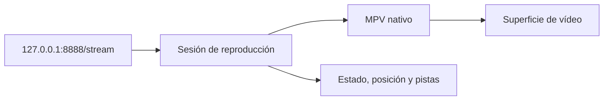
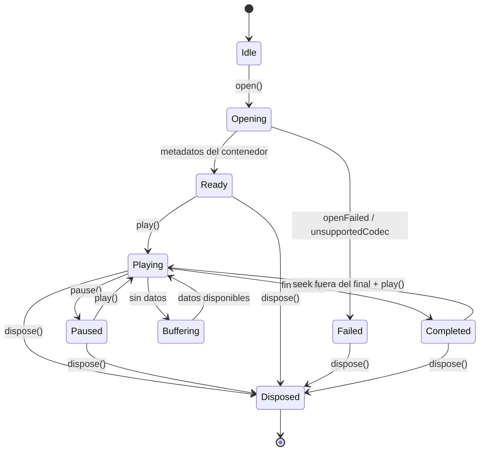

# 🎬 CMP-06 — Media Player

---

spec_id: CMP-06
spec_type: CMP
layer: backend
name: Media Player
target: lib/features/player/application/media_player_session.dart
block: player
status: APPROVED
version: 1.3
owner: Architecture
last_reviewed: 2026-10-24
approved_at: 2026-10-24
approved_by: Architecture
supersedes: []
superseded_by: []
user_story: user_story.md
processes: [PRC-01]
depends_on: [CMP-00, CMP-05]
consumed_by: []
---

`CMP-06` · `DRAFT` · `v1.0` · `Dart` · `player`

| 🧩 Tipo | 🚦 Estado | 🧭 Feature | 🎯 Target |
|---|---|---|---|
| `CMP` | `DRAFT` | `player` | `lib/features/player/application/media_player_session.dart` |

> [!IMPORTANT]
> **Contrato de lectura rápida.** Esta spec es la fuente de verdad del reproductor. El código no puede añadir estados, errores, pistas ni controles fuera de aquí.
>
> **Archivo:** `CMP-06-media-player.spec.md` · **Historia:** [`user_story.md`](user_story.md) · **Flujo consumido:** [`CMP-05`](../CMP-05-p2p-engine/CMP-05-p2p-engine.spec.md)
>
> **Diseño visual:** no aplica. El OSD y los controles pertenecen a `tv_experience`.

> [!NOTE]
> **Implementado y verificado** en `lib/features/player/` con 15 tests en verde y APK medido. Licencias y tamaño de MPV: [`ADR-0004`](../../../../memory/decisions/ADR-0004-media-kit-licensing-and-size.md).

> [!TIP]
> **Ruta de lectura:** §4 requisitos → §6 estados → §8 contratos → §10 trazabilidad → §11 pruebas.

### 🗺️ Mapa de lectura

| Bloque | Qué encontrarás |
|---|---|
| §1–§3 | Problema, alcance y actores |
| §4–§6 | Requisitos, reglas, estados y errores |
| §7–§9 | UI (no aplica), contratos y dependencias |
| §10–§12 | Trazabilidad, pruebas y BDD |
| §13–§15 | Cierre, decisiones y preguntas |



---

## 🧭 0. Protocolo de lectura y no invención

1. Leer esta spec, `block_media_player.md` y `CMP-05`.
2. Implementar solo los `FR-*` y `CT-*` definidos aquí.
3. No añadir controles, OSD, persistencia ni dependencias fuera de §9.
4. Si falta un dato, registrarlo en §15 y detener la implementación.
5. `media_kit` y MPV solo pueden importarse en `lib/features/player/data/media_kit/`.

**Jerarquía de verdad:** contexto del proyecto → `architecture_rules.md` → esta spec → código.

---

## 🎯 1. Contexto y objetivo

### 1.1 Problema

`CMP-05` entrega un flujo HTTP local con `206`, pero la aplicación no tiene forma de decodificarlo: no hay imagen, no hay control de reproducción y no hay estado que el orquestador pueda observar.

### 1.2 Objetivo medible

Con una sesión P2P activa y su `streamUrl`:

1. `MediaPlayerSession.open(uri)` resuelve en menos de 5 s con datos disponibles.
2. `play()` hace que `position` avance al menos 1 s en 2 s reales.
3. `seek(posición)` se refleja en `position` con un error menor de 1 s.
4. `dispose()` deja la sesión cerrada, sin timers ni reproductor nativo vivo, y es idempotente.

### 1.3 No objetivos

- Descargar, resolver magnets o hablar con el motor P2P (`CMP-05`).
- Pintar OSD, controles, carátulas o navegación (`CMP-*` de `tv_experience`).
- Persistir progreso, decidir reanudación o gestionar catálogo.
- Transcodificar, remuxear o descargar el archivo completo.
- Reproducción en segundo plano o Picture-in-Picture.

---

## 📐 2. Alcance y límites

**Incluye:**

- Apertura y cierre de una sesión de reproducción sobre una URL local.
- Play, pausa, seek y consulta de posición y duración.
- Superficie de vídeo como recurso opaco para la capa de presentación.
- Listado y selección de pistas de audio y subtítulos.
- Carga de subtítulos externos desde una ruta local autorizada.
- Estado tipado, errores tipados y notificación de finalización.

**Excluye:**

- Cualquier acceso a red distinto de la URL de reproducción recibida.
- Controles visuales, OSD, tokens de diseño y foco.
- Persistencia de progreso y reanudación.
- Pistas descargadas desde Internet.

**Invariantes de arquitectura aplicables:**

- `architecture_rules.md` §2.2 (reproducción desacoplada del catálogo), §4.6 (sin transcodificación), §4.10 (liberación determinista).
- `coding_standards.md` §5 (MPV confinado a `player`).
- `ui-design-system.md`: fuera de alcance; no se define ningún estilo aquí.

---

## 👤 3. Actores e historia de usuario

> **Como** usuario de FLIK,
> **quiero** que el flujo local se reproduzca con controles básicos y pistas seleccionables,
> **para** ver el contenido sin esperar ni salir de la app.

**Actores secundarios:** `PRC-01` (abre y cierra la sesión), `CMP-05` (fuente del flujo), `tv_experience` (pinta la superficie y el OSD).

### 🔗 Trazabilidad de negocio

| Criterio `US-*` | Requisitos que lo cubren |
|---|---|
| `US-01` | `FR-01` |
| `US-02` | `FR-02`, `FR-03` |
| `US-03` | `FR-04`, `FR-05` |
| `US-04` | `FR-06`, `FR-07` |
| `US-05` | `FR-08`, `FR-10` |
| `US-06` | `INV-02`, `INV-03` |

---

## ✅ 4. Requisitos funcionales

### 4.1 Requisitos

| ID | Requisito | Prioridad | Criterio | Regla |
|---|---|---|---|---|
| `FR-01` | Abrir una sesión de reproducción sobre una URL de loopback y una posición inicial opcional. | Must | `AC-01` | `BR-01`, `INV-01` |
| `FR-02` | Ofrecer `play()` y `pause()` idempotentes sobre una sesión abierta. | Must | `AC-02` | `BR-02` |
| `FR-03` | Permitir `seek(position)` recortando al rango `[0, duration]` sin reiniciar la apertura del flujo. | Must | `AC-03` | `BR-03` |
| `FR-04` | Publicar la posición actual al menos cada 250 ms mientras haya sesión abierta. | Must | `AC-04` | `BR-04` |
| `FR-05` | Publicar duración y estado de reproducción (`idle`, `opening`, `ready`, `playing`, `paused`, `buffering`, `completed`, `failed`, `disposed`). | Must | `AC-05` | `BR-05` |
| `FR-06` | Listar las pistas de audio y subtítulos disponibles con su idioma y título. | Must | `AC-06` | `BR-06` |
| `FR-07` | Seleccionar una pista de audio o subtítulo por identificador y añadir un subtítulo externo desde una ruta local existente. | Should | `AC-07` | `BR-07` |
| `FR-08` | Notificar la finalización de la reproducción con estado `completed` y posición igual a la duración. | Must | `AC-08` | `BR-05` |
| `FR-09` | Devolver errores tipados ante URL no permitida, fallo de apertura, códec no soportado y pista inexistente. | Must | `AC-09` | `BR-08` |
| `FR-10` | Cerrar la sesión de forma idempotente, liberando reproductor nativo, superficie, suscripciones y timers. | Must | `AC-10` | `INV-04` |
| `FR-11` | No abrir conexiones distintas de la URL recibida ni descargar o transcodificar contenido. | Must | `AC-11` | `INV-02`, `INV-03` |
| `FR-12` | Ejecutar las operaciones del reproductor sin bloquear el isolate de UI. | Must | `AC-12` | `BR-09` |

### 4.2 Criterios de aceptación

| ID | Criterio observable |
|---|---|
| `AC-01` | `open()` con `http://127.0.0.1:<puerto>/stream` devuelve una sesión; con `http://example.com/x` devuelve `invalidUri`. |
| `AC-02` | `play()` sobre una sesión pausada cambia el estado a `playing`; `pause()` dos veces seguidas no produce error. |
| `AC-03` | `seek(5 s)` deja `position` a 5 s ±1 s y el estado vuelve a `playing` si lo estaba; `seek(-1 s)` se recorta a 0. |
| `AC-04` | Durante 2 s de reproducción se reciben al menos 8 actualizaciones de `position`. |
| `AC-05` | `state` emite `opening` y después `ready`; `duration` es mayor que cero cuando hay metadatos del contenedor. |
| `AC-06` | Con un MKV con dos audios y subtítulos, `audioTracks` y `subtitleTracks` contienen las pistas con `id`, `language` y `title`. |
| `AC-07` | Seleccionar un `trackId` existente cambia la pista activa; un `trackId` inexistente devuelve `trackNotFound`. |
| `AC-08` | Al llegar al final, el estado es `completed` y `position == duration`. |
| `AC-09` | Los cuatro casos de error devuelven su `MediaPlayerErrorCode` correspondiente. |
| `AC-10` | Tras `dispose()`, el estado es `disposed`, `state` deja de emitir y un segundo `dispose()` no lanza. |
| `AC-11` | El reproductor solo recibe la URL dada; no hay cliente HTTP propio ni llamadas a otros hosts. |
| `AC-12` | Un timer de 10 ms en el isolate de UI mantiene su desviación por debajo de 100 ms durante la apertura. |

---

## ⚖️ 5. Reglas de negocio e invariantes

| ID | Regla / invariante | Fuente canónica | Verificación |
|---|---|---|---|
| `BR-01` | Solo se aceptan URLs `http` con host `127.0.0.1`; el reproductor nunca abre otras. | `architecture_rules.md` §4.2 | `TC-01` |
| `BR-02` | `play` y `pause` no lanzan si el estado ya es el solicitado. | Esta spec | `TC-02` |
| `BR-03` | `seek` recorta al rango válido y no reabre la URL. | Esta spec | `TC-03` |
| `BR-04` | La posición se publica cada ≤250 ms mientras la sesión no esté cerrada. | Esta spec | `TC-04` |
| `BR-05` | Estados y transiciones son los de §6.1; no existen estados intermedios no declarados. | Esta spec | `TC-05`, `TC-08` |
| `BR-06` | Cada pista se identifica por un `trackId` opaco y estable durante la sesión. | Esta spec | `TC-06` |
| `BR-07` | Un subtítulo externo debe ser una ruta absoluta existente y con extensión `srt`, `vtt` o `ass`. | `SEC-04` (confinamiento) | `TC-07` |
| `BR-08` | Los fallos nativos se traducen a `MediaPlayerFailure`; nunca se propagan códigos de MPV. | `coding_standards.md` §5 | `TC-09` |
| `BR-09` | La apertura, el seek y el dispose no bloquean el isolate de UI. | `FM-FLIK-006` | `TC-12` |
| `INV-01` | El reproductor no conoce catálogo, magnets ni motor P2P; solo recibe la URL. | `architecture_rules.md` §2.2 | `TC-01` |
| `INV-02` | Prohibida la transcodificación o el remuxing. | `architecture_rules.md` §4.6 | `TC-11` |
| `INV-03` | Prohibido descargar contenido por cuenta propia. | `project_overview.md` §5 | `TC-11` |
| `INV-04` | Al cerrar se destruye el reproductor y se libera la superficie, siempre. | `architecture_rules.md` §4.10 | `TC-10` |
| `INV-05` | Ninguna dependencia de `media_kit` se expone fuera de `data/media_kit/`. | `coding_standards.md` §5 | `TC-13` |

---

## 🔄 6. Estados, comportamiento y errores

### 6.1 Máquina de estados



`dispose()` es idempotente: la segunda llamada no produce error.

### 6.2 Tabla de estados

| Estado | Entrada | Salida | Efecto observable |
|---|---|---|---|
| `Idle` | Sesión creada | `open()` | Sin reproductor nativo |
| `Opening` | `open()` | metadatos o error | `duration` aún 0 |
| `Ready` | metadatos | `play()` | Superficie disponible, posición 0 |
| `Playing` | `play()` | pausa, fin o cierre | `position` avanza |
| `Paused` | `pause()` | `play()` | `position` estable |
| `Buffering` | falta de datos | datos | Informativo, sin cambiar posición |
| `Completed` | fin del flujo | `dispose()` | `position == duration` |
| `Failed` | error tipado | `dispose()` | `failure` no nulo |
| `Disposed` | `dispose()` | — | `state` cerrado y superficie liberada |

### 6.3 Errores

| Código | Condición | Resultado | Recuperable |
|---|---|---|---|
| `invalidUri` | Esquema distinto de `http` o host distinto de `127.0.0.1` | Sesión no creada | Sí, con la URL local correcta |
| `openFailed` | MPV no puede abrir el flujo | Estado `failed` | Sí, reintentando la sesión |
| `unsupportedCodec` | Contenedor o códec no soportado | Estado `failed` | No; se informa al usuario |
| `trackNotFound` | `trackId` inexistente | `MediaPlayerFailure` | Sí, con un id válido |
| `subtitleNotFound` | Ruta externa inexistente o extensión no admitida | `MediaPlayerFailure` | Sí, con otra ruta |
| `alreadyDisposed` | Operación sobre sesión cerrada | `MediaPlayerFailure` | No |

### 6.4 Casos borde obligatorios

- `seek` más allá de la duración: se recorta a `duration`.
- `play()` antes de que termine `open()`: espera a `ready` y no lanza.
- Fin del flujo mientras está en pausa: no se emite `completed`.
- Cierre durante `opening`: se aborta y se libera sin emitir `ready`.
- `selectSubtitleTrack(null)` desactiva los subtítulos.
- Cambio de pista de audio sin reiniciar el flujo ni perder la posición.

---

## 🎨 7. UX/UI y foco

**No aplica.** `CMP-06` es `layer: backend`: no pinta OSD, controles ni estilos. La superficie se entrega como recurso opaco y `tv_experience` decide cómo mostrarla y cómo gestionar el foco.

---

## 🔌 8. Contratos de datos (`CT-*`)

### 8.1 Estados, pistas y errores

```dart
// Ruta canónica: lib/features/player/domain/media_player.dart
// Spec: CMP-06

enum MediaPlayerStatus {
  idle,
  opening,
  ready,
  playing,
  paused,
  buffering,
  completed,
  failed,
  disposed,
}

enum MediaTrackKind { audio, subtitle }

final class MediaTrack {
  const MediaTrack({
    required this.id,
    required this.kind,
    required this.language,
    required this.title,
    required this.isSelected,
    required this.isExternal,
  });

  final String id;
  final MediaTrackKind kind;
  final String language;
  final String title;
  final bool isSelected;
  final bool isExternal;
}

enum MediaPlayerErrorCode {
  invalidUri,
  openFailed,
  unsupportedCodec,
  trackNotFound,
  subtitleNotFound,
  alreadyDisposed,
}

final class MediaPlayerFailure implements Exception {
  const MediaPlayerFailure({
    required this.code,
    required this.message,
    this.cause,
  });

  final MediaPlayerErrorCode code;
  final String message;
  final Object? cause;

  @override
  String toString() => 'MediaPlayerFailure($code): $message';
}

final class MediaPlayerState {
  const MediaPlayerState({
    required this.status,
    required this.position,
    required this.duration,
    required this.audioTracks,
    required this.subtitleTracks,
    required this.selectedAudioId,
    required this.selectedSubtitleId,
    required this.failure,
  });

  const MediaPlayerState.idle()
    : status = MediaPlayerStatus.idle,
      position = Duration.zero,
      duration = Duration.zero,
      audioTracks = const <MediaTrack>[],
      subtitleTracks = const <MediaTrack>[],
      selectedAudioId = null,
      selectedSubtitleId = null,
      failure = null;

  final MediaPlayerStatus status;
  final Duration position;
  final Duration duration;
  final List<MediaTrack> audioTracks;
  final List<MediaTrack> subtitleTracks;
  final String? selectedAudioId;
  final String? selectedSubtitleId;
  final MediaPlayerFailure? failure;

  bool get isPlaying => status == MediaPlayerStatus.playing;
  bool get isTerminal =>
      status == MediaPlayerStatus.disposed ||
      status == MediaPlayerStatus.failed;
}
```

### 8.2 Configuración y sesión

```dart
final class MediaPlayerConfig {
  const MediaPlayerConfig({
    this.initialPosition = Duration.zero,
    this.autoPlay = true,
    this.volume = 1.0,
  });

  final Duration initialPosition;
  final bool autoPlay;

  /// `0.0`–`1.0`.
  final double volume;
}

/// Builder de superficie; el tipo concreto lo crea `data/media_kit`.
typedef MediaSurfaceBuilder = Widget Function(BuildContext context);

final class MediaPlayerSession {
  static Future<MediaPlayerSession> open({
    required Uri uri,
    required MediaPlayerAdapter adapter,
    MediaPlayerConfig config = const MediaPlayerConfig(),
  });

  /// Superficie de vídeo lista para pintar, o `null` si el adaptador no la ofrece.
  MediaSurfaceBuilder? get videoSurface;
  MediaPlayerState get currentState;
  Stream<MediaPlayerState> get state;

  Future<void> play();
  Future<void> pause();
  Future<void> seek(Duration position);
  Future<void> setVolume(double volume);
  Future<void> selectAudioTrack(String trackId);
  Future<void> selectSubtitleTrack(String? trackId);
  Future<void> addExternalSubtitle(String absolutePath);

  /// Idempotente. Libera reproductor, superficie y suscripciones.
  Future<void> dispose();
}
```

### 8.3 Tabla de campos y restricciones

| Campo | Tipo | Obligatorio | Restricción |
|---|---|---|---|
| `uri` | `Uri` | Sí | `http` + host `127.0.0.1` |
| `config.initialPosition` | `Duration` | No | ≥ 0; recortado a la duración |
| `config.autoPlay` | `bool` | No | Por defecto `true` |
| `config.volume` | `double` | No | `[0.0, 1.0]` |
| `MediaTrack.id` | `String` | Sí | Opaco y estable durante la sesión |
| `MediaTrack.language` | `String` | Sí | ISO 639-1/2 o `und` |
| `addExternalSubtitle(path)` | `String` | Sí | Ruta absoluta existente con extensión `srt`, `vtt` o `ass` |

### 8.4 Adaptador nativo (frontera `data/media_kit/`)

```dart
abstract interface class MediaPlayerAdapter {
  Future<void> open(Uri uri, {Duration startAt});
  Future<void> play();
  Future<void> pause();
  Future<void> seek(Duration position);
  Future<void> setVolume(double volume);
  Future<void> selectTrack(MediaTrackKind kind, String? trackId);
  Future<void> addSubtitle(String absolutePath);
  Future<List<MediaTrack>> tracks();

  Stream<Duration> get position;
  Stream<Duration> get duration;
  Stream<bool> get buffering;
  Stream<bool> get playing;
  Stream<bool> get completed;
  Stream<MediaPlayerFailure> get errors;

  Object? get surface;
  Future<void> dispose();
}
```

`MediaPlayerAdapter` es la única frontera con `media_kit`/MPV. El adaptador real vive en `data/media_kit/`; los tests usan un adaptador fake.

---

## 🧱 9. Interfaces y dependencias

### 9.1 Dependencias permitidas

- `media_kit` `1.2.6`, `media_kit_video` `2.0.1` y `media_kit_libs_video` `1.0.7`, confinados a `lib/features/player/data/media_kit/`.
- `dart:async` para streams y timers.
- `dart:io` solo para comprobar la existencia de subtítulos externos.
- Tipos de `CMP-05` únicamente como URL recibida (no se importa su implementación).

### 9.2 Dependencias prohibidas

- Clientes HTTP (`package:http`, `dio`) o cualquier descarga propia.
- Catálogo, `p2p_engine` o `tv_experience` (imports entre features).
- Persistencia, base de datos o `shared_preferences`.
- Analítica, publicidad o crash reporting remoto.
- Exposición de tipos de `media_kit`/MPV fuera de `data/media_kit/`.

### 9.3 Ciclo de vida

- **Creación:** `PRC-01` construye la sesión con la URL de `CMP-05`.
- **Suscripción:** `tv_experience` escucha `state` y usa `videoSurface`.
- **Cancelación:** `dispose()` cancela suscripciones, timer de posición y streams.
- **Destrucción:** se destruye el reproductor nativo, se libera la superficie y se emite `disposed`.

---

## 🗺️ 10. Mapa de implementación y trazabilidad

> [!NOTE]
> Todos los estados están en `Pending`: no existe implementación.

| Requisito | Contrato | Implementación (archivo::símbolo) | Test | Estado |
|---|---|---|---|---|
| `FR-01` | `CT-01`, `CT-02` | `lib/features/player/application/media_player_session.dart::MediaPlayerSession.open` | `TC-01` | Verified |
| `FR-02` | `CT-02` | `lib/features/player/application/media_player_session.dart::MediaPlayerSession.play` | `TC-02` | Verified |
| `FR-03` | `CT-02` | `lib/features/player/application/media_player_session.dart::MediaPlayerSession.seek` | `TC-03` | Verified |
| `FR-04` | `CT-01` | `lib/features/player/application/media_player_session.dart::_onPosition` | `TC-04` | Verified |
| `FR-05` | `CT-01` | `lib/features/player/domain/media_player.dart::MediaPlayerState` | `TC-05` | Verified |
| `FR-06` | `CT-01`, `CT-04` | `lib/features/player/domain/media_player.dart::MediaTrack` | `TC-06` | Verified |
| `FR-07` | `CT-02`, `CT-04` | `lib/features/player/application/media_player_session.dart::selectSubtitleTrack` | `TC-07` | Verified |
| `FR-08` | `CT-01` | `lib/features/player/application/media_player_session.dart::_onCompleted` | `TC-08` | Verified |
| `FR-09` | `CT-01` | `lib/features/player/domain/media_player.dart::MediaPlayerFailure` | `TC-09` | Verified |
| `FR-10` | `CT-02` | `lib/features/player/application/media_player_session.dart::MediaPlayerSession.dispose` | `TC-10` | Verified |
| `FR-11` | `CT-04` | `lib/features/player/data/media_kit/media_kit_adapter.dart::MediaKitAdapter` | `TC-11` | Verified |
| `FR-12` | `CT-04` | `lib/features/player/application/media_player_session.dart::MediaPlayerSession.open` | `TC-12` | Verified |

**Estados:** `Pending`, `Implemented`, `Verified`. Este componente no puede estar `Verified` hasta que exista código y tests en verde.

---

## 🧪 11. Plan de pruebas

Los tests automatizados usan un `MediaPlayerAdapter` fake determinista: **no abren MPV real ni consumen red**.

| ID | Tipo | Qué verifica | Entrada | Criterio |
|---|---|---|---|---|
| `TC-01` | Unit | `FR-01` URL permitida y rechazada | `http://127.0.0.1:8888/stream`, `https://…`, `http://example.com/x`, `file:///x` | Sesión creada solo con loopback `http`; el resto `invalidUri` |
| `TC-02` | Unit | `FR-02` idempotencia | Adaptador fake en `ready` | `play()` dos veces y `pause()` dos veces sin error; estado correcto |
| `TC-03` | Unit | `FR-03` recorte de seek | `seek(-1 s)`, `seek(5 s)`, `seek(99 h)` | Valores recortados a `[0, duration]`; el adaptador recibe el valor recortado |
| `TC-04` | Unit | `FR-04` propagación de posición | Adaptador emite 5 posiciones | `state.position` refleja cada emisión |
| `TC-05` | Unit | `FR-05` transiciones | Apertura fake con duración 10 s | `opening` → `ready` → `playing`; `duration` 10 s |
| `TC-06` | Unit | `FR-06` pistas | Dos audios y dos subtítulos | Listas con `id`, `language`, `title`, `isSelected` |
| `TC-07` | Unit | `FR-07` selección y subtítulo externo | `trackId` válido, inválido, ruta inexistente `.srt` | Cambia pista; inválido `trackNotFound`; ruta inexistente `subtitleNotFound` |
| `TC-08` | Unit | `FR-08` fin de reproducción | Adaptador marca `completed` con `duration` 10 s | Estado `completed` y `position == 10 s` |
| `TC-09` | Unit | `FR-09` errores | Fallo de apertura y error de códec del adaptador | `openFailed` y `unsupportedCodec` en estado `failed` |
| `TC-10` | Unit | `FR-10` dispose | `dispose()` dos veces | Adaptador cerrado una vez, estado `disposed`, `state` cerrado |
| `TC-11` | Estático | `FR-11`, `INV-02`, `INV-03` | Código de `lib/features/player/` | Sin cliente HTTP, sin flags de transcodificación, sin descargas |
| `TC-12` | Integration | `FR-12` isolate de UI | Timer de 10 ms durante apertura fake lenta | Desviación < 100 ms |
| `TC-13` | Estático | `INV-05` confinamiento de `media_kit` | Imports de `lib/features/player/` | `media_kit` solo en `data/media_kit/` |

**Smoke manual (fuera de la suite)**

Con una sesión `CMP-05` activa y un magnet legal, abrir el `streamUrl` en el reproductor del dispositivo y comprobar imagen, seek y cambio de pista. Se registra en `memory/ephemeral_feedback/`.

**Comandos**

```bash
flutter analyze
flutter test test/unit/player
```

---

## 🥒 12. Criterios de aceptación BDD

```gherkin
@FR-01
Scenario: Reproducir el flujo local del motor P2P
  Given una sesión P2P activa con streamUrl "http://127.0.0.1:44107/stream"
  When abro la sesión del reproductor con esa URL
  Then el estado llega a ready
  And duration es mayor que cero
  And play() cambia el estado a playing
```

```gherkin
@FR-03
Scenario: Buscar una posición fuera de rango
  Given una sesión lista con duración de 10 s
  When solicito seek a 99 horas
  Then el adaptador recibe un seek a 10 s
  And position queda en 10 s
```

```gherkin
@FR-09
Scenario: Rechazar una URL no local
  Given una URL "https://example.com/pelicula.mp4"
  When abro la sesión del reproductor
  Then recibo invalidUri
  And no se crea ningún reproductor nativo
```

```gherkin
@FR-10
Scenario: Cerrar la sesión dos veces
  Given una sesión en reproducción
  When invoco dispose() dos veces
  Then el adaptador se cierra una sola vez
  And el estado es disposed
  And no se lanza ninguna excepción
```

---

## 🏁 13. Definition of Done

- [x] Todos los `FR-*` tienen `AC-*`, `TC-*` y entrada en §10.
- [x] Todos los `CT-*` implementados y referenciados por código.
- [x] Los símbolos públicos llevan comentario `/// Spec: CMP-06 / FR-...`.
- [x] `flutter analyze` y `flutter test` pasan.
- [x] `media_kit` solo se importa en `data/media_kit/`.
- [x] No hay cliente HTTP ni transcodificación en `lib/features/player/`.
- [x] `dispose()` libera el reproductor y es idempotente.
- [x] Smoke manual con el `streamUrl` real de `CMP-05` documentado.
- [x] No se añadieron dependencias fuera de §9.
- [x] La spec está `APPROVED` y `sync-sdd` no reporta `DIVERGED`.
- [x] §15 no tiene preguntas bloqueantes.

> [!NOTE]
> Verificado el 2026-10-24: `flutter analyze` sin issues, **94 tests** en verde (15 de player) y APK debug medido en **143,46 MB** con `libmpv.so` de 15,08 MB por ABI. Licencias y riesgos de MPV/FFmpeg en [`ADR-0004`](../../../../memory/decisions/ADR-0004-media-kit-licensing-and-size.md).

---

## 🧾 14. Decisiones

| Fecha | Decisión | Motivo | Impacto | Aprobado por |
|---|---|---|---|---|
| 2026-10-24 | El ID es `CMP-06`; `CMP-02`/`CMP-03`/`CMP-04`/`CMP-05` quedan ocupados o reservados. | Los IDs no se reutilizan. | Ubicación de la spec. | Pendiente |
| 2026-10-24 | El reproductor solo acepta URLs `http` en `127.0.0.1`. | El flujo siempre viene de `CMP-05`; evita usos accidentales de red externa. | `BR-01`, `FR-01`. | Pendiente |
| 2026-10-24 | La superficie de vídeo se expone como `Object?` opaco. | Evita filtrar tipos de `media_kit`/MPV fuera de `data/media_kit/`. | `CT-02`, `INV-05`. | Pendiente |
| 2026-10-24 | Versiones fijadas: `media_kit` 1.2.6, `media_kit_video` 2.0.1, `media_kit_libs_video` 1.0.7. | Evitar deriva de API y problemas de códecs. | `§9.1`. | Pendiente |
| 2026-10-24 | El OSD y los controles no pertenecen a esta spec. | Mantener el reproductor como capa sin UI. | `§7`, `§2`. | Pendiente |
| 2026-10-24 | La superficie se expone como `MediaSurfaceBuilder?` (builder de widget) generado por el adaptador. | Permite pintar sin filtrar tipos de `media_kit` fuera de `data/media_kit/`. | `CT-02`, `INV-05`. | Architecture |
| 2026-10-24 | Release con APK por ABI y aviso de terceros de MPV/FFmpeg. | El APK debug con tres ABIs mide 143,46 MB y `libmpv.so` pesa 15,08 MB. | `§9.1`, [`ADR-0004`](../../../../memory/decisions/ADR-0004-media-kit-licensing-and-size.md). | Architecture |

---

## ❓ 15. Preguntas abiertas

| ID | Pregunta | Bloqueante | Responsable | Respuesta |
|---|---|---|---|---|
| `Q-01` | ¿Se fija hardware decoding como preferencia explícita por plataforma o se deja a MPV? | No | Platform | Pendiente; MPV decide por defecto y se medirá en TV real |
| `Q-02` | ¿El volumen y el mute viven en el reproductor o en `tv_experience`? | No | Architecture | El volumen vive en la sesión (`setVolume`); el mute es del OSD |
| `Q-03` | ¿Los subtítulos externos se limitan a rutas del usuario o también a los del torrent? | No | Product | El MVP solo admite rutas locales existentes |
| `Q-04` | ¿Qué build de libmpv se distribuye (GPL o LGPL)? | No (bloquea release) | Architecture | Pendiente; ver [`ADR-0004`](../../../../memory/decisions/ADR-0004-media-kit-licensing-and-size.md) |

> [!NOTE]
> No hay preguntas bloqueantes. `Q-01`–`Q-03` se resolverán durante la implementación sin cambiar los contratos de §8.

---

## 🧾 Historial de cambios

| Versión | Fecha | Tipo | Cambio | Aprobado por |
|---|---|---|---|---|
| 1.0 | 2026-10-24 | Inicial | Spec del reproductor: apertura, controles, pistas, errores y cierre determinista. | Pendiente |
| 1.1 | 2026-10-24 | Implementación | Aprobación, adaptador `media_kit`, builder de superficie, mapa en `Verified`, tests y medición de APK/licencias. | Architecture |
| 1.2 | 2026-10-25 | Corrección | `_refreshTracks` reconstruye el estado para permitir desactivar subtítulos (`null`); la superficie usa `controls: null` para no duplicar el OSD de la app. | Product Owner |
| 1.3 | 2026-10-25 | Corrección | `setVolume` traduce la escala 0.0–1.0 del dominio a la escala 0–100 de `media_kit`; API pública `MediaPlayerSession.setVolume`. | Product Owner |


