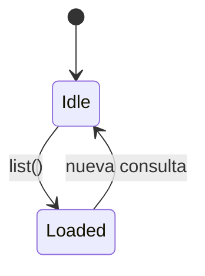

# CMP-35 — Channel Manifest

---

spec_id: CMP-35
spec_type: CMP
layer: backend
name: Channel Manifest
target: lib/features/catalog/domain/channel.dart
block: catalog
status: APPROVED
version: 2.0
owner: Catalog Team
last_reviewed: 2026-10-27
approved_at: 2026-10-27
approved_by: Product Owner
supersedes: []
superseded_by: []
user_story: user_story.md
processes: []
depends_on: [CMP-01, CMP-04]
consumed_by: [CMP-33, CMP-34]
---

`CMP-35` · `v2.0` · `catalog` · `Flutter` · `APPROVED`

| 🧩 Tipo | 🚦 Estado | 🧭 Feature | 🎯 Target |
|---|---|---|---|
| `CMP` | `DRAFT` | `catalog` | `lib/features/catalog/domain/channel.dart` |

> [!IMPORTANT]
> **Modelo y manifiesto de canales.** Define `Channel`, su fuente declarada y los cinco canales por defecto que sirven la pantalla de entrada sin red.

> [!WARNING]
> **Fuera de alcance:** creación, borrado, sincronización, cliente HTTP, selector de archivos y persistencia en base de datos.

> [!TIP]
> **Ruta de lectura:** §4 → §8 → §10.

### 🗺️ Mapa de lectura

| Bloque | Qué encontrarás |
|---|---|
| §1–§3 | Problema, alcance y actores |
| §4–§6 | Requisitos, reglas y estados |
| §7–§9 | Contratos y dependencias |
| §10–§12 | Trazabilidad, pruebas y BDD |
| §13–§15 | Cierre, decisiones y preguntas |

---

## 0. Protocolo de lectura y no invención

1. Leer `glossary.md` (entrada **Canal**), `CMP-01` y `05-pages.md` §3.
2. Implementar solo los `FR-*` y `CT-*` de esta spec.
3. Un canal **no** es un `kind` del contrato de catálogo: `CMP-01 FR-14` sigue rechazando `kind: channel`.
4. Si falta un dato, registrarlo en §15 y detener la implementación.

---

## 1. Contexto y objetivo

### 1.1 Problema

La aplicación abre directamente un catálogo semilla sin una unidad de entrada. `CMP-04 Q-02` fijaba «v1 usa un único espacio implícito», decisión que esta spec sustituye.

### 1.2 Objetivo medible

Exponer de forma determinista una lista de exactamente cinco canales por defecto, todos sin fuente conectada, consumible desde `tv_experience` sin red y sin acceso a base de datos.

### 1.3 No objetivos

- Crear, editar o borrar canales.
- Resolver o validar URLs y rutas.
- Leer portadas remotas.
- Persistir el orden o el último abierto.

---

## 2. Alcance y límites

**Incluye:**

- Modelo inmutable `Channel` y su fuente declarada opcional.
- Enumerados cerrados de arte, tipo de fuente y estado de fuente.
- Manifiesto con los cinco canales por defecto.
- Contrato de repositorio asíncrono para que la persistencia futura no rompa la UI.

**Excluye:**

- Cualquier operación de escritura.
- Cualquier acceso a red.
- Cualquier dependencia de Flutter, UI o `media_kit`.

**Invariantes de arquitectura aplicables:**

- `architecture_rules.md` §2.4: la presentación no accede a almacenamiento ni red.
- `architecture_rules.md` §4.8: la primera pantalla se sirve sin red.
- `block_catalog_service.md`: el catálogo posee modelos y persistencia; no posee presentación.

---

## 3. Actores e historia de usuario

> **Como** responsable de catálogo,
> **quiero** un modelo de canal y un manifiesto por defecto,
> **para** que la pantalla de entrada tenga datos reales desde el primer frame sin inventar campos en la UI.

**Actores secundarios:** `CMP-33` (pantalla), `CMP-34` (tarjeta), `CMP-04` (semilla de catálogo).

---

## 4. Requisitos funcionales

| ID | Requisito | Prioridad | Criterio de aceptación | Regla |
|---|---|---|---|---|
| `FR-01` | `Channel` es inmutable y declara `id`, `name`, `description`, `art`, `coverUri`, `source`, `sortOrder`, `lastOpenedAt`. | Must | `AC-01`: campos `final` y constructor `const` | `BR-01` |
| `FR-02` | `source == null` significa «canal sin conectar» y es un estado válido, no un error. | Must | `AC-02`: el manifiesto por defecto cumple `source == null` | `BR-02` |
| `FR-03` | `ChannelArt` es un enumerado cerrado con exactamente cinco valores: `rings`, `grid`, `wave`, `prism`, `orbit`. | Must | `AC-03`: `ChannelArt.values.length == 5` | `BR-03` |
| `FR-04` | El manifiesto por defecto contiene exactamente cinco canales. | Must | `AC-04`: `kDefaultChannels.length == 5` | `BR-04` |
| `FR-05` | Cada canal por defecto declara un `art` distinto del de los demás. | Must | `AC-05`: el conjunto de `art` tiene tamaño 5 | `BR-03` |
| `FR-06` | Los `sortOrder` de los canales por defecto son únicos y forman la secuencia 0..4. | Must | `AC-06`: conjunto `{0,1,2,3,4}` | `BR-05` |
| `FR-07` | `ChannelSourceState` es un enumerado cerrado con `pending`, `syncing`, `ready` y `error`. | Must | `AC-07`: cuatro valores exactos | `BR-06` |
| `FR-08` | `ChannelRepository.list()` devuelve los canales ordenados por `sortOrder` ascendente. | Must | `AC-08`: orden verificable | `BR-05` |
| `FR-09` | `ChannelRepository.byId` devuelve `null` si el identificador no existe, sin lanzar. | Must | `AC-09`: `null` para id desconocido | `BR-07` |
| `FR-10` | Los identificadores son estables, en minúsculas y kebab-case. | Must | `AC-10`: regex `^[a-z0-9]+(-[a-z0-9]+)*$` | `BR-08` |
| `FR-11` | El módulo no importa Flutter, `dart:io`, HTTP, base de datos ni UI. | Must | `AC-11`: revisión de imports | `INV-02` |
| `FR-12` | Un canal sin fuente reporta `itemCount == 0`; el contador nunca es nulo. | Must | `AC-12`: `0` en los cinco canales | `BR-09` |
| `FR-13` | `ChannelSourceType` admite `asset`, `localFile` y `remoteUrl`; `asset` se usa para catálogos empaquetados. | Must | `AC-13`: tres valores exactos | `BR-07` |
| `FR-14` | `uniqueChannelName(desired, existing)` devuelve el nombre tal cual si está libre o con sufijo ` 2`, ` 3`… hasta 99; es puro y determinista. | Must | `AC-14`: dos nombres iguales → ` 2` | `BR-12` |
| `FR-15` | Los cinco canales por defecto se siembran una sola vez en la tabla `channels` con `isDefault = true` cuando está vacía. | Must | `AC-15`: reabrir no duplica | `INV-03` |
| `FR-16` | El `id` de un canal importado se deriva de su `catalog_id`; el de un canal por defecto, de su nombre normalizado. | Must | `AC-16`: ids estables y kebab-case | `BR-08` |

---

## 5. Reglas de negocio e invariantes

| ID | Regla / invariante | Fuente canónica | Verificación |
|---|---|---|---|
| `BR-01` | El canal es un contenedor de listas, no un ítem de catálogo. | `glossary.md` | `TC-01` |
| `BR-02` | «Sin conectar» es un estado de primera clase; no se representa con cadenas vacías. | `05-pages.md` §3 | `TC-02` |
| `BR-03` | El arte se declara, no se calcula: sin azar y sin hash. | `04-components.md` §4.8 | `TC-03` |
| `BR-04` | Los canales por defecto viven en el manifiesto, nunca en el código de UI. | `05-pages.md` §3 | `TC-04` |
| `BR-05` | El orden lo fija `sortOrder`; el repositorio no reordena por nombre ni por fecha. | Esta spec | `TC-05` |
| `BR-06` | Una fuente no puede estar `ready` sin ingesta previa. | `PRC-02` | `TC-06` |
| `BR-07` | Consultar un canal inexistente no es un fallo del sistema. | Esta spec | `TC-07` |
| `BR-08` | Los ids son contrato público: cambiarlos rompe el último canal abierto. | Esta spec | `TC-08` |
| `BR-09` | El contador refleja títulos ingeridos; sin ingesta vale 0. | `05-pages.md` §3 | `TC-09` |
| `BR-12` | El nombre visible es único; el sufijo se calcula sin consultar la base en bucle. | `PRC-07` `ST-06` | `TC-11` |
| `INV-03` | La siembra de canales por defecto es idempotente. | `CMP-03` | `TC-12` |
| `INV-01` | El manifiesto por defecto siempre contiene los cinco canales; no es editable en v1. | `05-pages.md` §3 | `TC-04` |
| `INV-02` | Cero red y cero telemetría en este módulo. | `architecture_rules.md` §4.9 | `TC-10` |

---

## 6. Estados, comportamiento y errores

### 6.1 Flujo del repositorio



### 6.2 Tabla de estados

| Estado | Entrada | Salida | Efecto observable |
|---|---|---|---|
| `Idle` | Construcción | `list()` | Nada |
| `Loaded` | `list()` resuelve | Consulta posterior | Lista de cinco canales ordenada |

### 6.3 Errores y casos borde

| Código | Condición | Resultado | Recuperable |
|---|---|---|---|
| `channelNotFound` | `byId` con id desconocido | `null` | Sí |
| `manifestEmpty` | Manifiesto sin canales | Violación de `INV-01`; test en rojo | No |
| `duplicateArt` | Dos canales con el mismo `art` | Violación de `FR-05`; test en rojo | No |

No existen errores de red ni de almacenamiento en v1: el manifiesto es estático.

---

## 7. UX/UI y foco

No aplica: componente de capa `backend` sin presentación.

---

## 8. Contratos de datos (`CT-*`)

### 8.1 Modelos e interfaces

```dart
// Ruta canónica: lib/features/catalog/domain/channel.dart
// Spec: CMP-35 / FR-01 .. FR-10

/// Variantes cerradas de arte procedural de canal.
/// Spec: CMP-35 / FR-03
enum ChannelArt { rings, grid, wave, prism, orbit }

/// Origen declarado de la lista de un canal.
/// Spec: CMP-35 / FR-07, FR-13
enum ChannelSourceType { asset, localFile, remoteUrl }

/// Estado de la fuente declarada.
/// Spec: CMP-35 / FR-07
enum ChannelSourceState { pending, syncing, ready, error }

/// Lista declarada a la que apunta un canal.
/// Spec: CMP-35 / FR-07, FR-12
final class ChannelSource {
  const ChannelSource({
    required this.type,
    required this.location,
    this.state = ChannelSourceState.pending,
    this.itemCount = 0,
    this.lastSyncedAt,
  });

  final ChannelSourceType type;
  final String location;
  final ChannelSourceState state;
  final int itemCount;
  final DateTime? lastSyncedAt;
}

/// Contenedor de listas de catálogo.
/// Spec: CMP-35 / FR-01, FR-02, FR-12
final class Channel {
  const Channel({
    required this.id,
    required this.name,
    required this.description,
    required this.art,
    required this.sortOrder,
    this.source,
    this.lastOpenedAt,
  });

  final String id;
  final String name;
  final String description;
  final ChannelArt art;
  final int sortOrder;

  /// Portada declarada: `asset:` local. Si es nula o remota, se usa el arte
  /// procedural.
  /// Spec: CMP-35 / FR-01, FR-13
  final Uri? coverUri;
  final ChannelSource? source;
  final DateTime? lastOpenedAt;

  /// Sin fuente conectada el contador es 0, nunca nulo.
  /// Spec: CMP-35 / FR-12
  int get itemCount => source?.itemCount ?? 0;
}

/// Devuelve un nombre visible único dentro del conjunto existente.
///
/// Si `desired` está libre se devuelve tal cual; si no, se prueba ` 2`, ` 3`…
/// hasta ` 99`. Es puro y no consulta la base de datos.
/// Spec: CMP-35 / FR-14
String uniqueChannelName(String desired, Iterable<String> existing) {
  final Set<String> taken = existing.toSet();
  if (!taken.contains(desired)) {
    return desired;
  }
  for (int suffix = 2; suffix <= 99; suffix += 1) {
    final String candidate = '$desired $suffix';
    if (!taken.contains(candidate)) {
      return candidate;
    }
  }
  return desired;
}
```

### 8.2 Tabla de campos

| Campo | Tipo | Obligatorio | Restricción | Origen |
|---|---|---|---|---|
| `id` | `String` | Sí | kebab-case, estable | Manifiesto |
| `name` | `String` | Sí | No vacío | Manifiesto |
| `description` | `String` | Sí | No vacío | Manifiesto |
| `art` | `ChannelArt` | Sí | Único en el manifiesto por defecto | Manifiesto |
| `coverUri` | `Uri?` | No | Solo `asset:` se pinta | Manifiesto |
| `sortOrder` | `int` | Sí | Único, `>= 0` | Manifiesto |
| `source` | `ChannelSource?` | No | `null` = sin conectar | Manifiesto / `PRC-07` |
| `lastOpenedAt` | `DateTime?` | No | UTC | Navegación |

### 8.3 Contratos expuestos

| ID | Símbolo público | Entrada | Salida | Errores |
|---|---|---|---|---|
| `CT-01` | `Channel` | — | Instancia inmutable | — |
| `CT-02` | `ChannelSource` | — | Instancia inmutable | — |
| `CT-03` | `ChannelArt`, `ChannelSourceType`, `ChannelSourceState` | — | Enumerados cerrados | — |
| `CT-04` | `ChannelRepository.list` | — | `Future<List<Channel>>` | — |
| `CT-05` | `ChannelRepository.byId` | `String id` | `Future<Channel?>` | — |
| `CT-06` | `kDefaultChannels` | — | `List<Channel>` de longitud 5 | — |
| `CT-07` | `uniqueChannelName` | `String desired`, `Iterable<String> existing` | `String` único | — |

---

## 9. Interfaces y dependencias

### 9.1 Dependencias permitidas

- Dart SDK.

### 9.2 Dependencias prohibidas

- Flutter, `dart:io`, `dart:html`, HTTP, base de datos y `media_kit`.
- Importar `tv_experience`, `player` o `p2p_engine`.
- Telemetría, analítica o registro remoto.

### 9.3 Ciclo de vida

- **Creación:** el repositorio se construye en la composición de `lib/app/` y se inyecta.
- **Suscripción:** sin streams en v1.
- **Cancelación:** no aplica.
- **Destrucción:** sin recursos que liberar.

---

## 10. Mapa de implementación y trazabilidad

| Requisito | Contrato | Implementación (archivo::símbolo) | Test | Estado |
|---|---|---|---|---|
| `FR-01` | `CT-01` | `lib/features/catalog/domain/channel.dart::Channel` | `TC-01` | Verified |
| `FR-02` | `CT-01` | `lib/features/catalog/domain/channel.dart::Channel.source` | `TC-02` | Verified |
| `FR-03` | `CT-03` | `lib/features/catalog/domain/channel.dart::ChannelArt` | `TC-03` | Verified |
| `FR-04` | `CT-06` | `lib/features/catalog/data/manifest/default_channel_manifest.dart::kDefaultChannels` | `TC-04` | Verified |
| `FR-05` | `CT-06` | `.../default_channel_manifest.dart::kDefaultChannels` | `TC-03` | Verified |
| `FR-06` | `CT-06` | `.../default_channel_manifest.dart::kDefaultChannels` | `TC-05` | Verified |
| `FR-07` | `CT-03` | `lib/features/catalog/domain/channel.dart::ChannelSourceState` | `TC-06` | Verified |
| `FR-08` | `CT-04` | `.../default_channel_manifest.dart::DefaultChannelRepository.list` | `TC-05` | Verified |
| `FR-09` | `CT-05` | `.../default_channel_manifest.dart::DefaultChannelRepository.byId` | `TC-07` | Verified |
| `FR-10` | `CT-06` | `.../default_channel_manifest.dart::kDefaultChannels` | `TC-08` | Verified |
| `FR-11` | — | `lib/features/catalog/domain/channel.dart` (imports) | `TC-10` | Verified |
| `FR-12` | `CT-01` | `lib/features/catalog/domain/channel.dart::Channel.itemCount` | `TC-09` | Verified |

**Estados:** `Pending`, `Implemented`, `Verified`.

**Regla anti-deriva:** los símbolos de `channel_repository.dart` se añaden a esta tabla antes de implementarse.

---

## 11. Plan de pruebas

| ID | Tipo | Qué verifica | Entrada | Criterio |
|---|---|---|---|---|
| `TC-01` | Unit | `FR-01` | Canal construido | Campos accesibles e inmutables |
| `TC-02` | Unit | `FR-02` | Manifiesto por defecto | `source` nulo en los cinco |
| `TC-03` | Unit | `FR-03`, `FR-05` | Manifiesto por defecto | Cinco `art` distintos |
| `TC-04` | Unit | `FR-04`, `INV-01` | Manifiesto por defecto | Longitud exactamente 5 |
| `TC-05` | Unit | `FR-06`, `FR-08` | `list()` | Orden 0..4 |
| `TC-06` | Unit | `FR-07` | Enumerados | Cuatro estados exactos |
| `TC-07` | Unit | `FR-09` | `byId('inexistente')` | `null` |
| `TC-08` | Unit | `FR-10` | Ids del manifiesto | Regex kebab-case |
| `TC-09` | Unit | `FR-12` | Canal sin fuente | `itemCount == 0` |
| `TC-10` | Unit | `FR-11`, `INV-02` | Fuente del módulo | Sin imports de red, UI ni E/S |

**Comandos:** `flutter analyze`; `flutter test test/features/catalog/channel_manifest_test.dart`.

**Prohibido:** red real, temporizadores reales, aleatoriedad en los fixtures.

---

## 12. Criterios de aceptación BDD

```gherkin
@FR-04
Scenario: Manifiesto por defecto completo
  Given el manifiesto de arranque de canales
  When se cargan los canales por defecto
  Then la lista contiene exactamente cinco canales
  And ninguno declara una fuente conectada
```

```gherkin
@FR-09
Scenario: Consultar un canal inexistente
  Given un repositorio de canales cargado
  When se consulta el identificador "no-existe"
  Then el resultado es nulo
  And no se lanza ninguna excepción
```

---

## 13. Definition of Done

- [ ] Todos los `FR-*` tienen `AC-*`, `TC-*` y entrada en §10.
- [ ] `CT-01`..`CT-06` implementados y exportados por `catalog.dart`.
- [ ] Los símbolos públicos llevan comentario `/// Spec: CMP-35 / FR-...`.
- [ ] `flutter analyze` y `flutter test` pasan.
- [ ] Sin imports de Flutter, red ni E/S.
- [ ] §15 sin preguntas bloqueantes.

---

## 14. Decisiones y cambios

| Fecha | Decisión | Motivo | Impacto | Aprobado por |
|---|---|---|---|---|
| 2026-10-27 | Sustituye «espacio implícito» por manifiesto de cinco canales | La pantalla de entrada necesita varias unidades navegables | `FR-04`, `CT-06` | Product Owner |
| 2026-10-27 | El repositorio es asíncrono aunque el manifiesto sea estático | Permite sustituirlo por persistencia sin cambiar la UI | `CT-04` | Arquitectura |
| 2026-10-27 | El arte se declara por canal en el manifiesto | Hace determinista y testeable «arte distinto por canal» | `FR-03`, `FR-05` | Arquitectura |

---

## 15. Preguntas abiertas

| ID | Pregunta | Bloqueante | Responsable | Respuesta |
|---|---|---|---|---|
| `Q-01` | ¿Los canales por defecto se podrán borrar en una fase posterior? | No | Producto | Se decidirá con `PRC-07` |

---

## Historial de cambios

| Versión | Fecha | Tipo | Cambio | Aprobado por |
|---|---|---|---|---|
| 1.0 | 2026-10-27 | Inicial | Modelo, enumerados y manifiesto de cinco canales | Pendiente |


