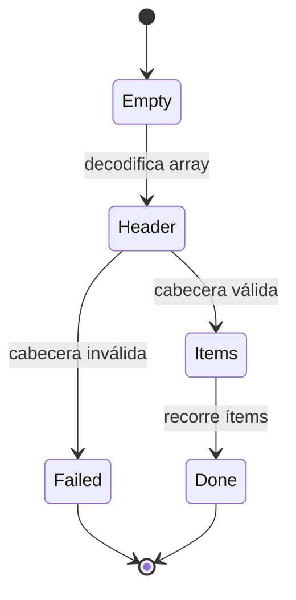

# CMP-36 — Importable Catalog

---

spec_id: CMP-36
spec_type: CMP
layer: backend
name: Importable Catalog
target: lib/features/catalog/domain/importable_catalog.dart
block: catalog
status: APPROVED
version: 1.0
owner: Catalog Team
last_reviewed: 2026-10-27
approved_at: 2026-10-27
approved_by: Product Owner
supersedes: []
superseded_by: []
user_story: user_story.md
processes: [PRC-07]
depends_on: [CMP-01]
consumed_by: [PRC-07]
---

`CMP-36` · `v1.0` · `catalog` · `Dart` · `APPROVED`

| 🧩 Tipo | 🚦 Estado | 🧭 Feature | 🎯 Target |
|---|---|---|---|
| `CMP` | `DRAFT` | `catalog` | `lib/features/catalog/domain/importable_catalog.dart` |

> [!IMPORTANT]
> **Contrato del catálogo importable.** Define el formato que emite el generador externo, lo valida y lo transforma en `ChannelHeader` + `CatalogDocument` del dominio de FLIK.

> [!WARNING]
> **Fuera de alcance:** descarga HTTP, lectura de archivos, escritura en base de datos, cifrado, compresión y YAML.

> [!TIP]
> **Ruta de lectura:** §4 requisitos → §8 contratos → §10 trazabilidad.

### 🗺️ Mapa de lectura

| Bloque | Qué encontrarás |
|---|---|
| §1–§3 | Problema, alcance y actores |
| §4–§6 | Requisitos, reglas y errores |
| §7–§9 | UI, contratos y dependencias |
| §10–§12 | Trazabilidad, pruebas y BDD |
| §13–§15 | Cierre, decisiones y preguntas |

---

## 0. Protocolo de lectura y no invención

1. Leer `CMP-01`, `CMP-35`, `glossary.md` y `PRC-07`.
2. Implementar solo los `FR-*` y `CT-*` de esta spec.
3. No añadir campos al formato sin versionar `schema_version`.
4. Si falta un dato, registrarlo en §15 y detener la implementación.

---

## 1. Contexto y objetivo

### 1.1 Problema

El generador externo produce un array JSON con una cabecera de canal y 240 películas. `CMP-01` define el documento canónico interno, pero no el formato de intercambio. Sin un contrato explícito, cada importación inventaría campos.

### 1.2 Objetivo medible

Convertir el documento real de 241 elementos en un `ImportableCatalog` válido con 240 ítems aceptados y 0 descartados, en menos de 200 ms, sin red y sin acceso a disco.

### 1.3 No objetivos

- Decidir si el canal es nuevo o existente (`PRC-07`).
- Persistir nada.
- Descargar o leer el documento.

---

## 2. Alcance y límites

**Incluye:**

- Validación de la cabecera del canal.
- Validación y mapeo de ítems, variantes, idiomas, calidad e `info_hash`.
- Errores tipados con código y mensaje en español.
- Contadores de aceptados y descartados.

**Excluye:**

- Red, sistema de archivos y base de datos.
- Carátulas remotas: `poster_url` y `backdrop_url` se conservan como URI, no se descargan.
- Series: todo ítem importado es `CatalogKind.movie`.

**Invariantes de arquitectura aplicables:**

- `architecture_rules.md` §2.4: dominio puro, sin Flutter ni E/S.
- `FM-FLIK-012`: los magnets se validan antes de persistirse.
- `FM-FLIK-006`: el parseo de 855 KB no debe bloquear el isolate de UI.

---

## 3. Actores e historia de usuario

> **Como** capa de catálogo,
> **quiero** un parser determinista del formato de intercambio,
> **para** que un catálogo externo se convierta en datos válidos del dominio sin inventar contratos.

**Actores secundarios:** `PRC-07` (proceso), `CMP-03` (destino), `CMP-33` (canal resultante).

---

## 4. Requisitos funcionales

| ID | Requisito | Prioridad | Criterio de aceptación | Regla |
|---|---|---|---|---|
| `FR-01` | El documento es un array JSON con al menos dos elementos. | Must | `AC-01`: array válido | `BR-01` |
| `FR-02` | El elemento 0 es la cabecera y declara `type: "channel"`; si no, se rechaza el documento completo. | Must | `AC-02`: error `missingHeader` | `BR-02` |
| `FR-03` | La cabecera exige `schema_version` 1, `catalog_id`, `name`, `description` y `generated_at` no vacíos. | Must | `AC-03`: error `invalidHeader` | `BR-02` |
| `FR-04` | `catalog_id` cumple `^[a-z0-9]+(-[a-z0-9]+)*$` y es la identidad del catálogo. | Must | `AC-04`: error `invalidCatalogId` | `BR-03` |
| `FR-05` | `art` es opcional; si falta o no pertenece al enumerado, se asigna de forma determinista a partir de `catalog_id`. | Must | `AC-05`: cinco valores posibles | `BR-04` |
| `FR-06` | `language` es opcional (`es` por defecto) y solo admite `es` o `en`. | Should | `AC-06`: valor desconocido cae a `es` | `BR-05` |
| `FR-07` | `generated_at` es ISO-8601 en UTC; un valor inválido rechaza el documento. | Must | `AC-07`: error `invalidGeneratedAt` | `BR-02` |
| `FR-08` | Cada ítem requiere `imdb_id` o `tmdb_id`; sin ninguno se descarta y se cuenta. | Must | `AC-08`: `skippedCount` aumenta | `BR-06` |
| `FR-09` | El identificador del ítem es `<catalog_id>:<imdb_id>` o, en su defecto, `<catalog_id>:tmdb-<tmdb_id>`. | Must | `AC-09`: ids únicos y estables | `BR-03` |
| `FR-10` | El título se toma de `title_es` o `title_en` según `language`, con fallback al otro y, después, a `original_title`. | Must | `AC-10`: nunca vacío si hay algún título | `BR-07` |
| `FR-11` | La sinopsis se toma de `overview_es` u `overview_en` con el mismo criterio de fallback. | Must | `AC-11`: puede quedar nula | `BR-07` |
| `FR-12` | Se conservan `genres` en su idioma de origen, `year` y `vote_average` como `rating`. | Must | `AC-12`: mapeo directo | `BR-08` |
| `FR-13` | Cada entrada no nula de `streams` produce una variante; las nulas se ignoran. | Must | `AC-13`: 1..4 variantes por ítem | `BR-09` |
| `FR-14` | El idioma del stream define audio y subtítulos: `castellano`→`es`; `latino`→`es-419`; `ingles`→`en`; `vose`→`en` con subtítulos `es`. | Must | `AC-14`: idiomas correctos | `BR-10` |
| `FR-15` | La calidad se extrae de `stream.title` buscando `480p`, `720p`, `1080p` o `2160p`; sin coincidencia queda `unknown`. | Must | `AC-15`: calidad declarada | `BR-11` |
| `FR-16` | `info_hash` se normaliza a minúsculas y el magnet debe empezar por `magnet:?xt=urn:btih:`. | Must | `AC-16`: error `invalidMagnet` | `BR-12` |
| `FR-17` | Límites: 20 MiB de documento, 20 000 ítems y 50 variantes por ítem. | Must | `AC-17`: error `documentTooLarge` | `BR-13` |
| `FR-18` | Los errores son tipados con código; un ítem inválido no invalida el documento. | Must | `AC-18`: `CatalogImportFailure` | `BR-14` |
| `FR-19` | El resultado expone los contadores de aceptados y descartados. | Must | `AC-19`: `acceptCount + skippedCount == elementos - 1` | `BR-14` |
| `FR-20` | El módulo no importa Flutter, E/S, HTTP ni base de datos. | Must | `AC-20`: revisión de imports | `INV-02` |

---

## 5. Reglas de negocio e invariantes

| ID | Regla / invariante | Fuente canónica | Verificación |
|---|---|---|---|
| `BR-01` | El formato de intercambio es JSON. YAML no se admite. | `CMP-01` BR-01 | `TC-01` |
| `BR-02` | La cabecera es obligatoria, única y la primera. | `PRC-07` | `TC-02` |
| `BR-03` | Los identificadores se derivan de ids externos, nunca del orden de aparición. | `CMP-36` | `TC-03` |
| `BR-04` | El arte se persiste: si no viene declarado, se asigna una vez y se guarda. | `04-components.md` §4.8 | `TC-04` |
| `BR-05` | El idioma solo afecta a qué texto se elige; no se traduce nada en runtime. | `01-foundations.md` §11 | `TC-05` |
| `BR-06` | Un ítem sin identificador externo no se puede actualizar ni borrar en un diff futuro. | `PRC-07` | `TC-06` |
| `BR-07` | Nunca se inventan textos: si falta el idioma preferido se usa el otro; si faltan ambos, el original. | `CMP-36` | `TC-07` |
| `BR-08` | Los géneros se conservan en su idioma de origen; el mapeo a vocabulario interno ocurre en la consulta. | `05-pages.md` §4 | `TC-08` |
| `BR-09` | `seeders`, `score` e `indexer` no se persisten: son datos volátiles del indexador. | `CMP-03` | `TC-09` |
| `BR-10` | VOSE es audio original con subtítulos en español. | `CMP-36` | `TC-10` |
| `BR-11` | La calidad es orientativa; `unknown` sigue siendo reproducible. | `CMP-01` FR-10 | `TC-11` |
| `BR-12` | El `info_hash` es la clave real de reproducción; si no es válido, la variante se descarta. | `FM-FLIK-012` | `TC-12` |
| `BR-13` | Los límites protegen memoria y almacenamiento en TV. | `architecture_rules.md` §6 | `TC-13` |
| `BR-14` | Un documento con cabecera válida y algún ítem inválido se acepta, informando de los descartes. | `CMP-36` | `TC-14` |
| `INV-01` | `catalog_id` es la identidad del catálogo entre importaciones. | `PRC-07` | `TC-03` |
| `INV-02` | Cero red, cero E/S y cero telemetría en este módulo. | `architecture_rules.md` §4.9 | `TC-15` |

---

## 6. Estados, comportamiento y errores

### 6.1 Flujo del parser



### 6.2 Tabla de estados

| Estado | Entrada | Salida | Efecto observable |
|---|---|---|---|
| `Empty` | Documento vacío o no JSON | — | `CatalogImportFailure` |
| `Header` | Array decodificado | Cabecera leída | Se valida `schema_version` y campos |
| `Items` | Cabecera válida | Recorrido | Se mapea cada ítem o se cuenta como descartado |
| `Done` | Recorrido completo | `ImportableCatalog` | Contadores disponibles |

### 6.3 Errores y casos borde

| Código | Condición | Resultado | Recuperable |
|---|---|---|---|
| `notJson` | El texto no decodifica | Rechazo del documento | Sí (otro archivo) |
| `notArray` | La raíz no es un array | Rechazo | Sí |
| `documentTooLarge` | Supera 20 MiB | Rechazo sin decodificar | Sí |
| `itemLimitExceeded` | Más de 20 000 ítems | Rechazo | No |
| `missingHeader` | El elemento 0 no es la cabecera | Rechazo | Sí |
| `invalidHeader` | Falta un campo obligatorio | Rechazo | Sí |
| `invalidCatalogId` | No cumple kebab-case | Rechazo | Sí |
| `unsupportedSchemaVersion` | `schema_version` distinta de 1 | Rechazo | Sí |
| `invalidGeneratedAt` | Fecha no ISO-8601 | Rechazo | Sí |
| `invalidMagnet` | Magnet sin `btih` | Se descarta **la variante**, no el ítem | Sí |

---

## 7. UX/UI y foco

No aplica: componente de capa `backend` sin presentación. Los mensajes de error los presenta `CMP-37`.

---

## 8. Contratos de datos (`CT-*`)

### 8.1 Modelos e interfaces

```dart
// Ruta canónica: lib/features/catalog/domain/importable_catalog.dart
// Spec: CMP-36 / FR-01 .. FR-20

/// Cabecera del catálogo: describe el canal que se va a crear o actualizar.
/// Spec: CMP-36 / FR-02 .. FR-07
final class ChannelHeader {
  const ChannelHeader({
    required this.catalogId,
    required this.name,
    required this.description,
    required this.art,
    required this.language,
    required this.generatedAt,
    this.coverUri,
  });

  final String catalogId;
  final String name;
  final String description;
  final ChannelArt art;
  final String language;
  final DateTime generatedAt;
  final Uri? coverUri;
}

/// Resultado completo de una importación.
/// Spec: CMP-36 / FR-18, FR-19
final class ImportableCatalog {
  const ImportableCatalog({
    required this.channel,
    required this.document,
    required this.skippedCount,
  });

  final ChannelHeader channel;
  final CatalogDocument document;
  final int skippedCount;

  int get acceptCount => document.items.length;
}

/// Motivos de rechazo de un documento.
/// Spec: CMP-36 / §6.3
enum CatalogImportErrorCode {
  notJson,
  notArray,
  documentTooLarge,
  itemLimitExceeded,
  missingHeader,
  invalidHeader,
  invalidCatalogId,
  unsupportedSchemaVersion,
  invalidGeneratedAt,
}

/// Error tipado de importación.
/// Spec: CMP-36 / FR-18
final class CatalogImportFailure implements Exception {
  const CatalogImportFailure({
    required this.code,
    required this.message,
    this.cause,
  });

  final CatalogImportErrorCode code;
  final String message;
  final Object? cause;
}

/// Parser determinista del formato de intercambio.
/// Spec: CMP-36 / FR-01 .. FR-20
abstract interface class ImportableCatalogParser {
  ImportableCatalog parseBytes(List<int> bytes);
}

/// Implementación basada en `dart:convert`.
/// Spec: CMP-36 / FR-01 .. FR-20
final class JsonImportableCatalogParser implements ImportableCatalogParser {
  const JsonImportableCatalogParser();
}
```

### 8.2 Tabla de campos

| Campo | Tipo | Obligatorio | Restricción | Origen |
|---|---|---|---|---|
| `catalogId` | `String` | Sí | kebab-case | `catalog_id` |
| `name` | `String` | Sí | 1–60 caracteres | `name` |
| `description` | `String` | Sí | 1–140 caracteres | `description` |
| `art` | `ChannelArt` | Sí (resuelto) | Declarado o determinista | `art` |
| `language` | `String` | Sí | `es` o `en` | `language` |
| `generatedAt` | `DateTime` | Sí | UTC | `generated_at` |
| `coverUri` | `Uri?` | No | Solo `asset:` se pinta | `cover` |

### 8.3 Contratos expuestos

| ID | Símbolo público | Entrada | Salida | Errores |
|---|---|---|---|---|
| `CT-01` | `ChannelHeader` | — | Inmutable | — |
| `CT-02` | `ImportableCatalog` | — | Inmutable con contadores | — |
| `CT-03` | `ImportableCatalogParser.parseBytes` | `List<int>` | `ImportableCatalog` | `CatalogImportFailure` |
| `CT-04` | `CatalogImportErrorCode` | — | Enumerado | — |
| `CT-05` | constantes `kImportMaxDocumentBytes`, `kImportMaxItems`, `kImportMaxVariantsPerItem`, `kImportSchemaVersion` | — | `int` | — |

---

## 9. Interfaces y dependencias

### 9.1 Dependencias permitidas

- `dart:convert`.
- Tipos de `CMP-01` (`CatalogDocument`, `MovieItem`, `MediaVariant`, `CatalogKind`, `CatalogQuality`).
- `ChannelArt` de `CMP-35`.

### 9.2 Dependencias prohibidas

- Flutter, `dart:io`, `dart:html`, HTTP, base de datos y `media_kit`.
- Importar `tv_experience`, `player` o `p2p_engine`.
- Telemetría o registro remoto.

### 9.3 Ciclo de vida

- **Creación:** instancia `const`, sin estado.
- **Suscripción:** ninguna.
- **Cancelación:** no aplica; el parseo es síncrono y acotado por límites.
- **Destrucción:** sin recursos.

---

## 10. Mapa de implementación y trazabilidad

| Requisito | Contrato | Implementación (archivo::símbolo) | Test | Estado |
|---|---|---|---|---|
| `FR-01` | `CT-03` | `.../importable_catalog.dart::JsonImportableCatalogParser.parseBytes` | `TC-01` | Verified |
| `FR-02` | `CT-03` | `.../importable_catalog.dart::_parseHeader` | `TC-02` | Verified |
| `FR-03` | `CT-01` | `.../importable_catalog.dart::_parseHeader` | `TC-02` | Verified |
| `FR-04` | `CT-01` | `.../importable_catalog.dart::_parseHeader` | `TC-03` | Verified |
| `FR-05` | `CT-01` | `.../importable_catalog.dart::_resolveArt` | `TC-04` | Verified |
| `FR-06` | `CT-01` | `.../importable_catalog.dart::_parseHeader` | `TC-05` | Verified |
| `FR-07` | `CT-01` | `.../importable_catalog.dart::_parseHeader` | `TC-02` | Verified |
| `FR-08` | `CT-03` | `.../importable_catalog.dart::_parseItem` | `TC-06` | Verified |
| `FR-09` | `CT-03` | `.../importable_catalog.dart::_itemId` | `TC-03` | Verified |
| `FR-10` | `CT-03` | `.../importable_catalog.dart::_localizedTitle` | `TC-07` | Verified |
| `FR-11` | `CT-03` | `.../importable_catalog.dart::_localizedOverview` | `TC-07` | Verified |
| `FR-12` | `CT-03` | `.../importable_catalog.dart::_parseItem` | `TC-08` | Verified |
| `FR-13` | `CT-03` | `.../importable_catalog.dart::_parseVariants` | `TC-09` | Verified |
| `FR-14` | `CT-03` | `.../importable_catalog.dart::_languageOf` | `TC-10` | Verified |
| `FR-15` | `CT-03` | `.../importable_catalog.dart::qualityFromTitle` | `TC-11` | Verified |
| `FR-16` | `CT-03` | `.../importable_catalog.dart::_parseVariants` | `TC-12` | Verified |
| `FR-17` | `CT-05` | `.../importable_catalog.dart::kImportMaxDocumentBytes` | `TC-13` | Verified |
| `FR-18` | `CT-04` | `.../importable_catalog.dart::CatalogImportFailure` | `TC-02` | Verified |
| `FR-19` | `CT-02` | `.../importable_catalog.dart::ImportableCatalog` | `TC-14` | Verified |
| `FR-20` | — | `.../importable_catalog.dart` (imports) | `TC-15` | Verified |

**Estados:** `Pending`, `Implemented`, `Verified`.

---

## 11. Plan de pruebas

| ID | Tipo | Qué verifica | Entrada | Criterio |
|---|---|---|---|---|
| `TC-01` | Unit | `FR-01` | Array de 2 elementos | Parsea sin error |
| `TC-02` | Unit | `FR-02`, `FR-03`, `FR-07`, `FR-18` | Cabecera ausente o incompleta | Fallo con el código correcto |
| `TC-03` | Unit | `FR-04`, `FR-09`, `INV-01` | Dos catálogos distintos | Ids únicos y estables |
| `TC-04` | Unit | `FR-05` | Sin `art` y con `art` inválido | Arte determinista dentro del enumerado |
| `TC-05` | Unit | `FR-06` | `language: "fr"` | Cae a `es` |
| `TC-06` | Unit | `FR-08` | Ítem sin ids | Se descarta y se cuenta |
| `TC-07` | Unit | `FR-10`, `FR-11` | Solo `title_en` con `language: es` | Usa el inglés |
| `TC-08` | Unit | `FR-12` | Géneros y nota | Se conservan tal cual |
| `TC-09` | Unit | `FR-13` | `streams` con nulos | Solo variantes no nulas |
| `TC-10` | Unit | `FR-14` | Los cuatro idiomas | `es`, `es-419`, `en`, `en`+subs `es` |
| `TC-11` | Unit | `FR-15` | Títulos con 720p, 1080p y sin calidad | `720p`, `1080p`, `unknown` |
| `TC-12` | Unit | `FR-16` | Hash en mayúsculas y magnet inválido | Normaliza; descarta la variante |
| `TC-13` | Unit | `FR-17` | 20 MiB + 1 byte | `documentTooLarge` |
| `TC-14` | Unit | `FR-19` | Documento con 2 ítems y 1 descarte | `acceptCount == 2`, `skippedCount == 1` |
| `TC-15` | Unit | `FR-20`, `INV-02` | Fuente del módulo | Sin Flutter, E/S ni red |

**Comandos:** `flutter analyze`; `flutter test test/features/catalog/importable_catalog_test.dart`.

**Prohibido:** fixtures generados aleatoriamente en el test; se usa una copia reducida del catálogo real en `.ai-harness/fixtures/`.

---

## 12. Criterios de aceptación BDD

```gherkin
@FR-02
Scenario: Importar el catálogo del generador
  Given un documento con cabecera catalog_id "todo-cine" y 240 películas
  When se parsea el documento
  Then el resultado declara el canal "Todo cine"
  And acepta 240 ítems
  And no descarta ninguno
```

```gherkin
@FR-02
Scenario: Documento sin cabecera
  Given un array cuya primera posición es una película
  When se parsea el documento
  Then falla con el código missingHeader
  And no se produce ningún catalog document
```

```gherkin
@FR-08
Scenario: Película sin identificador externo
  Given un documento válido con una película sin imdb_id ni tmdb_id
  When se parsea el documento
  Then la importación continúa
  And skippedCount vale 1
```

---

## 13. Definition of Done

- [ ] Todos los `FR-*` tienen `AC-*`, `TC-*` y entrada en §10.
- [ ] `CT-01`..`CT-05` implementados y exportados por `catalog.dart`.
- [ ] Los símbolos públicos llevan comentario `/// Spec: CMP-36 / FR-...`.
- [ ] `flutter analyze` y `flutter test` pasan.
- [ ] Sin Flutter, E/S ni red en el módulo.
- [ ] El catálogo demo real se parsea sin descartes.
- [ ] §15 sin preguntas bloqueantes.

---

## 14. Decisiones y cambios

| Fecha | Decisión | Motivo | Impacto | Aprobado por |
|---|---|---|---|---|
| 2026-10-27 | La cabecera es el elemento 0 con `type: "channel"` | Evita depender de la posición y autodocumenta el archivo | `FR-02` | Product Owner |
| 2026-10-27 | `catalog_id` es la identidad del catálogo | Permite distinguir alta de actualización sin mirar la ruta | `FR-04`, `INV-01` | Product Owner |
| 2026-10-27 | JSON único; YAML rechazado | Sin parser YAML en runtime y contrato interno JSON | `BR-01` | Product Owner |
| 2026-10-27 | Arte determinista = suma de puntos de código de `catalog_id` módulo 5 | Estable entre ejecuciones y plataformas; `hashCode` no lo garantiza | `FR-05` | Arquitectura |
| 2026-10-27 | Un ítem sin id externo se descarta en vez de rechazar el documento | Un catálogo de 240 no debe caerse por uno malo | `FR-08` | Product Owner |
| 2026-10-27 | `seeders`, `score` e `indexer` no se persisten | Son datos del indexador y cambian sin que cambie el catálogo | `BR-09` | Arquitectura |

---

## 15. Preguntas abiertas

| ID | Pregunta | Bloqueante | Responsable | Respuesta |
|---|---|---|---|---|
| `Q-01` | ¿El generador puede emitir géneros en el vocabulario interno (`sci-fi`) en vez de español? | No | Producto | Se mapea en consulta mientras no cambie |
| `Q-02` | ¿Se admitirán series en el formato? | No | Producto | v1 solo películas |
| `Q-03` | ¿Se descargan `poster_url` y `backdrop_url`? | No | Producto | Diferido a la fase de carátulas |

---

## Historial de cambios

| Versión | Fecha | Tipo | Cambio | Aprobado por |
|---|---|---|---|---|
| 1.0 | 2026-10-27 | Inicial | Contrato de importación, mapeo y errores tipados | Pendiente |


