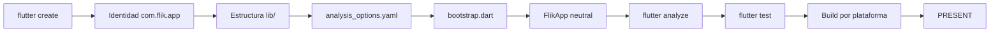
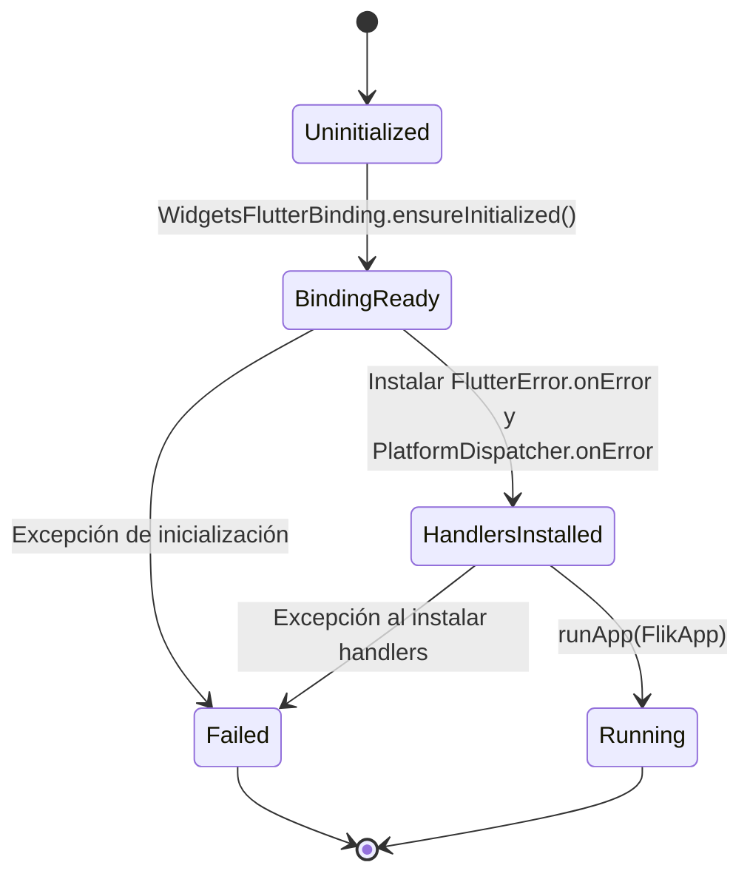

# 🚀 CMP-00 — App Bootstrap

`CMP-00` · `DRAFT` · `v1.0` · `Flutter` · `app`

| 🧩 Tipo | 🚦 Estado | 🧭 Bloque | 🎯 Target |
|---|---|---|---|
| `CMP` | `DRAFT` | `app` | `lib/app/bootstrap/bootstrap.dart` |

> [!IMPORTANT]
> Esta spec crea **infraestructura**, no producto. No implementa catálogo, parser, P2P, reproductor, almacenamiento ni interfaz de TV. Su único objetivo es dejar un proyecto Flutter compilable, analizable y testeable para que las specs de features puedan ejecutarse.

| Dato | Valor |
|---|---|
| **ID** | `CMP-00` |
| **Tipo** | Componente de infraestructura |
| **Bloque** | `app` |
| **Estado** | `DRAFT` |
| **Versión** | `1.0` |
| **Target** | `lib/app/bootstrap/bootstrap.dart` |
| **Historia** | [`user_story.md`](user_story.md) |
| **Depende de** | — |
| **Consumida por** | `CMP-01`, `CMP-02`, `CMP-*`, `PRC-*` |

> [!WARNING]
> **No se implementa hasta que el estado sea `APPROVED`.** El target todavía no existe; es lo esperado en `DRAFT`.
>
> **No se añaden dependencias de features.** `media_kit`, Hive, SQLite, cliente HTTP, motor P2P o cualquier paquete de producto quedan prohibidos en esta spec.

---

## 🗺️ Mapa de lectura

| Si buscas… | Ve a… |
|---|---|
| El problema y el resultado esperado | §1 |
| Qué entra y qué no | §2 |
| La historia y su trazabilidad | §3 |
| Los requisitos verificables | §4 |
| Las reglas que no se pueden romper | §5 |
| El arranque y sus errores | §6 |
| La shell neutral | §7 |
| Los contratos Dart | §8 |
| Dependencias permitidas | §9 |
| Trazabilidad y pruebas | §10, §11, §12 |
| Cierre y decisiones | §13, §14, §15 |



---

## 🧭 0. Protocolo de lectura y no invención

1. Leer `AGENTS.md` y el contexto JIT completo antes de tocar código.
2. Leer los scopes `block_app_core.md` y `block_ui_navigation_engine.md`.
3. Leer la historia de usuario y esta spec completas.
4. No inventar identificadores, plataformas, dependencias ni comandos.
5. Si una decisión falta, registrar `Q-NN` y detenerse.
6. No implementar fuera de las rutas autorizadas en §2.3.

---

## 🎯 1. Contexto y objetivo

FLIK todavía no es un proyecto Flutter ejecutable. El arnés, las specs y los fixtures existen, pero no hay `pubspec.yaml`, `lib/`, `test/` ni configuración de análisis.

Ese vacío impide implementar `CMP-01`, cuyo target es `lib/features/catalog/domain/catalog_contract.dart`.

### Objetivo medible

Al terminar esta spec debe ser posible ejecutar, sin pasos manuales adicionales:

```bash
flutter pub get
flutter analyze
flutter test
```

Y debe existir una app que arranque con una shell vacía en Android, Windows, macOS y Linux.

### Resultado observable

```text
$ flutter analyze
No issues found!

$ flutter test
All tests passed!
```

> [!TIP]
> El bootstrap no tiene que “hacer” nada visible. Tiene que ser una base correcta, pequeña y fácil de reemplazar por la UI real.


---

## 📐 2. Alcance y límites

### 2.1 Incluido

- Proyecto Flutter con nombre de paquete `flik`.
- Identificador de aplicación `com.flik.app`.
- Plataformas Android, Windows, macOS y Linux.
- `pubspec.yaml` mínimo.
- `analysis_options.yaml` con lints estrictos.
- Estructura de carpetas para `app`, `core` y features.
- `lib/main.dart` como entrypoint delgado.
- `lib/app/bootstrap/bootstrap.dart` con la inicialización.
- `lib/app/flik_app.dart` con una shell neutral.
- Test de arranque y de configuración.
- Comandos de verificación documentados.

### 2.2 Excluido

- iOS y web.
- Catálogo, modelos de catálogo y parser JSON.
- Motor P2P, magnets, `info_hash`, `file_index`.
- Reproductor, `media_kit`, códecs o ventanas de vídeo.
- Base de datos, Hive, SQLite, SharedPreferences.
- Cliente HTTP, descargas o sincronización.
- Navegación de TV, D-Pad, foco, pantallas o temas.
- Backend, proxy, CDN, analítica o telemetría.
- Internacionalización.
- Iconos, splash o branding visual.
- CI/CD.

### 2.3 Rutas autorizadas

| Ruta | Uso |
|---|---|
| `pubspec.yaml` | Nombre, versión, SDK y dependencias mínimas. |
| `analysis_options.yaml` | Reglas de análisis. |
| `lib/main.dart` | Entrypoint. |
| `lib/app/**` | Bootstrap y shell neutral. |
| `lib/core/**` | Solo carpetas/base mínima; sin lógica de producto. |
| `lib/features/**` | Solo estructura de carpetas; sin lógica. |
| `test/**` | Tests del bootstrap. |
| `integration_test/**` | Carpeta preparada; sin pruebas de producto. |
| `android/**` | Identidad y configuración mínima. |
| `windows/**` | Configuración mínima. |
| `macos/**` | Identidad y configuración mínima. |
| `linux/**` | Identidad y configuración mínima. |

> [!CAUTION]
> Esta spec cruza dos scopes: `block_app_core` (configuración y `lib/core`) y `block_ui_navigation_engine` (`lib/app`). Es una excepción de infraestructura aprobada por esta spec; no autoriza lógica de UI ni de navegación.

---

## 👤 3. Actores e historia de usuario

| Actor | Interacción |
|---|---|
| Desarrollador | Ejecuta `flutter run`, `flutter analyze` y `flutter test`. |
| CI | Ejecuta los mismos comandos de forma no interactiva. |
| Specs de features | Aterrizan en `lib/features/*` sin tocar el bootstrap. |

> **Brief de producto:** [`user_story.md`](user_story.md). La historia explica el *por qué*; esta spec fija el *qué* verificable.

### 🔗 Trazabilidad de negocio

| Historia | Requisitos |
|---|---|
| `US-01` | `FR-01`, `FR-09` |
| `US-02` | `FR-02`, `FR-08` |
| `US-03` | `FR-03` |
| `US-04` | `FR-06`, `FR-07` |
| `US-05` | `FR-05`, `FR-10` |
| `US-06` | `FR-11`, `FR-12` |

---

## ✅ 4. Requisitos funcionales

| ID | Requisito | Prioridad | Aceptación |
|---|---|---|---|
| `FR-01` | Crear un proyecto Flutter con nombre de paquete `flik`, versión `0.1.0` y SDK compatible con Flutter estable. | Must | `pubspec.yaml` válido; `flutter pub get` termina sin errores. |
| `FR-02` | Soportar Android, Windows, macOS y Linux. No generar iOS ni web. | Must | Existen `android/`, `windows/`, `macos/` y `linux/`; no existen `ios/` ni `web/`. |
| `FR-03` | Crear la estructura `lib/app`, `lib/core`, `lib/features/{catalog,player,p2p_engine,tv_experience}`, `test/` e `integration_test/`. | Must | Las carpetas existen y las features solo contienen estructura, no lógica. |
| `FR-04` | Configurar `analysis_options.yaml` con `flutter_lints` y reglas adicionales de seguridad y estilo. | Must | `flutter analyze` no reporta issues. |
| `FR-05` | Mantener dependencias mínimas: `flutter`, `flutter_test` y `flutter_lints`. | Must | `pubspec.yaml` no contiene paquetes de producto. |
| `FR-06` | Implementar `bootstrap()` con inicialización de binding, instalación de manejadores de error y retorno de configuración. | Must | `TC-06` pasa; no hay inicialización pesada ni red. |
| `FR-07` | Implementar `FlikApp` como shell neutral sin tema, sin pantallas y sin lógica de producto. | Must | `TC-07` pasa; la shell no contiene `Scaffold`, `AppBar`, navegación ni datos. |
| `FR-08` | Fijar la identidad `com.flik.app` en Android, macOS y Linux; nombre visible `FLIK`. | Must | Los archivos de plataforma contienen el identificador y el nombre. |
| `FR-09` | Documentar y permitir `flutter analyze`, `flutter test` y builds de plataforma. | Must | `TC-01`…`TC-05` ejecutables en el host correspondiente. |
| `FR-10` | Prohibir red, P2P, base de datos, reproductor, analítica y backend en el bootstrap. | Must | `TC-08` verifica dependencias y ausencia de APIs prohibidas. |
| `FR-11` | Reemplazar la app contador por defecto de Flutter por una shell vacía de FLIK. | Must | No existe el contador ni el texto “Flutter Demo”. |
| `FR-12` | No implementar ningún requisito de `CMP-01` ni de specs posteriores. | Must | No existen modelos de catálogo ni lógica de features. |

---

## ⚖️ 5. Reglas de negocio e invariantes

| ID | Regla | Verificación |
|---|---|---|
| `BR-01` | El paquete Dart se llama `flik`; el identificador de aplicación es `com.flik.app`. | `TC-08` |
| `BR-02` | Las únicas plataformas son Android, Windows, macOS y Linux. | `TC-02` |
| `BR-03` | iOS y web no se generan ni se configuran. | `TC-02` |
| `BR-04` | El bootstrap no añade dependencias de features. | `TC-08` |
| `BR-05` | `lib/main.dart` solo inicializa y arranca; la lógica vive en `lib/app/bootstrap/bootstrap.dart`. | `TC-06` |
| `BR-06` | La shell no define tema, colores, tipografía ni pantallas. | `TC-07` |
| `BR-07` | La shell no realiza red, disco, P2P, reproducción ni telemetría. | `TC-07`, `TC-08` |
| `BR-08` | Las features se crean como carpetas vacías o con `.gitkeep`; no contienen código. | `TC-02` |
| `INV-01` | FLIK es 100 % client-side; el bootstrap no contacta ningún servidor. | `TC-07` |
| `INV-02` | Ningún archivo de `CMP-01` se crea en esta spec. | `TC-08` |
| `INV-03` | La configuración de plataforma usa `com.flik.app`, no el identificador generado por defecto. | `TC-08` |

> [!IMPORTANT]
> El bootstrap no es una excusa para introducir “temporalmente” dependencias de producto. Una dependencia temporal se convierte en deuda permanente y rompe la trazabilidad SDD.


---

## 🔄 6. Estados, comportamiento y errores

### 6.1 Secuencia de arranque



### 6.2 Reglas de comportamiento

| ID | Regla |
|---|---|
| `BR-09` | `bootstrap()` es idempotente en la práctica: no abre recursos, no escribe en disco y no realiza red. |
| `BR-10` | Si falla la inicialización, no se llama a `runApp` y el error se reporta por el canal de Flutter. |
| `BR-11` | No hay reintentos automáticos, backoff ni fallback remoto. |
| `BR-12` | No se usa telemetría, analítica ni registro remoto para reportar el fallo. |

### 6.3 Errores

| Código | Cuándo ocurre | Resultado |
|---|---|---|
| `bindingInitializationFailed` | El binding de Flutter no puede inicializarse. | `BootstrapFailure`; no se arranca la shell. |
| `errorHandlerInstallFailed` | No se pueden instalar los manejadores globales. | `BootstrapFailure`; no se arranca la shell. |

> [!NOTE]
> En el bootstrap no existe una pantalla de error. El fallo se reporta con `FlutterError.reportError` y la app no continúa. La UI de error, si existe, pertenece a una spec de experiencia de TV.

---

## 🎨 7. UX/UI y foco

**No aplica en esta spec.**

La shell es deliberadamente neutral:

- `MaterialApp` se usa solo como host de widgets y navegación.
- No se define `theme`, `darkTheme`, `colorScheme`, tipografía ni tokens.
- No hay `Scaffold`, `AppBar`, `NavigationBar`, `Drawer` ni pantallas.
- El contenido es `const SizedBox.shrink()`.
- No hay foco, D-Pad ni navegación.
- La ventana puede aparecer vacía; es el resultado esperado.

> [!WARNING]
> Cualquier color, tipografía o pantalla que se añada aquí invadiría `ui-design-system.md` y las specs `CMP-*`. El bootstrap no toma decisiones visuales.

---

## 🔌 8. Contratos de datos (`CT-*`)

### 8.1 `AppBootstrapConfig` — `CT-01`

```dart
final class AppBootstrapConfig {
  const AppBootstrapConfig({
    required this.appName,
    required this.packageId,
  });

  final String appName;
  final String packageId;

  static const AppBootstrapConfig flik = AppBootstrapConfig(
    appName: 'FLIK',
    packageId: 'com.flik.app',
  );
}
```

| Campo | Tipo | Regla |
|---|---|---|
| `appName` | `String` | Debe ser `FLIK`. |
| `packageId` | `String` | Debe ser `com.flik.app`. |

### 8.2 `BootstrapFailure` — `CT-02`

```dart
enum BootstrapFailureCode {
  bindingInitializationFailed,
  errorHandlerInstallFailed,
}

final class BootstrapFailure implements Exception {
  const BootstrapFailure({
    required this.code,
    required this.message,
    this.cause,
  });

  final BootstrapFailureCode code;
  final String message;
  final Object? cause;

  @override
  String toString() => 'BootstrapFailure($code): $message';
}
```

### 8.3 `bootstrap()` — `CT-03`

```dart
Future<AppBootstrapConfig> bootstrap() async {
  try {
    WidgetsFlutterBinding.ensureInitialized();
  } catch (error) {
    throw BootstrapFailure(
      code: BootstrapFailureCode.bindingInitializationFailed,
      message: 'No se pudo inicializar el binding de Flutter.',
      cause: error,
    );
  }

  try {
    FlutterError.onError = FlutterError.presentError;
    PlatformDispatcher.instance.onError = (error, stack) {
      FlutterError.reportError(
        FlutterErrorDetails(exception: error, stack: stack),
      );
      return true;
    };
  } catch (error) {
    throw BootstrapFailure(
      code: BootstrapFailureCode.errorHandlerInstallFailed,
      message: 'No se pudieron instalar los manejadores de error.',
      cause: error,
    );
  }

  return AppBootstrapConfig.flik;
}
```

Contrato:

1. Llama a `WidgetsFlutterBinding.ensureInitialized()`.
2. Instala `FlutterError.onError = FlutterError.presentError`.
3. Instala `PlatformDispatcher.instance.onError` para errores no capturados.
4. Devuelve `AppBootstrapConfig.flik`.
5. No abre red, disco, base de datos ni P2P.
6. Si falla, lanza `BootstrapFailure`.

### 8.4 `FlikApp` — `CT-04`

```dart
final class FlikApp extends StatelessWidget {
  const FlikApp({super.key, required this.config});

  final AppBootstrapConfig config;

  @override
  Widget build(BuildContext context) {
    return MaterialApp(
      title: config.appName,
      debugShowCheckedModeBanner: false,
      home: const SizedBox.shrink(),
    );
  }
}
```

Contrato:

- `MaterialApp` es solo el host; no se personaliza el tema.
- `home` es una shell vacía.
- No hay lógica de producto.
- No hay acceso a red, disco, P2P ni reproducción.

### 8.5 `main()` — `CT-05`

```dart
Future<void> main() async {
  final config = await bootstrap();
  runApp(FlikApp(config: config));
}
```

`main.dart` no contiene lógica adicional. Cualquier inicialización futura debe pasar por `bootstrap()` o por una spec posterior.

---

## 🧱 9. Interfaces y dependencias

### 9.1 Dependencias permitidas

| Dependencia | Tipo | Motivo |
|---|---|---|
| `flutter` | SDK | Framework de la aplicación. |
| `flutter_test` | dev | Tests de widgets y unidad. |
| `flutter_lints` | dev | Reglas de análisis. |

### 9.2 Dependencias prohibidas

| Dependencia | Motivo |
|---|---|
| `media_kit`, `video_player`, `chewie` | Pertenecen a `CMP-*` del player. |
| `hive`, `sqflite`, `shared_preferences` | Persistencia no especificada aún. |
| `http`, `dio`, `web_socket_channel` | Red y sincronización no especificadas aún. |
| Cualquier paquete P2P o de torrents | Dominio del motor P2P. |
| Cualquier SDK de analítica, ads o telemetría | Prohibido por privacidad. |

### 9.3 Identidad por plataforma

| Plataforma | Identificador | Archivo de referencia |
|---|---|---|
| Dart | `flik` | `pubspec.yaml` |
| Android | `com.flik.app` | `android/app/build.gradle.kts` |
| macOS | `com.flik.app` | `macos/Runner/Configs/AppInfo.xcconfig` |
| Linux | `com.flik.app` | `linux/CMakeLists.txt` |
| Windows | `flik.exe` | `windows/runner/` |
| iOS | No aplica | Excluido |
| Web | No aplica | Excluido |

### 9.4 Dirección de dependencias

```text
main.dart
  └── app/bootstrap/bootstrap.dart
        └── app/flik_app.dart
              └── (futuras specs de UI)
```

`bootstrap.dart` no importa `lib/features/*`. `FlikApp` no importa `lib/features/*`. Las features futuras podrán importar `lib/core/*`, nunca al revés.

---

## 🗺️ 10. Mapa de implementación y trazabilidad

| Requisito | Contrato | Implementación (archivo::símbolo) | Test | Estado |
|---|---|---|---|---|
| `FR-01` | `CT-01` | `pubspec.yaml::name` | `TC-01` | Verified |
| `FR-02` | — | `android/`, `windows/`, `macos/`, `linux/` | `TC-02` | Implemented |
| `FR-03` | — | `lib/app/`, `lib/core/`, `lib/features/*` | `TC-02` | Verified |
| `FR-04` | — | `analysis_options.yaml::analyzer` | `TC-01` | Verified |
| `FR-05` | — | `pubspec.yaml::dependencies` | `TC-08` | Verified |
| `FR-06` | `CT-03` | `lib/app/bootstrap/bootstrap.dart::bootstrap` | `TC-06` | Verified |
| `FR-07` | `CT-04` | `lib/app/flik_app.dart::FlikApp` | `TC-07` | Verified |
| `FR-08` | `CT-01` | `android/app/build.gradle.kts::applicationId`, `macos/Runner/Configs/AppInfo.xcconfig::PRODUCT_BUNDLE_IDENTIFIER`, `linux/CMakeLists.txt::APPLICATION_ID` | `TC-08` | Verified |
| `FR-09` | `CT-05` | `lib/main.dart::main` | `TC-01`…`TC-05` | Implemented; Windows/macOS/Linux builds pendientes |
| `FR-10` | — | `pubspec.yaml` sin dependencias de producto | `TC-08` | Verified |
| `FR-11` | `CT-04` | `lib/app/flik_app.dart::FlikApp` | `TC-07` | Verified |
| `FR-12` | — | Ausencia de `lib/features/catalog/domain` con lógica | `TC-08` | Verified |


---

## 🧪 11. Plan de pruebas

### 11.1 Tests automatizados

| ID | Tipo | Qué verifica | Archivo |
|---|---|---|---|
| `TC-01` | Comando | `flutter analyze` sin issues. | — |
| `TC-02` | Estructura | Carpetas de plataforma y features; ausencia de `ios/` y `web/`. | `test/architecture/bootstrap_guard_test.dart` |
| `TC-03` | Comando | `flutter test` en verde. | — |
| `TC-04` | Build | `flutter build apk --debug` en host con Android SDK. | — |
| `TC-05` | Build | Build de Windows/macOS/Linux en el host correspondiente. | — |
| `TC-06` | Unidad | `bootstrap()` devuelve `FLIK` y `com.flik.app`. | `test/app/bootstrap_test.dart` |
| `TC-07` | Widget | `FlikApp` construye una shell vacía sin excepciones. | `test/app/bootstrap_test.dart` |
| `TC-08` | Guardia | Solo dependencias permitidas; sin imports prohibidos en `lib/app`. | `test/architecture/bootstrap_guard_test.dart` |
| `TC-09` | Guardia | `lib/features` no contiene lógica Dart. | `test/architecture/bootstrap_guard_test.dart` |
| `TC-10` | Guardia | No existe el contador por defecto de Flutter ni “Flutter Demo”. | `test/architecture/bootstrap_guard_test.dart` |

### 11.2 Comandos

```bash
flutter pub get
flutter analyze
flutter test
flutter build apk --debug
flutter build windows --debug
```

> [!NOTE]
> Los builds de macOS y Linux solo pueden ejecutarse en sus respectivos hosts. En Windows se validan Android y Windows; macOS y Linux quedan como verificación pendiente del host correspondiente.

### 11.3 Matriz de plataformas

| Plataforma | Build local | Estado esperado |
|---|---|---|
| Android | `flutter build apk --debug` | Debe compilar. |
| Windows | `flutter build windows --debug` | Debe compilar. |
| macOS | `flutter build macos --debug` | Debe compilar en macOS. |
| Linux | `flutter build linux --debug` | Debe compilar en Linux. |

---

## 🥒 12. Criterios de aceptación BDD

```gherkin
Feature: Arranque mínimo de FLIK

  Scenario: La configuración de arranque es la identidad de FLIK
    Given el proyecto Flutter "flik"
    When ejecuto "bootstrap()"
    Then recibo "appName" igual a "FLIK"
    And recibo "packageId" igual a "com.flik.app"

  Scenario: La aplicación arranca con una shell neutral
    Given una configuración de arranque válida
    When construyo "FlikApp"
    Then no se lanza ninguna excepción
    And no existe "Scaffold"
    And no existe "AppBar"
    And el contenido es una shell vacía

  Scenario: El bootstrap no implementa producto
    Given el código de "lib/app"
    When reviso sus imports y dependencias
    Then no hay red, P2P, base de datos, reproductor ni analítica
    And no hay modelos de catálogo
```

---

## 🏁 13. Definition of Done

- [x] La spec está en `APPROVED`.
- [x] `flutter pub get` termina sin errores.
- [x] `flutter analyze` no reporta issues.
- [x] `flutter test` pasa completo.
- [x] `flutter build apk --debug` compila en el host con Android SDK.
- [ ] `flutter build windows --debug` compila en Windows.
- [x] Los builds de macOS y Linux quedan verificados en sus hosts o registrados como pendientes.
- [x] `lib/main.dart` es delgado y solo arranca.
- [x] `bootstrap()` devuelve la identidad `FLIK` / `com.flik.app`.
- [x] `FlikApp` es una shell neutral sin tema ni pantallas.
- [x] No existen dependencias de producto.
- [x] No existe código de catálogo, P2P, player ni base de datos.
- [x] No existe `ios/` ni `web/`.
- [x] `python .ai-harness/skills/harness-validator/runner.py` pasa.
- [x] `python .ai-harness/skills/preflight/runner.py` pasa sin warnings de proyecto ausente.
- [x] `python .ai-harness/skills/sync-sdd/runner.py` reporta `CMP-00` como `PRESENT` sin `DIVERGED`.

> [!NOTE]
> Verificado en Windows con Flutter 3.47.8. `flutter build apk --debug` completó correctamente. El build Windows queda pendiente porque falta el workload “Desktop development with C++” de Visual Studio; macOS y Linux no se pueden construir en este host.

---

## 🧾 14. Decisiones

| Fecha | Decisión | Motivo |
|---|---|---|
| 2026-10-23 | Nombre de paquete `flik`; identificador `com.flik.app`. | Identidad estable y coherente con el producto. |
| 2026-10-23 | Plataformas Android, Windows, macOS y Linux. | Alcance MVP; iOS y web quedan fuera. |
| 2026-10-23 | Dependencias mínimas: `flutter`, `flutter_test`, `flutter_lints`. | Evitar deuda y respetar SDD-First. |
| 2026-10-23 | `MaterialApp` solo como host, sin tema ni pantallas. | Permite arrancar sin invadir `ui-design-system.md`. |
| 2026-10-23 | Shell vacía con `SizedBox.shrink()`. | El bootstrap no decide UI; la UI llega en `CMP-*`. |
| 2026-10-23 | No crear código en `lib/features/*`. | Cada feature se implementa en su propia spec. |
| 2026-10-23 | `minSdk` Android 21. | Base compatible con Android TV y Flutter estable. |

---

## ❓ 15. Preguntas abiertas

No hay preguntas abiertas bloqueantes.

> [!TIP]
> Cualquier decisión sobre Leanback, D-Pad, tema visual, reproductor o motor P2P se registrará en las specs de `CMP-*` o `PRC-*` correspondientes, no aquí.

---

## 🧾 Historial de cambios

| Versión | Fecha | Tipo | Cambio | Aprobado por |
|---|---|---|---|---|
| 1.0 | 2026-10-23 | Inicial | Bootstrap inicial aprobado. | Architecture |

