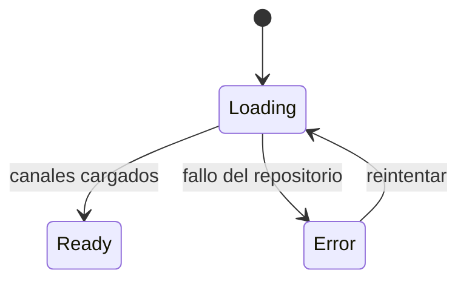

# CMP-33 — Channels Screen

---

spec_id: CMP-33
spec_type: CMP
layer: frontend
name: Channels Screen
target: lib/features/tv_experience/presentation/screens/channels_screen.dart
block: tv_experience
status: APPROVED
version: 1.3
owner: UI Team
last_reviewed: 2026-10-27
approved_at: 2026-10-27
approved_by: Product Owner
supersedes: []
superseded_by: []
user_story: user_story.md
processes: []
design_ref: .ai-harness/context/ui-design-system.md
depends_on: [CMP-07, CMP-17, CMP-34, CMP-35]
consumed_by: [CMP-00]
---

`CMP-33` · `v1.3` · `tv_experience` · `Flutter` · `APPROVED`

| 🧩 Tipo | 🚦 Estado | 🧭 Feature | 🎯 Target |
|---|---|---|---|
| `CMP` | `DRAFT` | `tv_experience` | `lib/features/tv_experience/presentation/screens/channels_screen.dart` |

> [!IMPORTANT]
> **Pantalla raíz de FLIK.** Presenta los canales en un carrusel de selección central, con degradado ambiente, cabecera centrada y bloque de información del canal seleccionado. Activar la tarjeta abre el Home del canal.

> [!WARNING]
> **Fuera de alcance:** creación de canales, conexión de listas, búsqueda, favoritos, perfiles, edición y borrado.

> [!TIP]
> **Ruta de lectura:** §4 requisitos → §7 UI y foco → §8 contratos → §10 trazabilidad.

### 🗺️ Mapa de lectura

| Bloque | Qué encontrarás |
|---|---|
| §1–§3 | Problema, alcance y actores |
| §4–§6 | Requisitos, reglas y estados |
| §7–§9 | UI, contratos y dependencias |
| §10–§12 | Trazabilidad, pruebas y BDD |
| §13–§15 | Cierre, decisiones y preguntas |

---

## 0. Protocolo de lectura y no invención

1. Leer `CMP-34`, `CMP-35`, `CMP-17`, `05-pages.md` §3 y `03-layout.md` §5.2.
2. Implementar solo los `FR-*` y `CT-*` de esta spec.
3. No añadir buscador, favoritos, perfiles ni acciones de edición.
4. Si falta un dato, registrarlo en §15 y detener la implementación.

---

## 1. Contexto y objetivo

### 1.1 Problema

`CMP-12` era la raíz y abría un catálogo implícito. No existía una pantalla que permitiera elegir entre varias listas ni un estado «sin conectar».

### 1.2 Objetivo medible

Mostrar en el primer frame, sin red, cinco canales seleccionables; recorrerlos completos con D-Pad; y abrir el Home del canal con una pulsación de `Select`.

### 1.3 No objetivos

- Crear o conectar canales.
- Buscar, filtrar u ordenar.
- Elegir perfil.
- Reproducir directamente un título.

---

## 2. Alcance y límites

**Incluye:**

- Carga de canales desde `ChannelRepository`.
- Degradado ambiente, cabecera centrada, carrusel, bloque de información e indicador de página.
- Foco inicial, recorrido D-Pad, absorción de `Up` y `Back`.
- Estados de carga y error con reintento.
- Localización completa con ARB.

**Excluye:**

- Escritura en el manifiesto o en base de datos.
- Validación de fuentes y sincronización (`PRC-07`).
- Lógica de reproducción.

**Invariantes de arquitectura aplicables:**

- `architecture_rules.md` §2.4: widgets solo pintan y emiten intenciones.
- `architecture_rules.md` §4.7: foco universal.
- `architecture_rules.md` §4.8: primera pantalla sin red.
- `block_ui_navigation_engine.md`: prohibido importar bases de datos o `media_kit`.

---

## 3. Actores e historia de usuario

> **Como** usuario,
> **quiero** ver mis canales al abrir FLIK y elegir uno,
> **para** entrar en la biblioteca que quiero consumir.

**Actores secundarios:** `CMP-35` (datos), `CMP-34` (tarjeta), `lib/app/` (navegación).

---

## 4. Requisitos funcionales

| ID | Requisito | Prioridad | Criterio de aceptación | Regla |
|---|---|---|---|---|
| `FR-01` | Al montarse, carga los canales desde `ChannelRepository`. | Must | `AC-01`: `list()` invocado una vez | `BR-01` |
| `FR-02` | Mientras carga muestra esqueletos de tarjeta; no usa red. | Must | `AC-02`: sin peticiones de red | `BR-02` |
| `FR-03` | Pinta el degradado ambiente de `ambientStart` a `ambientEnd` como fondo de página. | Must | `AC-03`: degradado presente | `BR-03` |
| `FR-04` | Muestra `DS-PAGE-HEADER` centrado con eyebrow y titular desde ARB. | Must | `AC-04`: dos textos ARB | `BR-04` |
| `FR-05` | La barra muestra el logotipo y, en el extremo derecho, la acción «Crear canal». | Must | `AC-05`: logo a la izquierda y acción a la derecha | `BR-05` |
| `FR-06` | No se muestra ningún aviso de función futura en la pantalla. | Must | `AC-06`: sin copy de «próximamente» | `BR-06` |
| `FR-07` | El carrusel usa una escalera de profundidad: tarjeta central a `channelCenterScale` y cada vecina interpolada con `channelScaleRatio` y `channelOpacityRatio` según su distancia, con suelos. | Must | `AC-07`: escalas y opacidades decrecientes | `BR-07` |
| `FR-08` | `Left`/`Right` mueven la selección sin salir de los límites y desplazan el contenedor. | Must | `AC-08`: índice acotado | `BR-08` |
| `FR-09` | El bloque de información refleja nombre, descripción y estado del canal seleccionado. | Must | `AC-09`: coincide con la selección | `BR-09` |
| `FR-10` | Activar la tarjeta emite `onOpenChannel` con el canal seleccionado. | Must | `AC-10`: callback una vez | `BR-10` |
| `FR-11` | `Up` desde el carrusel se absorbe y no mueve el foco fuera de la pantalla. | Must | `AC-11`: `KeyEventResult.handled` | `BR-11` |
| `FR-12` | `Back` invoca `onExit`. | Must | `AC-12`: callback una vez | `BR-12` |
| `FR-13` | El indicador de página solo se pinta en `compact` y `medium`. | Must | `AC-13`: ausente en `tv` | `BR-13` |
| `FR-14` | Si la carga falla, muestra un panel de error con acción de reintento enfocable. | Must | `AC-14`: foco en reintentar | `BR-14` |
| `FR-15` | Todos los textos provienen de ARB; no hay literales. | Must | `AC-15`: revisión de cadenas | `BR-15` |
| `FR-16` | No existe buscador, favoritos, perfil ni acción de edición. | Must | `AC-16`: cero controles de ese tipo | `BR-16` |
| `FR-17` | El contenedor del carrusel reserva altura para la tarjeta central escalada y su anillo; el foco nunca se recorta. | Must | `AC-17`: anillo completo arriba y abajo | `BR-17` |

---

## 5. Reglas de negocio e invariantes

| ID | Regla / invariante | Fuente canónica | Verificación |
|---|---|---|---|
| `BR-01` | La pantalla no construye sus dependencias. | `architecture_rules.md` §3 | `TC-01` |
| `BR-02` | El primer frame sale sin red. | `architecture_rules.md` §4.8 | `TC-02` |
| `BR-03` | El degradado ambiente solo se usa en esta página. | `01-foundations.md` §3.3 | `TC-03` |
| `BR-04` | El titular centrado solo se permite en páginas de entrada. | `04-components.md` §4.4 | `TC-04` |
| `BR-05` | Un control deshabilitado no recibe foco. | `04-components.md` §4.1 | `TC-05` |
| `BR-06` | La explicación no depende de hover ni de tooltip. | `01-foundations.md` §9 | `TC-06` |
| `BR-07` | La selección central usa los tokens de carrusel, sin escalas literales. | `02-tokens.md` §2.4 | `TC-07` |
| `BR-08` | La selección está acotada: nunca queda fuera de la lista. | `03-layout.md` §6 | `TC-08` |
| `BR-09` | El bloque de información y la tarjeta muestran el mismo canal. | Esta spec | `TC-09` |
| `BR-10` | La navegación la decide `lib/app/`; la pantalla solo emite. | `architecture_rules.md` §2.4 | `TC-10` |
| `BR-11` | Ningún contenedor atrapa el foco ni lo envía a un nodo inexistente. | `FM-FLIK-007` | `TC-11` |
| `BR-12` | En la raíz, `Back` cierra la aplicación. | `05-pages.md` §1 | `TC-12` |
| `BR-13` | El indicador no es interactivo. | `04-components.md` §4.4 | `TC-13` |
| `BR-14` | Todo error ofrece una acción de recuperación enfocable. | `01-foundations.md` §10 | `TC-14` |
| `BR-15` | Prohibido el literal de interfaz en el widget. | `ui-design-system.md` §3.8 | `TC-15` |
| `BR-16` | No se implementan funciones sin spec. | `AGENTS.md` §3 | `TC-16` |
| `BR-17` | El foco del carrusel nunca se recorta: el contenedor reserva la altura escalada. | `04-components.md` §4.8 | `TC-17` |
| `INV-01` | La pantalla es la raíz y no depende de un canal previo. | `05-pages.md` §3 | `TC-01` |

---

## 6. Estados, comportamiento y errores

### 6.1 Máquina de estados



### 6.2 Tabla de estados

| Estado | Entrada | Salida | UI / efecto observable |
|---|---|---|---|
| `Loading` | Montaje o reintento | `Ready` / `Error` | Esqueletos de tarjeta; sin red |
| `Ready` | Repositorio resuelve con canales | `Loading` por reintento | Carrusel, cabecera, bloque de información |
| `Error` | Repositorio lanza | `Loading` por reintento | Panel de error con acción enfocada |

El estado vacío no existe en v1: `INV-01` de `CMP-35` garantiza cinco canales.

### 6.3 Errores y casos borde

| Código | Condición | Resultado | Recuperable |
|---|---|---|---|
| `channelLoadFailed` | El repositorio lanza | Panel de error con «Reintentar» | Sí |
| `singleChannel` | Un solo canal | Sin vecinas; selección fija en 0 | Sí |
| `narrowViewport` | `compact` | Una tarjeta con asomo e indicador visible | Sí |

---

## 7. UX/UI y foco

- **Tokens:** `surface.canvas`, `surface.ambientStart`, `surface.ambientEnd`, `text.primary`, `text.secondary`, `text.disabled`, `border.subtle`, `border.focus`, `accent.soft`, `focus.scale`, `layout.poster`, `layout.carouselGap`, `layout.channelCenterScale`, `layout.channelScaleRatio`, `layout.channelOpacityRatio`, `layout.channelMinScale`, `layout.channelMinOpacity`, `layout.topBarHeight`, `radius.lg`, `motion.slow`.
- **Composición vertical:** barra (`layout.topBarHeight`) → cabecera centrada → carrusel → bloque de información → indicador. Sin scroll.
- **Fondo:** degradado vertical de `ambientStart` a `ambientEnd` a sangre, detrás de todo el contenido.
- **Jerarquía:** eyebrow `eyebrow` → titular `display` → carrusel → nombre `title` → descripción `body` → estado `chip`.
- **Foco inicial:** la tarjeta del canal con `lastOpenedAt` más reciente; si ninguno, el índice central de la lista.
- **Orden D-Pad:** `Left`/`Right` cambian la selección; `Up` se absorbe; `Select` activa; `Back` cierra.
- **Estado de foco:** anillo `border.focus`, halo `accent.soft`, escala `focus.scale` sobre la tarjeta activa; transición `motion.base`.
- **Accesibilidad:** el carrusel expone una etiqueta que nombra el canal seleccionado y su posición; el botón deshabilitado expone `hint`.
- **Responsive:** en `tv` y `expanded` se ven cinco tarjetas y vecinas; en `compact` una tarjeta a ancho disponible con el indicador visible.
- **Prohibido:** buscador, avatar, favoritos, acciones de edición, flechas como parada de foco y cualquier degradado por canal.

**Regla:** ninguna decisión visual puede contradecir `ui-design-system.md`.

---

## 8. Contratos de datos (`CT-*`)

### 8.1 Modelos e interfaces

```dart
// Ruta canónica: lib/features/tv_experience/presentation/controllers/channels_controller.dart
// Spec: CMP-33 / FR-01, FR-08, FR-09, FR-14

/// Estado de carga de la pantalla de canales.
/// Spec: CMP-33 / §6
enum ChannelsStatus { loading, ready, error }

/// Controlador de la pantalla; única lógica de selección y carga.
/// Spec: CMP-33 / FR-01 .. FR-14
final class ChannelsController extends ChangeNotifier {
  ChannelsController({required ChannelRepository repository});

  ChannelsStatus get status;
  List<Channel> get channels;
  int get selectedIndex;
  Channel? get selected;
  Object? get failure;

  Future<void> load();
  void selectNext();
  void selectPrevious();
}
```

```dart
// Ruta canónica: lib/features/tv_experience/presentation/screens/channels_screen.dart
// Spec: CMP-33 / FR-01 .. FR-16

/// Pantalla raíz: elige el canal con el que se entra.
/// Spec: CMP-33 / FR-01 .. FR-16
final class ChannelsScreen extends StatefulWidget {
  const ChannelsScreen({
    super.key,
    required this.repository,
    required this.onOpenChannel,
    required this.onExit,
  });

  final ChannelRepository repository;
  final ValueChanged<Channel> onOpenChannel;
  final VoidCallback onExit;
}
```

```dart
// Ruta canónica: lib/features/tv_experience/presentation/widgets/channels/
// Spec: CMP-33 / FR-04, FR-07, FR-13

/// Cabecera centrada de página de entrada.
/// Spec: CMP-33 / FR-04
final class PageHeader extends StatelessWidget {
  const PageHeader({super.key, required this.eyebrow, required this.headline});

  final String eyebrow;
  final String headline;
}

/// Carrusel con selección central.
/// Spec: CMP-33 / FR-07, FR-08, FR-10, FR-11
final class ChannelCarousel extends StatefulWidget {
  const ChannelCarousel({
    super.key,
    required this.channels,
    required this.selectedIndex,
    required this.onSelected,
    required this.onActivate,
  });

  final List<Channel> channels;
  final int selectedIndex;
  final ValueChanged<int> onSelected;
  final ValueChanged<Channel> onActivate;
}

/// Indicador de posición; no interactivo.
/// Spec: CMP-33 / FR-13
final class PageIndicator extends StatelessWidget {
  const PageIndicator({super.key, required this.count, required this.index});

  final int count;
  final int index;
}
```

### 8.2 Tabla de campos

| Campo | Tipo | Obligatorio | Restricción | Origen |
|---|---|---|---|---|
| `repository` | `ChannelRepository` | Sí | Inyectado en `lib/app/` | `CMP-35` |
| `selectedIndex` | `int` | Sí | `0 <= i < channels.length` | Controlador |
| `onOpenChannel` | `ValueChanged<Channel>` | Sí | Una invocación por activación | `lib/app/` |
| `onExit` | `VoidCallback` | Sí | Una invocación por `Back` | `lib/app/` |

### 8.3 Contratos expuestos

| ID | Símbolo público | Entrada | Salida | Errores |
|---|---|---|---|---|
| `CT-01` | `ChannelsController` | `ChannelRepository` | Estado y selección | `failure` no nulo en `error` |
| `CT-02` | `ChannelsScreen` | `repository`, `onOpenChannel`, `onExit` | Widget | — |
| `CT-03` | `PageHeader` | `eyebrow`, `headline` | Widget | — |
| `CT-04` | `ChannelCarousel` | `channels`, `selectedIndex`, callbacks | Widget | — |
| `CT-05` | `PageIndicator` | `count`, `index` | Widget | — |

---

## 9. Interfaces y dependencias

### 9.1 Dependencias permitidas

- `CMP-35` (`Channel`, `ChannelRepository`), `CMP-34` (`ChannelCard`), `CMP-17` (ARB).
- `lib/app/theme/` (tokens).
- Flutter SDK.

### 9.2 Dependencias prohibidas

- Base de datos, HTTP, `media_kit`, P2P y sistema de archivos.
- Importar `catalog/data` o `catalog/presentation`.
- Colores, tamaños o duraciones literales.

### 9.3 Ciclo de vida

- **Creación:** `lib/app/` construye la pantalla y le inyecta el repositorio.
- **Suscripción:** `ChangeNotifier` del controlador; `FocusNode` del carrusel.
- **Cancelación:** se retira el listener y se ignoran respuestas tardías tras `dispose`.
- **Destrucción:** se liberan controlador, `ScrollController` y `FocusNode`.

---

## 10. Mapa de implementación y trazabilidad

| Requisito | Contrato | Implementación (archivo::símbolo) | Test | Estado |
|---|---|---|---|---|
| `FR-01` | `CT-01` | `.../controllers/channels_controller.dart::ChannelsController.load` | `TC-01` | Verified |
| `FR-02` | `CT-02` | `.../screens/channels_screen.dart::_ChannelsSkeleton` | `TC-02` | Verified |
| `FR-03` | `CT-02` | `.../screens/channels_screen.dart::_AmbientBackground` | `TC-03` | Verified |
| `FR-04` | `CT-03` | `.../widgets/channels/page_header.dart::PageHeader` | `TC-04` | Verified |
| `FR-05` | `CT-02` | `.../screens/channels_screen.dart::_ChannelsTopBar` | `TC-05` | Verified |
| `FR-06` | `CT-02` | `.../screens/channels_screen.dart::_CreateChannelHint` | `TC-06` | Verified |
| `FR-07` | `CT-04` | `.../widgets/channels/channel_carousel.dart::ChannelCarousel` | `TC-07` | Verified |
| `FR-08` | `CT-01` | `.../controllers/channels_controller.dart::selectNext/selectPrevious` | `TC-08` | Verified |
| `FR-09` | `CT-02` | `.../screens/channels_screen.dart::_ChannelInfo` | `TC-09` | Verified |
| `FR-10` | `CT-04` | `.../widgets/channels/channel_carousel.dart::ChannelCarousel` | `TC-10` | Verified |
| `FR-11` | `CT-04` | `.../widgets/channels/channel_carousel.dart::_CarouselKeyHandler` | `TC-11` | Verified |
| `FR-12` | `CT-02` | `.../screens/channels_screen.dart::_onBack` | `TC-12` | Verified |
| `FR-13` | `CT-05` | `.../widgets/channels/page_indicator.dart::PageIndicator` | `TC-13` | Verified |
| `FR-14` | `CT-01` | `.../controllers/channels_controller.dart::ChannelsController.failure` | `TC-14` | Verified |
| `FR-15` | — | `.../screens/channels_screen.dart` (strings) | `TC-15` | Verified |
| `FR-16` | — | `.../screens/channels_screen.dart` (árbol de widgets) | `TC-16` | Verified |

**Estados:** `Pending`, `Implemented`, `Verified`.

**Regla anti-deriva:** cualquier símbolo de estos archivos que no aparezca en la tabla está fuera de spec.

---

## 11. Plan de pruebas

| ID | Tipo | Qué verifica | Entrada | Criterio |
|---|---|---|---|---|
| `TC-01` | Unit | `FR-01` | Repositorio espía | `list()` una vez |
| `TC-02` | Widget | `FR-02` | Repositorio con retardo | Esqueletos; sin red |
| `TC-03` | Widget | `FR-03` | Pantalla montada | `LinearGradient` con tokens |
| `TC-04` | Widget | `FR-04` | Pantalla montada | Eyebrow y titular ARB |
| `TC-05` | Widget | `FR-05` | Pantalla montada | Botón presente y sin foco |
| `TC-06` | Widget | `FR-06` | Pantalla montada | Texto visible y `hint` semántico |
| `TC-07` | Widget | `FR-07` | Cinco canales | Activa 1.08; vecinas 0.86/0.72 |
| `TC-08` | Unit | `FR-08` | `selectNext` en el último | Índice no desborda |
| `TC-09` | Widget | `FR-09` | Cambio de selección | Nombre y estado coinciden |
| `TC-10` | Widget | `FR-10` | `Enter` sobre la tarjeta | `onOpenChannel` una vez |
| `TC-11` | Widget | `FR-11` | Flecha arriba | Foco permanece; evento consumido |
| `TC-12` | Widget | `FR-12` | `Back` | `onExit` una vez |
| `TC-13` | Widget | `FR-13` | `tv` y `compact` | Ausente en TV, presente en compacto |
| `TC-14` | Widget | `FR-14` | Repositorio que lanza | Panel de error con foco en reintentar |
| `TC-15` | Unit | `FR-15` | Fuente del widget | Sin literales de interfaz |
| `TC-16` | Widget | `FR-16` | Pantalla montada | Sin buscador, avatar ni favoritos |

**Comandos:** `flutter analyze`; `flutter test test/widgets/tv_experience/channels_screen_test.dart`.

---

## 12. Criterios de aceptación BDD

```gherkin
@FR-01
Scenario: Arranque sin red
  Given un repositorio de canales con cinco entradas
  When se abre la aplicación
  Then la pantalla de canales muestra cinco tarjetas
  And no se realiza ninguna petición de red
```

```gherkin
@FR-10
Scenario: Entrar en un canal con el mando
  Given la pantalla de canales con la segunda tarjeta seleccionada
  When el usuario pulsa Select
  Then se solicita abrir el segundo canal
  And la pantalla no navega por sí misma
```

```gherkin
@FR-14
Scenario: Fallo al cargar canales
  Given un repositorio que falla
  When se abre la pantalla de canales
  Then se muestra el panel de error
  And el foco está en la acción de reintentar
```

---

## 13. Definition of Done

- [ ] Todos los `FR-*` tienen `AC-*`, `TC-*` y entrada en §10.
- [ ] `CT-01`..`CT-05` implementados.
- [ ] Los símbolos públicos llevan comentario `/// Spec: CMP-33 / FR-...`.
- [ ] `flutter analyze` y `flutter test` pasan.
- [ ] Sin tokens hardcodeados ni literales de interfaz.
- [ ] El degradado ambiente no se usa fuera de esta pantalla.
- [ ] §15 sin preguntas bloqueantes.

---

## 14. Decisiones y cambios

| Fecha | Decisión | Motivo | Impacto | Aprobado por |
|---|---|---|---|---|
| 2026-10-27 | Canales es la raíz; Perfiles sale de v1 | Producto prioriza entrar directo a la biblioteca | `FR-12`, `INV-01` | Product Owner |
| 2026-10-27 | Sin botón «Abrir»: la tarjeta activa | El foco ya es la selección | `FR-10` | Product Owner |
| 2026-10-27 | «Crear canal» deshabilitado con explicación visible | La conexión de listas llega con `PRC-07` | `FR-05`, `FR-06` | Product Owner |
| 2026-10-27 | Degradado ambiente sancionado solo aquí | Página con vacío estructural | `FR-03` | Arquitectura |
| 2026-10-27 | `Up` se absorbe en v1 | La barra no tiene acciones enfocables | `FR-11` | Arquitectura |
| 2026-10-27 | `supersedes` vacío: `CMP-11` nunca llegó a especificarse | Su blueprint se reescribe en `05-pages.md` §3; no hay contrato que sustituir | Front matter | Arquitectura |
| 2026-10-27 | Sin acción de creación ni aviso de «próximamente» | En v1 no hay conector de listas; un botón muerto con explicación es ruido | `FR-05`, `FR-06` | Product Owner |
| 2026-10-27 | Coverflow con profundidad continua | La fila se anima como valor continuo y cada tarjeta interpola escala y opacidad | `FR-07` | Product Owner |
| 2026-10-27 | El contenedor reserva la altura escalada | El anillo de foco se recortaba arriba y abajo | `FR-17` | Arquitectura |
| 2026-10-27 | La barra queda solo con el logotipo | El título duplicaba el contexto del titular y ensuciaba la esquina | `FR-05` | Product Owner |
| 2026-10-27 | Vuelve la acción «Crear canal» ahora que existe el diálogo | Sin acción de creación la pantalla no permite añadir catálogos | `FR-05` | Product Owner |

---

## 15. Preguntas abiertas

| ID | Pregunta | Bloqueante | Responsable | Respuesta |
|---|---|---|---|---|
| `Q-01` | ¿Se muestran flechas laterales para puntero en escritorio? | No | Diseño | Se decidirá con `PRC-07`; en v1 no hay parada de foco |

---

## Historial de cambios

| Versión | Fecha | Tipo | Cambio | Aprobado por |
|---|---|---|---|---|
| 1.0 | 2026-10-27 | Inicial | Pantalla raíz de canales con carrusel central y degradado ambiente | Pendiente |


