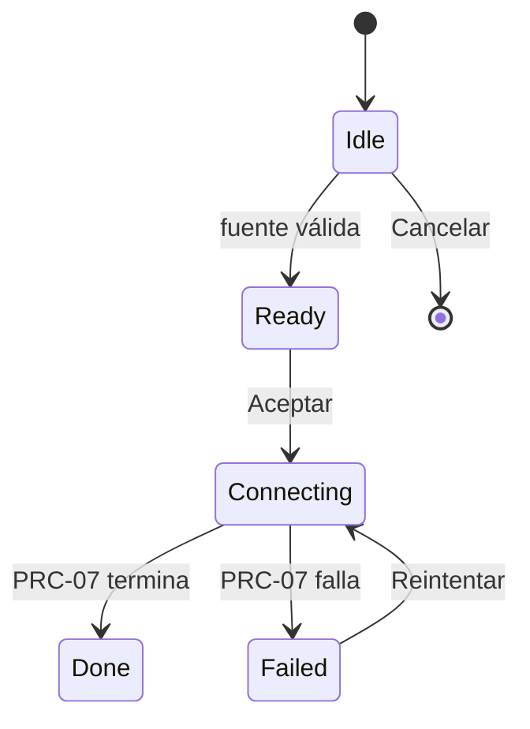

# CMP-37 — Create Channel Dialog

---

spec_id: CMP-37
spec_type: CMP
layer: frontend
name: Create Channel Dialog
target: lib/features/tv_experience/presentation/widgets/channels/create_channel_dialog.dart
block: tv_experience
status: APPROVED
version: 1.0
owner: UI Team
last_reviewed: 2026-10-27
approved_at: 2026-10-27
approved_by: Product Owner
supersedes: []
superseded_by: []
user_story: user_story.md
processes: [PRC-07]
design_ref: .ai-harness/context/ui-design-system.md
depends_on: [CMP-07, CMP-17, CMP-36, PRC-07]
consumed_by: [CMP-33]
---

`CMP-37` · `v1.0` · `tv_experience` · `Flutter` · `APPROVED`

| 🧩 Tipo | 🚦 Estado | 🧭 Feature | 🎯 Target |
|---|---|---|---|
| `CMP` | `APPROVED` | `tv_experience` | `lib/features/tv_experience/presentation/widgets/channels/create_channel_dialog.dart` |

> [!IMPORTANT]
> **Diálogo de «Nuevo canal».** Permite elegir un archivo local o escribir una URL, valida la fuente y entrega la petición a `PRC-07`. No lee, no descarga y no parsea.

> [!WARNING]
> **Fuera de alcance:** lectura de bytes, parseo, escritura en base de datos, explorador de archivos propio y carátulas.

> [!TIP]
> **Ruta de lectura:** §4 → §7 → §8 → §10.

### 🗺️ Mapa de lectura

| Bloque | Qué encontrarás |
|---|---|
| §1–§3 | Problema, alcance y actores |
| §4–§6 | Requisitos, reglas y estados |
| §7–§9 | UI, contratos y dependencias |
| §10–§12 | Trazabilidad, pruebas y BDD |
| §13–§15 | Cierre, decisiones y preguntas |

---

## 0. Protocolo de lectura y no invención

1. Leer esta spec, `CMP-36`, `PRC-07`, `CMP-33` y `04-components.md`.
2. Implementar solo los `FR-*` y `CT-*` de esta spec.
3. No añadir pestañas, campos ni acciones.
4. Si falta un dato, registrarlo en §15 y detener la implementación.

---

## 1. Contexto y objetivo

### 1.1 Problema

La pantalla de canales ya tiene sitio para «Crear canal», pero no existe la superficie que recoge el origen del catálogo.

### 1.2 Objetivo medible

Recoger un origen válido en menos de tres pasos de D-Pad, emitir exactamente una `CatalogSourceRequest` y mostrar el error correspondiente si `PRC-07` falla.

### 1.3 No objetivos

- Leer el archivo o descargarlo.
- Decidir si el canal es nuevo.
- Mostrar el catálogo.

---

## 2. Alcance y límites

**Incluye:** pestañas, campo de URL, selección de archivo, validación de entrada, estados de progreso y error, foco D-Pad y textos ARB.

**Excluye:** E/S, red, parseo, persistencia y navegación.

**Invariantes de arquitectura aplicables:**

- `architecture_rules.md` §2.4: el widget solo pinta y emite intenciones.
- `ui-design-system.md` §3: sin estilos literales.
- `FM-FLIK-007`: todo control alcanzable con D-Pad.

---

## 3. Actores e historia de usuario

> **Como** usuario,
> **quiero** indicar de dónde viene mi catálogo,
> **para** que FLIK lo convierta en un canal.

**Actores secundarios:** `CMP-33` (anfitrión), `PRC-07` (servicio), `CMP-36` (errores de importación).

---

## 4. Requisitos funcionales

| ID | Requisito | Prioridad | Criterio de aceptación | Regla |
|---|---|---|---|---|
| `FR-01` | Se abre desde la acción «Crear canal» de `CMP-33` como diálogo modal que captura el foco. | Must | `AC-01`: el foco no sale del diálogo | `BR-01` |
| `FR-02` | Ofrece dos pestañas: «URL» y «Archivo local». | Must | `AC-02`: dos pestañas visibles | `BR-02` |
| `FR-03` | La pestaña «Archivo local» se deshabilita con explicación visible cuando el sistema no resuelve `OPEN_DOCUMENT`. | Must | `AC-03`: pestaña no enfocable y motivo visible | `BR-03` |
| `FR-04` | En «URL» hay un campo de texto con el teclado del sistema; la URL se normaliza (sin esquema → `https://`). | Must | `AC-04`: valor normalizado al aceptar | `BR-04` |
| `FR-05` | En «Archivo local» hay una acción «Elegir archivo» que abre el selector del sistema. | Must | `AC-05`: ruta seleccionada visible | `BR-05` |
| `FR-06` | «Aceptar» está deshabilitado hasta que la fuente sea válida. | Must | `AC-06`: sin fuente no se puede aceptar | `BR-06` |
| `FR-07` | «Aceptar» emite una única `CatalogSourceRequest` y cierra el diálogo al terminar. | Must | `AC-07`: una emisión por confirmación | `BR-07` |
| `FR-08` | «Cancelar» y `Back` cierran sin emitir nada. | Must | `AC-08`: cero emisiones | `BR-08` |
| `FR-09` | Durante la conexión se muestra progreso, se bloquean pestañas y botones, y el cierre queda deshabilitado. | Must | `AC-09`: sin acciones durante el proceso | `BR-09` |
| `FR-10` | Si `PRC-07` falla, se muestra el mensaje del error y se ofrecen «Reintentar» y «Cancelar». | Must | `AC-10`: error visible con dos acciones | `BR-10` |
| `FR-11` | El foco inicial está en la pestaña activa; `Left`/`Right` cambian de pestaña y `Down` baja al campo. | Must | `AC-11`: recorrido completo con D-Pad | `BR-11` |
| `FR-12` | Todos los textos provienen de ARB (`es`, `en`). | Must | `AC-12`: sin literales | `BR-12` |
| `FR-13` | No realiza E/S, red ni parseo: solo emite la petición. | Must | `AC-13`: sin imports de `dart:io`, `http` ni parser | `BR-13` |

---

## 5. Reglas de negocio e invariantes

| ID | Regla / invariante | Fuente canónica | Verificación |
|---|---|---|---|
| `BR-01` | El diálogo captura el foco y lo devuelve al cerrarse. | `03-layout.md` §7.5 | `TC-01` |
| `BR-02` | Dos fuentes, ni una más. | `PRC-07` `CT-01` | `TC-02` |
| `BR-03` | Un control deshabilitado no recibe foco y su motivo es visible. | `01-foundations.md` §10 | `TC-03` |
| `BR-04` | La URL se valida y se normaliza antes de emitirse. | `PRC-07` `ST-01` | `TC-04` |
| `BR-05` | El archivo se elige con el selector del sistema; nunca se escribe una ruta a mano. | `security_privacy.md` | `TC-05` |
| `BR-06` | Sin fuente válida no hay acción de aceptar. | `CMP-37` | `TC-06` |
| `BR-07` | Una confirmación produce una única petición. | `FM-FLIK-007` | `TC-07` |
| `BR-08` | Cancelar no deja efectos. | `CMP-37` | `TC-08` |
| `BR-09` | Durante la conexión no se puede cancelar: la transacción ya puede estar abierta. | `PRC-07` §2 | `TC-09` |
| `BR-10` | Todo error ofrece una acción de recuperación enfocable. | `01-foundations.md` §10 | `TC-10` |
| `BR-11` | El orden de foco coincide con el orden visual. | `03-layout.md` §7 | `TC-11` |
| `BR-12` | Prohibido el literal de interfaz. | `ui-design-system.md` §3.8 | `TC-12` |
| `BR-13` | Presentación delgada. | `architecture_rules.md` §2.4 | `TC-13` |
| `INV-01` | El diálogo no conoce SQLite ni el parser. | `block_ui_navigation_engine.md` | `TC-13` |

---

## 6. Estados, comportamiento y errores

### 6.1 Máquina de estados



### 6.2 Tabla de estados

| Estado | Entrada | Salida | UI / efecto observable |
|---|---|---|---|
| `Idle` | Apertura | Fuente válida o cancelar | Pestañas activas, «Aceptar» deshabilitado |
| `Ready` | Fuente válida | Aceptar o editar | «Aceptar» habilitado |
| `Connecting` | Aceptar | Éxito o error | Progreso; pestañas y botones bloqueados |
| `Failed` | Error de `PRC-07` | Reintentar o cancelar | Mensaje del error y dos acciones |
| `Done` | Éxito | — | El diálogo se cierra |

### 6.3 Errores y casos borde

| Código | Condición | Resultado | Recuperable |
|---|---|---|---|
| `urlInvalid` | La URL no es `http(s)` | Mensaje bajo el campo; «Aceptar» deshabilitado | Sí |
| `noLocalPicker` | Sin gestor de documentos | Pestaña deshabilitada con explicación | No en esa plataforma |
| `connectFailed` | `PRC-07` lanza | Estado `Failed` con el mensaje | Sí |
| `cancelled` | `Back` o «Cancelar» | Cierre sin efectos | — |

---

## 7. UX/UI y foco

- **Tokens:** `surface.elevated`, `surface.inset`, `border.subtle`, `border.focus`, `accent.soft`, `text.primary`, `text.secondary`, `text.disabled`, `radius.lg`, `space.*`, `motion.base`.
- **Composición:** título → pestañas → campo o selector → mensaje de ayuda/error → fila de acciones.
- **Foco inicial:** pestaña activa.
- **Orden D-Pad:** pestañas (`Left`/`Right`) → «Elegir archivo» o campo de texto (`Down`) → «Aceptar» / «Cancelar».
- **Foco atrapado:** mientras el diálogo está abierto, el foco no sale; al cerrar vuelve a «Crear canal».
- **Accesibilidad:** cada control con etiqueta; el error se anuncia con `liveRegion`.
- **Responsive:** ancho máximo `layout.settingsMaxWidth`; en compacto ocupa el ancho con margen de `space.4`.

---

## 8. Contratos de datos (`CT-*`)

```dart
// Ruta canónica: lib/features/tv_experience/presentation/widgets/channels/create_channel_dialog.dart
// Spec: CMP-37 / FR-01 .. FR-13

/// Pestaña activa del diálogo.
/// Spec: CMP-37 / FR-02
enum CreateChannelTab { url, localFile }

/// Selector de archivos del sistema, inyectable para pruebas.
/// Spec: CMP-37 / FR-03, FR-05
abstract interface class LocalCatalogPicker {
  Future<bool> isAvailable();
  Future<String?> pick();
}

/// Diálogo modal de «Nuevo canal».
/// Spec: CMP-37 / FR-01 .. FR-13
final class CreateChannelDialog extends StatefulWidget {
  const CreateChannelDialog({
    super.key,
    required this.onConnect,
    required this.picker,
    this.startTab = CreateChannelTab.url,
  });

  final Future<CatalogConnectResult> Function(CatalogSourceRequest request) onConnect;
  final LocalCatalogPicker picker;
  final CreateChannelTab startTab;
}
```

| ID | Contrato | Entrada | Salida | Errores |
|---|---|---|---|---|
| `CT-01` | `CreateChannelDialog` | `onConnect`, `picker`, `startTab` | Widget modal | — |
| `CT-02` | `LocalCatalogPicker` | — | `bool`, `String?` | — |
| `CT-03` | `CreateChannelTab` | — | Enumerado | — |

---

## 9. Interfaces y dependencias

### 9.1 Dependencias permitidas

- Flutter SDK, `CMP-07` (tokens), `CMP-17` (ARB), `CMP-36` (`CatalogImportErrorCode`), `PRC-07` (`CatalogSourceRequest`, `CatalogConnectResult`, `CatalogConnectFailure`).

### 9.2 Dependencias prohibidas

- `dart:io`, `http`, el parser, la base de datos y `media_kit`.
- Colores, tamaños o duraciones literales.

### 9.3 Ciclo de vida

- **Creación:** al pulsar «Crear canal».
- **Suscripción:** `FocusNode` propios; sin streams.
- **Cancelación:** nada que cancelar mientras `Connecting`; el cierre se ignora.
- **Destrucción:** libera `FocusNode` y `TextEditingController`.

---

## 10. Mapa de implementación y trazabilidad

| Requisito | Contrato | Implementación (archivo::símbolo) | Test | Estado |
|---|---|---|---|---|
| `FR-01` | `CT-01` | `.../create_channel_dialog.dart::CreateChannelDialog` | `TC-01` | Pending |
| `FR-02` | `CT-03` | `.../create_channel_dialog.dart::_Tabs` | `TC-02` | Pending |
| `FR-03` | `CT-02` | `.../create_channel_dialog.dart::_LocalTab` | `TC-03` | Pending |
| `FR-04` | `CT-01` | `.../create_channel_dialog.dart::normalizeCatalogUrl` | `TC-04` | Pending |
| `FR-05` | `CT-02` | `.../create_channel_dialog.dart::_LocalTab` | `TC-05` | Pending |
| `FR-06` | `CT-01` | `.../create_channel_dialog.dart::_canAccept` | `TC-06` | Pending |
| `FR-07` | `CT-01` | `.../create_channel_dialog.dart::_accept` | `TC-07` | Pending |
| `FR-08` | `CT-01` | `.../create_channel_dialog.dart::_cancel` | `TC-08` | Pending |
| `FR-09` | `CT-01` | `.../create_channel_dialog.dart::_ConnectingView` | `TC-09` | Pending |
| `FR-10` | `CT-01` | `.../create_channel_dialog.dart::_ErrorView` | `TC-10` | Pending |
| `FR-11` | `CT-01` | `.../create_channel_dialog.dart::_focusOrder` | `TC-11` | Pending |
| `FR-12` | — | `.../create_channel_dialog.dart` (strings) | `TC-12` | Pending |
| `FR-13` | — | `.../create_channel_dialog.dart` (imports) | `TC-13` | Pending |

---

## 11. Plan de pruebas

| ID | Tipo | Qué verifica | Entrada | Criterio |
|---|---|---|---|---|
| `TC-01` | Widget | `FR-01` | Diálogo abierto | Foco dentro; no se escapa |
| `TC-02` | Widget | `FR-02` | Apertura | Dos pestañas |
| `TC-03` | Widget | `FR-03` | Picker no disponible | Pestaña deshabilitada y motivo |
| `TC-04` | Unit | `FR-04` | `mi-servidor/catalog.json` | `https://mi-servidor/catalog.json` |
| `TC-05` | Widget | `FR-05` | Picker devuelve ruta | Ruta visible |
| `TC-06` | Widget | `FR-06` | Sin fuente | «Aceptar» deshabilitado |
| `TC-07` | Widget | `FR-07` | Aceptar con URL válida | Una petición |
| `TC-08` | Widget | `FR-08` | Cancelar | Cero peticiones |
| `TC-09` | Widget | `FR-09` | Conectando | Sin acciones disponibles |
| `TC-10` | Widget | `FR-10` | `connect` lanza | Mensaje y dos acciones |
| `TC-11` | Widget | `FR-11` | Recorrido D-Pad | Orden declarado |
| `TC-12` | Unit | `FR-12` | Fuente del widget | Sin literales |
| `TC-13` | Unit | `FR-13` | Imports | Sin E/S, red ni parser |

**Comandos:** `flutter analyze`; `flutter test test/widgets/tv_experience/create_channel_dialog_test.dart`.

---

## 12. Criterios de aceptación BDD

```gherkin
@FR-07
Scenario: Conectar por URL
  Given el diálogo abierto en la pestaña URL
  When el usuario escribe "https://mi-servidor/catalog.json" y acepta
  Then se emite una CatalogSourceRequest de tipo remoteUrl
  And el diálogo se cierra al terminar
```

```gherkin
@FR-03
Scenario: Plataforma sin explorador de archivos
  Given un dispositivo sin gestor de documentos
  When se abre el diálogo
  Then la pestaña "Archivo local" está deshabilitada
  And se explica por qué
```

```gherkin
@FR-10
Scenario: Fallo al conectar
  Given una URL que responde 404
  When el usuario acepta
  Then se muestra el mensaje de error
  And se ofrecen "Reintentar" y "Cancelar"
```

---

## 13. Definition of Done

- [ ] Todos los `FR-*` tienen `AC-*`, `TC-*` y entrada en §10.
- [ ] `CT-01`..`CT-03` implementados.
- [ ] `flutter analyze` y `flutter test` pasan.
- [ ] Sin literales ni tokens hardcodeados.
- [ ] §15 sin preguntas bloqueantes.

---

## 14. Decisiones y cambios

| Fecha | Decisión | Motivo | Impacto | Aprobado por |
|---|---|---|---|---|
| 2026-10-27 | El selector se inyecta como `LocalCatalogPicker` | Permite probar el diálogo sin plugin ni dispositivo | `CT-02` | Arquitectura |
| 2026-10-27 | No se puede cancelar durante la conexión | La transacción ya puede estar abierta en SQLite | `FR-09` | Arquitectura |
| 2026-10-27 | Pestaña deshabilitada en vez de oculta cuando no hay gestor | El usuario entiende que existe pero su dispositivo no puede | `FR-03` | Product Owner |

---

## 15. Preguntas abiertas

| ID | Pregunta | Bloqueante | Responsable | Respuesta |
|---|---|---|---|---|
| `Q-01` | ¿Se admitirá pegar una ruta de archivo escrita a mano en TV? | No | Producto | Descartado: scoped storage lo hace inviable |

---

## Historial de cambios

| Versión | Fecha | Tipo | Cambio | Aprobado por |
|---|---|---|---|---|
| 1.0 | 2026-10-27 | Inicial | Diálogo con dos fuentes, estados y foco | Pendiente |


