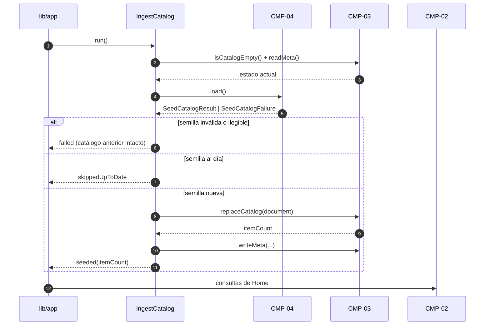
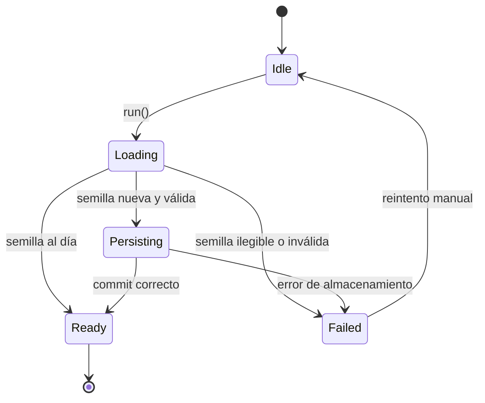

# PRC-02 — Catalog Ingest

---
spec_id: PRC-02
spec_type: PRC
name: Catalog Ingest
target: lib/features/catalog/domain/catalog_ingest.dart
block: catalog
status: APPROVED
version: 1.0
owner: Architecture
last_reviewed: 2026-10-26
approved_at: 2026-10-26
approved_by: Product Owner
supersedes: []
superseded_by: []
user_story: user_story.md
trigger: arranque de la app sin catálogo persistido o con una semilla más reciente
participants: [CMP-02, CMP-03, CMP-04]
depends_on: [CMP-01]
---

`PRC-02` · `v1.0` · `catalog` · `DRAFT`

| 🔄 Tipo | 🚦 Estado | 🧭 Bloque | 🎬 Disparador |
|---|---|---|---|
| `PRC` | `DRAFT` | `catalog` | Arranque sin catálogo o semilla más reciente |

> [!IMPORTANT]
> **El proceso orquesta, no reimplementa.** Lee la semilla con `CMP-04`, delega la validación en `CMP-01` y la escritura en `CMP-03`. No abre SQLite, no parsea JSON y no pinta nada.

> [!WARNING]
> **Fuera de alcance:** sincronización periódica, fuentes remotas, progreso de visualización y cualquier resolución de magnets.

> [!TIP]
> **Ruta de lectura:** §5 flujo → §6 pasos → §9 contratos → §11 trazabilidad → §12 pruebas.

### 🗺️ Mapa de lectura

| Bloque | Qué encontrarás |
|---|---|
| §1–§4 | Resultado, disparador, alcance y actores |
| §5–§7 | Flujo, pasos, estados y errores |
| §8–§10 | Datos, contratos e invariantes |
| §11–§13 | Trazabilidad, pruebas y BDD |
| §14–§16 | Cierre, decisiones y preguntas |

---

## 0. Protocolo de lectura y no invención

1. Leer esta spec, `CMP-01`, `CMP-03`, `CMP-04` y `ADR-0007`.
2. Implementar solo los `ST-*`, estados y contratos aquí definidos.
3. No añadir pasos, eventos, campos, errores ni dependencias.
4. Si falta un dato, registrarlo en §16 y detener la implementación.
5. Actualizar §11 y §12 en el mismo cambio que el código.

**Jerarquía de verdad:** contexto → arquitectura → specs de componentes → esta spec → código.

---

## 1. Resultado esperado

### 1.1 Objetivo del proceso

Convertir el asset semilla en un catálogo persistido y consultable, o determinar que ya está al día, conservando siempre el último catálogo válido.

### 1.2 Resultado observable

`CatalogIngestResult` con `status` ∈ {`seeded`, `skippedUpToDate`, `failed`} y, cuando aplica, `itemCount`; la Home puede consultar el catálogo inmediatamente después.

### 1.3 No objetivos

- Validar el documento (lo hace `CMP-01` dentro de `CMP-04`).
- Ejecutar SQL (lo hace `CMP-03`).
- Servir datos a la Home (lo hace `CMP-02`).
- Descargar catálogos.

---

## 2. Disparador y condiciones

| Elemento | Definición |
|---|---|
| Disparador | Arranque de la app, antes de construir la Home |
| Precondiciones | Base de datos abierta y esquema v1 disponible; llamador único, sin invocaciones concurrentes |
| Postcondiciones | Catálogo persistido y metadatos actualizados, o catálogo anterior intacto con resultado `failed` |
| Cancelación | El proceso no es cancelable a mitad de transacción; un cierre del proceso provoca rollback de SQLite |
| Reintento | Manual: una nueva llamada a `run()`; el proceso no reintenta solo |

**Regla:** si una precondición no se cumple, el proceso devuelve error tipado y no improvisa estado alternativo.

---

## 3. Alcance y límites

**Incluye:**

- Carga validada de la semilla.
- Comparación con los metadatos persistidos.
- Reemplazo transaccional y actualización de metadatos.
- Resultado tipado con éxito, omisión o fallo.

**Excluye:**

- Lógica de lectura del asset (`CMP-04`).
- Esquema y SQL (`CMP-03`).
- Consultas de la Home (`CMP-02`).
- Sincronización remota y reintentos automáticos.

---

## 4. Actores y participantes

| Actor / componente | Rol en el proceso |
|---|---|
| Arranque de la app (`lib/app/`) | Inicia el proceso y espera el resultado |
| `CMP-04` | Carga y valida la semilla |
| `CMP-03` | Ejecuta el reemplazo transaccional y los metadatos |
| `CMP-02` | Consulta el catálogo después de la ingesta |
| Usuario | No interviene; el proceso es silencioso |

---

## 5. Flujo



**Regla:** el diagrama coincide con los pasos `ST-*`; cualquier paso nuevo exige actualizar ambos.

---

## 6. Pasos del proceso

| ID | Paso | Componente | Entrada | Salida | Fallo | Requisito |
|---|---|---|---|---|---|---|
| `ST-01` | Leer estado actual del catálogo y metadatos de semilla | `CMP-03` | — | `CatalogIngestSnapshot` (vacío, `seed.asset`, `seed.generated_at`) | `storageFailed` | `CMP-03` `FR-09` |
| `ST-02` | Cargar y validar la semilla | `CMP-04` | `kSeedCatalogAssetPath` | `SeedCatalogResult` | `seedUnavailable` | `CMP-04` `FR-02`–`FR-07` |
| `ST-03` | Rechazar un resultado inválido sin tocar la base | Proceso | `SeedCatalogResult` inválido | `CatalogIngestResult.failed` | `invalidSeed` | `CMP-04` `FR-07` |
| `ST-04` | Decidir si la semilla está al día | Proceso | `CatalogIngestSnapshot` + `CatalogDocument` | `bool upToDate` | — | `BR-02` |
| `ST-05` | Reemplazar el catálogo en una transacción | `CMP-03` | `CatalogDocument` | `int itemCount` | `storageFailed` | `CMP-03` `FR-05` |
| `ST-06` | Escribir metadatos de ingesta | `CMP-03` | `CatalogDocument` + ruta + instante | `void` | `storageFailed` | `CMP-03` `FR-09` |
| `ST-07` | Emitir resultado `seeded` | Proceso | `itemCount` | `CatalogIngestResult` | — | `BR-03` |
| `ST-08` | Emitir resultado `skippedUpToDate` | Proceso | Semilla al día | `CatalogIngestResult` | — | `BR-02` |
| `ST-09` | Emitir resultado `failed` y conservar el catálogo anterior | Proceso | Fallo de `ST-01`, `ST-02` o `ST-05` | `CatalogIngestResult.failed` | — | `BR-04` |

**Reglas:**

- `ST-03` no escribe nada.
- `ST-05` y `ST-06` comparten transacción: si `ST-06` falla, se revierte `ST-05`.
- El proceso no cierra la base de datos; su propietario es `lib/app/`.

---

## 7. Estados y errores

### 7.1 Estados del proceso



### 7.2 Tabla de errores

| Código | Paso | Condición | Resultado | Recuperable |
|---|---|---|---|---|
| `seedUnavailable` | `ST-02` | Asset ausente o error de lectura | `failed` con catálogo anterior intacto | Sí, tras corregir el bundle |
| `invalidSeed` | `ST-03` | `SeedCatalogResult.isValid == false` | `failed` con lista de errores de contrato | Sí, tras corregir el JSON |
| `storageFailed` | `ST-01`, `ST-05`, `ST-06` | Excepción de SQLite | `failed` con rollback | Sí, en un nuevo arranque |

---

## 8. Mapeo de datos y transformación de estados

| Campo origen | Tipo origen | Campo destino | Tipo destino | Transformación | Paso |
|---|---|---|---|---|---|
| `SeedCatalogResult.assetPath` | `String` | `catalog_meta[seed.asset]` | `String` | Copia literal | `ST-06` |
| `CatalogDocument.catalogId` | `String` | `catalog_meta[catalog.id]` | `String` | Copia literal | `ST-06` |
| `CatalogDocument.generatedAt` | `DateTime` | `catalog_meta[catalog.generated_at]` | `String` | `toUtc().toIso8601String()` | `ST-06` |
| `CatalogDocument.generatedAt` | `DateTime` | `catalog_meta[seed.generated_at]` | `String` | `toUtc().toIso8601String()` | `ST-06` |
| Instante de ingesta | `DateTime` | `catalog_meta[seed.applied_at]` | `String` | `toUtc().toIso8601String()` | `ST-06` |
| `CatalogDocument.items.length` | `int` | `CatalogIngestResult.itemCount` | `int` | Longitud de la lista | `ST-05`, `ST-07` |
| `catalog_meta[seed.generated_at]` | `String?` | `CatalogIngestSnapshot.seedGeneratedAt` | `DateTime?` | `DateTime.tryParse` en UTC | `ST-01` |

**Regla:** ningún campo fuera de esta tabla puede añadirse al código del proceso.

---

## 9. Contratos de entrada, salida y eventos (`CT-*`)

```dart
// Ruta canónica: lib/features/catalog/domain/catalog_ingest.dart
// Spec: PRC-02
// Pasos cubiertos: ST-01 .. ST-09

/// Estado final de una ingesta.
/// Spec: PRC-02 / ST-07, ST-08, ST-09
enum CatalogIngestStatus { seeded, skippedUpToDate, failed }

/// Motivos de fallo de la ingesta.
/// Spec: PRC-02 / §7.2
enum CatalogIngestErrorCode { seedUnavailable, invalidSeed, storageFailed }

/// Instantánea mínima del catálogo antes de ingerir.
/// Spec: PRC-02 / ST-01
final class CatalogIngestSnapshot {
  const CatalogIngestSnapshot({
    required this.isEmpty,
    required this.seedAsset,
    required this.seedGeneratedAt,
  });

  final bool isEmpty;
  final String? seedAsset;
  final DateTime? seedGeneratedAt;
}

/// Fallo tipado de la ingesta.
/// Spec: PRC-02 / ST-09
final class CatalogIngestFailure {
  const CatalogIngestFailure({
    required this.code,
    required this.message,
    this.errors = const <CatalogContractError>[],
  });

  final CatalogIngestErrorCode code;
  final String message;

  /// Errores de contrato cuando `code == invalidSeed`.
  final List<CatalogContractError> errors;
}

/// Resultado observable del proceso.
/// Spec: PRC-02 / ST-07, ST-08, ST-09
final class CatalogIngestResult {
  const CatalogIngestResult._({
    required this.status,
    required this.itemCount,
    required this.assetPath,
    required this.failure,
  });

  /// Spec: PRC-02 / ST-07
  factory CatalogIngestResult.seeded({
    required int itemCount,
    required String assetPath,
  }) => CatalogIngestResult._(
    status: CatalogIngestStatus.seeded,
    itemCount: itemCount,
    assetPath: assetPath,
    failure: null,
  );

  /// Spec: PRC-02 / ST-08
  factory CatalogIngestResult.skippedUpToDate({required int itemCount}) =>
      CatalogIngestResult._(
        status: CatalogIngestStatus.skippedUpToDate,
        itemCount: itemCount,
        assetPath: null,
        failure: null,
      );

  /// Spec: PRC-02 / ST-09
  factory CatalogIngestResult.failed(CatalogIngestFailure failure) =>
      CatalogIngestResult._(
        status: CatalogIngestStatus.failed,
        itemCount: 0,
        assetPath: null,
        failure: failure,
      );

  final CatalogIngestStatus status;
  final int itemCount;
  final String? assetPath;
  final CatalogIngestFailure? failure;

  bool get isFailure => status == CatalogIngestStatus.failed;
}

/// Caso de uso de ingesta del catálogo semilla.
/// Spec: PRC-02 / ST-01 .. ST-09
abstract interface class CatalogIngest {
  Future<CatalogIngestResult> run();
}
```

| ID | Contrato | Tipo | Entrada / salida | Errores |
|---|---|---|---|---|
| `CT-01` | `CatalogIngest` | interfaz | `run()` → `CatalogIngestResult` | `CatalogIngestFailure` |
| `CT-02` | `CatalogIngestResult` | modelo inmutable | `status`, `itemCount`, `assetPath`, `failure` | — |
| `CT-03` | `CatalogIngestFailure` | modelo inmutable | `code`, `message`, `errors` | — |
| `CT-04` | `CatalogIngestSnapshot` | modelo inmutable | `isEmpty`, `seedAsset`, `seedGeneratedAt` | — |
| `CT-05` | `CatalogIngestStatus` / `CatalogIngestErrorCode` | enums exhaustivos | Ver §9 | — |

---

## 10. Invariantes y reglas del proceso

| ID | Regla / invariante | Fuente canónica | Verificación |
|---|---|---|---|
| `BR-01` | El proceso no parsea JSON ni ejecuta SQL: delega en `CMP-04` y `CMP-03`. | `sdd_framework.md` §1 | Revisión de código |
| `BR-02` | Se omite la escritura si la base no está vacía, `seed.asset` coincide y `seed.generated_at` es igual o posterior al de la semilla. | Esta spec | `TC-02` |
| `BR-03` | Un `seeded` solo se emite después del commit correcto de `ST-05` y `ST-06`. | `CMP-03` `FR-05` | `TC-01` |
| `BR-04` | Ante cualquier fallo, el catálogo anterior permanece consultable. | `CMP-03` `FR-05` | `TC-04`, `TC-05` |
| `BR-05` | La ingesta nunca sale a la red ni envía datos. | `architecture_rules.md` §4.9 | `TC-08` |
| `BR-06` | El proceso no cierra la base de datos ni cancela suscripciones ajenas. | `CMP-03` §9.3 | Revisión de código |
| `INV-01` | No existe estado intermedio visible: o catálogo anterior o catálogo nuevo completo. | `FM-FLIK-010` | `TC-04` |
| `INV-02` | Los metadatos se escriben en la misma transacción que el catálogo. | `ADR-0007` §5 | `TC-01` |
| `INV-03` | El progreso de visualización no se toca. | `architecture_rules.md` §2.3 | `TC-07` |

---

## 11. Mapa de implementación y trazabilidad

| Paso | Contrato | Implementación (archivo::símbolo) | Test | Estado |
|---|---|---|---|---|
| `ST-01` | `CT-04` | `lib/features/catalog/data/ingest_catalog_impl.dart::IngestCatalog._readSnapshot` | `TC-01` | Verified |
| `ST-02` | `CT-01` | `lib/features/catalog/data/ingest_catalog_impl.dart::IngestCatalog.run` | `TC-05` | Verified |
| `ST-03` | `CT-03` | `lib/features/catalog/data/ingest_catalog_impl.dart::IngestCatalog.run` | `TC-03` | Verified |
| `ST-04` | `CT-04` | `lib/features/catalog/data/ingest_catalog_impl.dart::IngestCatalog._isUpToDate` | `TC-02` | Verified |
| `ST-05` | `CT-01` | `lib/features/catalog/data/ingest_catalog_impl.dart::IngestCatalog.run` | `TC-01` | Verified |
| `ST-06` | `CT-01` | `lib/features/catalog/data/ingest_catalog_impl.dart::IngestCatalog._meta` | `TC-01` | Verified |
| `ST-07` | `CT-02` | `lib/features/catalog/domain/catalog_ingest.dart::CatalogIngestResult.seeded` | `TC-01` | Verified |
| `ST-08` | `CT-02` | `lib/features/catalog/domain/catalog_ingest.dart::CatalogIngestResult.skippedUpToDate` | `TC-02` | Verified |
| `ST-09` | `CT-02`, `CT-03` | `lib/features/catalog/domain/catalog_ingest.dart::CatalogIngestResult.failed` | `TC-03`, `TC-04`, `TC-05` | Verified |

**Regla anti-deriva:** todo paso ejecutado por `IngestCatalog` debe aparecer en esta tabla.

---

## 12. Plan de pruebas

| ID | Tipo | Qué verifica | Fixture / entrada | Criterio |
|---|---|---|---|---|
| `TC-01` | Unit | `ST-01`–`ST-07` | Base vacía + semilla válida | `seeded`, `itemCount = 48`, metadatos escritos |
| `TC-02` | Unit | `ST-04`, `ST-08` | Base con la misma semilla aplicada | `skippedUpToDate`, sin reescritura |
| `TC-03` | Unit | `ST-03`, `ST-09` | Semilla con magnet inválido | `failed/invalidSeed` y errores de contrato |
| `TC-04` | Unit | `ST-09` | Base con 48 ítems + semilla inválida | Siguen los 48 ítems originales |
| `TC-05` | Unit | `ST-02`, `ST-09` | Bundle sin asset | `failed/seedUnavailable` |
| `TC-06` | Unit | `BR-04` | Fallo inyectado en `writeMeta` | Rollback; catálogo anterior intacto |
| `TC-07` | Unit | `INV-03` | Base sin tablas de progreso | La ingesta no crea tablas nuevas |
| `TC-08` | Unit | `BR-05` | Análisis de imports | Sin `http`, `dio`, `socket` |

**Comandos:**

- `flutter analyze`
- `flutter test test/unit/catalog/catalog_ingest_test.dart`

**Prohibido:** red real, SQLite en archivo, temporizadores reales y assets reales fuera del bundle de test.

---

## 13. Criterios de aceptación BDD

```gherkin
@ST-01
Scenario: Primera ingesta en una instalación nueva
  Given una base de datos vacía
  And una semilla válida con 48 ítems y generated_at 2026-10-26T00:00:00Z
  When IngestCatalog.run() se ejecuta
  Then replaceCatalog persiste 48 ítems
  And catalog_meta contiene catalog.id, seed.asset, seed.generated_at y seed.applied_at
  And el resultado es seeded con itemCount = 48
```

```gherkin
@ST-08
Scenario: Semilla ya aplicada
  Given una base con la semilla de 48 ítems ya aplicada
  And los metadatos coinciden con el asset y su generated_at
  When IngestCatalog.run() se ejecuta
  Then no se llama a replaceCatalog
  And el resultado es skippedUpToDate con itemCount = 48
```

```gherkin
@ST-09
Scenario: Semilla inválida con catálogo previo
  Given una base con 48 ítems válidos
  And un asset semilla con un magnet malformado
  When IngestCatalog.run() se ejecuta
  Then el resultado es failed con código invalidSeed
  And se incluyen los errores de contrato con su ruta JSON
  And la base conserva los 48 ítems anteriores
```

---

## 14. Definition of Done

- [ ] Todos los `ST-*` tienen contrato, implementación y test.
- [ ] El diagrama y los pasos coinciden.
- [ ] Todos los errores tienen estado y recuperación definidos.
- [ ] El catálogo anterior se conserva ante cualquier fallo.
- [ ] `flutter analyze` y `flutter test` pasan.
- [ ] No hay placeholders ni secciones vacías.
- [ ] §16 no tiene preguntas bloqueantes.
- [ ] La spec está en `APPROVED` y `sync-sdd` no reporta `DIVERGED`.

---

## 15. Decisiones y cambios

| Fecha | Decisión | Motivo | Impacto | Aprobado por |
|---|---|---|---|---|
| 2026-10-26 | Proceso aprobado e implementado | Ingesta atómica verificada con pruebas de éxito, omisión y fallo | Todos los `ST` | Product Owner |
| 2026-10-26 | La ingesta se ejecuta en el arranque y no en la Home | La Home no debe bloquearse por almacenamiento | `ST-01` | Architecture |
| 2026-10-26 | La comparación usa `seed.asset` y `seed.generated_at` | Evita reescribir la base en cada arranque | `ST-04`, `BR-02` | Architecture |
| 2026-10-26 | Sin reintentos automáticos en v1 | Un fallo se resuelve en el siguiente arranque | §2 | Producto |
| 2026-10-26 | El proceso no cierra la base de datos | El propietario es `lib/app/` | `BR-06` | Architecture |

---

## 16. Preguntas abiertas

| ID | Pregunta | Bloqueante | Responsable | Respuesta |
|---|---|---|---|---|
| `Q-01` | ¿La ingesta se repetirá al cambiar de canal en F3? | No | Producto | Se definirá con `PRC-07` |
| `Q-02` | ¿Se mostrará al usuario el fallo de semilla? | No | Producto | En v1 se registra localmente y la Home muestra el estado vacío |

---

## Historial de cambios

| Versión | Fecha | Tipo | Cambio | Aprobado por |
|---|---|---|---|---|
| 1.0 | 2026-10-26 | Inicial | Ingesta atómica de la semilla con omisión idempotente | Pendiente |


