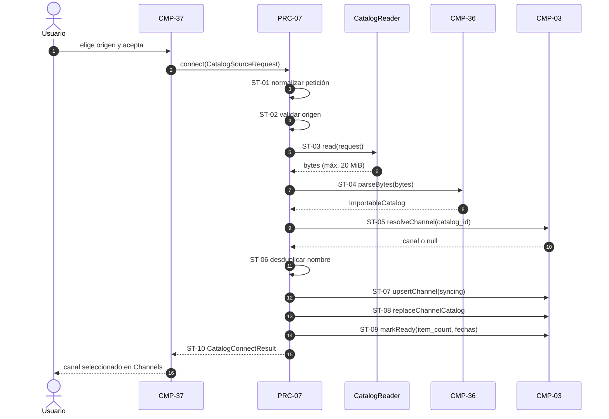
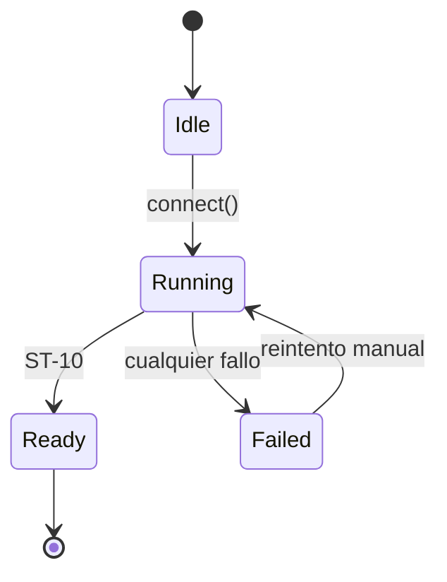

# PRC-07 — Catalog Connect

---

spec_id: PRC-07
spec_type: PRC
name: Catalog Connect
target: lib/features/catalog/application/catalog_connect_service.dart
block: catalog
status: APPROVED
version: 1.0
owner: Catalog Team
last_reviewed: 2026-10-27
approved_at: 2026-10-27
approved_by: Product Owner
supersedes: []
superseded_by: []
user_story: user_story.md
trigger: El usuario confirma un catálogo en el diálogo «Nuevo canal»
participants: [CMP-36, CMP-03, CMP-35, CMP-37, CMP-33]
depends_on: [PRC-02]
---

`PRC-07` · `v1.0` · `catalog` · `APPROVED`

| 🔄 Tipo | 🚦 Estado | 🧭 Bloque | 🎬 Disparador |
|---|---|---|---|
| `PRC` | `APPROVED` | `catalog` | Confirmación en el diálogo «Nuevo canal» |

> [!IMPORTANT]
> **El proceso orquesta, no reimplementa.** Valida el origen, delega el parseo en `CMP-36`, la persistencia en `CMP-03` y el nombre del canal en `CMP-35`.

> [!TIP]
> **Ruta de lectura:** §5 flujo → §6 pasos → §9 contratos → §11 trazabilidad → §12 pruebas.

### 🗺️ Mapa de lectura

| Bloque | Qué encontrarás |
|---|---|
| §1–§4 | Resultado, disparador, alcance y actores |
| §5–§7 | Flujo, pasos, estados y errores |
| §8–§10 | Datos, contratos e invariantes |
| §11–§13 | Trazabilidad, pruebas y BDD |
| §14–§16 | Cierre, decisiones y preguntas |

---

## 0. Protocolo de lectura y no invención

1. Leer esta spec, `CMP-36`, `CMP-03` v2, `CMP-35` v2 y `CMP-02` v2.
2. Implementar solo los pasos (`ST-*`), estados y contratos definidos aquí.
3. No inventar pasos, estados, campos ni dependencias.
4. Si falta un dato, registrarlo en §16 y detener la implementación.

---

## 1. Resultado esperado

### 1.1 Objetivo del proceso

Convertir una elección de catálogo (archivo local o URL) en un canal persistido, con su contenido escrito en la base de datos y listo para que `CMP-33` y `CMP-12` lo muestren.

### 1.2 Resultado observable

El canal aparece en Channels con el nombre de la cabecera, el contador real de títulos y estado `ready`. La Home de ese canal muestra sus filas con datos reales.

### 1.3 No objetivos

- Decidir el diff entre sincronizaciones (fase posterior).
- Sincronización diaria en segundo plano (fase posterior).
- Descargar carátulas.
- Comprimir, cifrar o validar contraseñas.

---

## 2. Disparador y condiciones

| Elemento | Definición |
|---|---|
| Disparador | El usuario pulsa «Aceptar» en `CMP-37` con un origen válido |
| Precondiciones | Base de datos abierta; origen con tipo admitido y localización no vacía |
| Postcondiciones | Canal en estado `ready` con `item_count`, `generated_at` y `last_synced_at` actualizados |
| Cancelación | Solo antes de `ST-07`; una vez iniciada la transacción, el proceso termina o revierte |
| Reintento | Manual desde el diálogo; el proceso es idempotente por `catalog_id` |

**Regla:** si una precondición no se cumple, el proceso no se inicia y devuelve un error tipado.

---

## 3. Alcance y límites

**Incluye:**

- Validación del origen y lectura acotada a 20 MiB.
- Parseo mediante `CMP-36`.
- Alta o actualización del canal por `catalog_id`.
- Desduplicado de nombre.
- Escritura transaccional del catálogo del canal.
- Estados `syncing`, `ready` y `error`.

**Excluye:**

- Comparar catálogos para aplicar solo diferencias.
- Temporizadores ni sincronización automática.
- Presentación y foco (`CMP-37`, `CMP-33`).

---

## 4. Actores y participantes

| Actor / componente | Rol en el proceso |
|---|---|
| Usuario (TV, móvil, escritorio) | Elige el origen y confirma |
| `CMP-37` | Diálogo que emite `CatalogSourceRequest` |
| `CMP-36` | Parsea y valida el documento |
| `CMP-03` v2 | Persiste canales e ítems en transacción |
| `CMP-35` v2 | Modelo de canal y tipo de fuente |
| `CMP-33` | Refresca la lista de canales al terminar |

---

## 5. Flujo



**Regla:** el diagrama debe coincidir con los pasos `ST-*`.

---

## 6. Pasos del proceso

| ID | Paso | Componente | Entrada | Salida | Fallo | Requisito |
|---|---|---|---|---|---|---|
| `ST-01` | Normaliza la petición: recorta espacios y añade `https://` si la URL no declara esquema. | `PRC-07` | `CatalogSourceRequest` | `CatalogSourceRequest` normalizada | — | `BR-01` |
| `ST-02` | Valida que el tipo esté admitido y que la localización no esté vacía. | `PRC-07` | `CatalogSourceRequest` | Petición válida | `unsupportedSource` | `BR-01` |
| `ST-03` | Lee los bytes del origen con tope de 20 MiB, cortando en cuanto se supera. | `CatalogReader` | `CatalogSourceRequest` | `List<int>` | `sourceUnreadable`, `documentTooLarge` | `BR-02` |
| `ST-04` | Parsea y mapea el documento. | `CMP-36` | `List<int>` | `ImportableCatalog` | `importFailed` | `BR-03` |
| `ST-05` | Busca un canal con el mismo `catalog_id`. | `CMP-03` | `String catalogId` | Canal o `null` | `storageFailed` | `BR-04` |
| `ST-06` | Si el nombre ya existe en otro canal, añade sufijo ` 2`, ` 3`… hasta 99. | `CMP-35` | Nombre deseado | Nombre único | `channelNameConflict` | `BR-05` |
| `ST-07` | Inserta o actualiza el canal en estado `syncing` con el origen usado. | `CMP-03` | Datos del canal | `channelId` | `storageFailed` | `BR-06` |
| `ST-08` | Reemplaza el contenido del canal en una transacción. | `CMP-03` | `channelId` + `CatalogDocument` | Nº de ítems escritos | `storageFailed` | `BR-07` |
| `ST-09` | Recalcula `item_count` y marca `ready` con `generated_at` y `last_synced_at`. | `CMP-03` | `channelId` | Canal actualizado | `storageFailed` | `BR-08` |
| `ST-10` | Emite el resultado al llamador. | `PRC-07` | `channelId` y contadores | `CatalogConnectResult` | — | `BR-09` |
| `ST-11` | Ante cualquier fallo tras `ST-07`, marca el canal en `error` conservando su catálogo anterior y propaga el fallo. | `PRC-07` | `channelId`, fallo | `CatalogConnectFailure` | — | `BR-10` |

**Reglas:**

- Cada paso tiene una única responsabilidad.
- `ST-03` es el único punto con E/S o red.
- Los pasos `ST-*` son la unidad de trazabilidad del proceso.

---

## 7. Estados y errores

### 7.1 Estados del proceso



### 7.2 Estados del canal

| Estado | Cuándo | UI en `CMP-33` |
|---|---|---|
| `pending` | Canal creado sin catálogo (por defecto) | «Sin conectar» |
| `syncing` | Entre `ST-07` y `ST-09` | «Sincronizando» |
| `ready` | Tras `ST-09` | Sin badge; contador real |
| `error` | Fallo tras `ST-07` | «Fuente no disponible» |

### 7.3 Tabla de errores

| Código | Paso | Condición | Resultado | Recuperable |
|---|---|---|---|---|
| `unsupportedSource` | `ST-02` | Tipo no admitido o localización vacía | Fallo tipado; no se crea canal | Sí |
| `sourceUnreadable` | `ST-03` | No se puede abrir o descargar | Fallo; el canal queda como estaba | Sí |
| `documentTooLarge` | `ST-03` | Supera 20 MiB | Se corta la lectura y falla | Sí |
| `importFailed` | `ST-04` | `CMP-36` lanza | Fallo con el código de `CMP-36` como causa | Sí |
| `storageFailed` | `ST-05`–`ST-09` | SQLite falla | Rollback; catálogo anterior intacto | Sí |
| `channelNameConflict` | `ST-06` | 99 sufijos ocupados | Fallo tipado | No |

**Regla:** todo error se propaga como estado tipado; prohibido silenciar fallos o dejar transacciones abiertas.

---

## 8. Mapeo de datos y transformación de estados

| Campo origen | Tipo origen | Campo destino | Tipo destino | Transformación | Paso |
|---|---|---|---|---|---|
| `request.type` | `ChannelSourceType` | `channels.source_type` | `TEXT` | `asset`, `local_file` o `remote_url` | `ST-07` |
| `request.location` | `String` | `channels.source_location` | `TEXT` | Recortado; URL con esquema | `ST-07` |
| `header.catalogId` | `String` | `channels.catalog_id` | `TEXT` | Tal cual | `ST-05`, `ST-07` |
| `header.name` | `String` | `channels.name` | `TEXT` | Desduplicado en `ST-06` | `ST-06` |
| `header.description` | `String` | `channels.description` | `TEXT` | Tal cual | `ST-07` |
| `header.art` | `ChannelArt` | `channels.art` | `TEXT` | `name` del enumerado | `ST-07` |
| `header.coverUri` | `Uri?` | `channels.cover_uri` | `TEXT?` | `toString()` o `NULL` | `ST-07` |
| `header.generatedAt` | `DateTime` | `channels.generated_at` | `TEXT` | ISO-8601 UTC | `ST-09` |
| `document.items` | `List<CatalogItem>` | `catalog_items` + hijas | Filas | Una transacción; `channel_id` en cada ítem | `ST-08` |
| `document.items.length` | `int` | `channels.item_count` | `INTEGER` | Conteo real escrito | `ST-09` |
| reloj | `DateTime` | `channels.last_synced_at` | `TEXT` | ISO-8601 UTC al cerrar | `ST-09` |
| — | — | `channels.state` | `TEXT` | `syncing` → `ready` / `error` | `ST-07`, `ST-09`, `ST-11` |

**Regla:** todo campo que atraviesa el proceso aparece aquí.

---

## 9. Contratos de entrada, salida y eventos (`CT-*`)

```dart
// Ruta canónica: lib/features/catalog/application/catalog_connect_service.dart
// Spec: PRC-07 / ST-01 .. ST-11

/// Petición de conexión emitida por el diálogo.
/// Spec: PRC-07 / ST-01
final class CatalogSourceRequest {
  const CatalogSourceRequest({required this.type, required this.location});

  final ChannelSourceType type;
  final String location;
}

/// Resultado correcto de una conexión.
/// Spec: PRC-07 / ST-10
final class CatalogConnectResult {
  const CatalogConnectResult({
    required this.channelId,
    required this.created,
    required this.itemCount,
    required this.skippedItems,
  });

  final String channelId;
  final bool created;
  final int itemCount;
  final int skippedItems;
}

/// Motivos de fallo del proceso.
/// Spec: PRC-07 / §7.3
enum CatalogConnectErrorCode {
  unsupportedSource,
  sourceUnreadable,
  documentTooLarge,
  importFailed,
  storageFailed,
  channelNameConflict,
}

/// Error tipado del proceso.
/// Spec: PRC-07 / ST-11
final class CatalogConnectFailure implements Exception {
  const CatalogConnectFailure({
    required this.code,
    required this.message,
    this.cause,
  });

  final CatalogConnectErrorCode code;
  final String message;
  final Object? cause;
}

/// Única pieza con acceso a E/S o red.
/// Spec: PRC-07 / ST-03
abstract interface class CatalogReader {
  Future<List<int>> read(CatalogSourceRequest request);
}

/// Orquestador del proceso.
/// Spec: PRC-07 / ST-01 .. ST-11
final class CatalogConnectService {
  CatalogConnectService({
    required CatalogReader reader,
    required ImportableCatalogParser parser,
    required CatalogDatabase database,
    DateTime Function()? clock,
  });

  Future<CatalogConnectResult> connect(CatalogSourceRequest request);
}
```

| ID | Contrato | Tipo | Entrada / salida | Errores |
|---|---|---|---|---|
| `CT-01` | `CatalogSourceRequest` | Modelo inmutable | `type`, `location` | — |
| `CT-02` | `CatalogConnectResult` | Modelo inmutable | `channelId`, `created`, `itemCount`, `skippedItems` | — |
| `CT-03` | `CatalogConnectErrorCode` | Enumerado | — | — |
| `CT-04` | `CatalogConnectFailure` | Excepción tipada | `code`, `message`, `cause` | — |
| `CT-05` | `CatalogReader.read` | Interfaz | Petición → bytes | `sourceUnreadable` |
| `CT-06` | `CatalogConnectService.connect` | Servicio | Petición → resultado | `CatalogConnectFailure` |

**Regla:** los estados del proceso son inmutables y exhaustivos.

---

## 10. Invariantes y reglas del proceso

| ID | Regla / invariante | Fuente canónica | Verificación |
|---|---|---|---|
| `BR-01` | El origen se normaliza y se valida antes de leer nada. | `PRC-07` | `TC-01` |
| `BR-02` | La lectura está acotada a 20 MiB y se corta al superarlos. | `architecture_rules.md` §6 | `TC-02` |
| `BR-03` | No se escribe nada en la base hasta que el documento es válido. | `FM-FLIK-010` | `TC-03` |
| `BR-04` | La identidad del canal es `catalog_id`. | `CMP-36` `INV-01` | `TC-04` |
| `BR-05` | El nombre visible es único; el duplicado se numera. | `PRC-07` | `TC-05` |
| `BR-06` | El canal entra en `syncing` antes de escribir el contenido. | `PRC-07` §7.2 | `TC-06` |
| `BR-07` | El contenido se escribe en una sola transacción. | `FM-FLIK-003` | `TC-07` |
| `BR-08` | `ready` solo se marca con `item_count` y fechas ya escritas. | `PRC-07` | `TC-08` |
| `BR-09` | El resultado identifica el canal y los contadores. | `PRC-07` | `TC-09` |
| `BR-10` | Un fallo tras `ST-07` deja el catálogo anterior intacto y el canal en `error`. | `PRC-07` | `TC-10` |
| `INV-01` | Cero backend, proxy o transcodificación. | `architecture_rules.md` §4.1 | Revisión |
| `INV-02` | La única red es la URL elegida por el usuario. | `security_privacy.md` | `TC-11` |

---

## 11. Mapa de implementación y trazabilidad

| Paso | Contrato | Implementación (archivo::símbolo) | Test | Estado |
|---|---|---|---|---|
| `ST-01` | `CT-01` | `.../catalog_connect_service.dart::_normalize` | `TC-01` | Pending |
| `ST-02` | `CT-01` | `.../catalog_connect_service.dart::_validate` | `TC-01` | Pending |
| `ST-03` | `CT-05` | `.../catalog_connect_service.dart::CatalogReader.read` | `TC-02` | Pending |
| `ST-04` | `CT-06` | `.../catalog_connect_service.dart::CatalogConnectService.connect` | `TC-03` | Pending |
| `ST-05` | `CT-06` | `.../catalog_connect_service.dart::_resolveChannel` | `TC-04` | Pending |
| `ST-06` | `CT-06` | `.../catalog_connect_service.dart::_uniqueName` | `TC-05` | Pending |
| `ST-07` | `CT-06` | `.../catalog_connect_service.dart::_upsertChannel` | `TC-06` | Pending |
| `ST-08` | `CT-06` | `.../catalog_connect_service.dart::_writeCatalog` | `TC-07` | Pending |
| `ST-09` | `CT-06` | `.../catalog_connect_service.dart::_markReady` | `TC-08` | Pending |
| `ST-10` | `CT-02` | `.../catalog_connect_service.dart::CatalogConnectResult` | `TC-09` | Pending |
| `ST-11` | `CT-04` | `.../catalog_connect_service.dart::_fail` | `TC-10` | Pending |

**Regla anti-deriva:** todo paso debe tener un símbolo real y una prueba.

---

## 12. Plan de pruebas

| ID | Tipo | Qué verifica | Fixture / entrada | Criterio |
|---|---|---|---|---|
| `TC-01` | Unit | `ST-01`, `ST-02` | URL sin esquema y tipo inválido | `https://` añadido; tipo inválido → `unsupportedSource` |
| `TC-02` | Unit | `ST-03` | Reader que devuelve 20 MiB + 1 | `documentTooLarge`; no se parsea |
| `TC-03` | Unit | `ST-04`, `BR-03` | Documento JSON inválido | `importFailed` y cero escrituras |
| `TC-04` | Unit | `ST-05`, `BR-04` | Dos conexiones con el mismo `catalog_id` | Un solo canal |
| `TC-05` | Unit | `ST-06`, `BR-05` | Dos catálogos con el mismo nombre | Segundo canal con sufijo ` 2` |
| `TC-06` | Unit | `ST-07`, `BR-06` | Base en memoria | El canal existe en `syncing` antes del contenido |
| `TC-07` | Unit | `ST-08`, `BR-07` | Fallo simulado en la escritura | Rollback; cero ítems nuevos |
| `TC-08` | Unit | `ST-09`, `BR-08` | Conexión correcta | `ready` con `item_count` y fechas |
| `TC-09` | Unit | `ST-10`, `BR-09` | Conexión correcta | Resultado con `channelId`, `created`, contadores |
| `TC-10` | Unit | `ST-11`, `BR-10` | Fallo tras `ST-07` sobre canal existente | Estado `error` y catálogo anterior intacto |
| `TC-11` | Unit | `INV-02` | Origen `asset` y `local_file` | Cero peticiones HTTP |

**Comandos:** `flutter analyze`; `flutter test test/features/catalog/catalog_connect_service_test.dart`.

**Prohibido:** red real, temporizadores reales y servicios externos.

---

## 13. Criterios de aceptación BDD

```gherkin
@ST-10
Scenario: Conectar un catálogo nuevo
  Given un catálogo válido con catalog_id "todo-cine" y 240 películas
  When el usuario confirma el origen
  Then se crea un canal llamado "Todo cine"
  And el canal queda en estado ready
  And item_count vale 240
```

```gherkin
@ST-04
Scenario: Documento inválido
  Given un archivo que no declara cabecera de canal
  When el usuario confirma el origen
  Then el proceso falla con importFailed
  And no se crea ningún canal
```

```gherkin
@ST-11
Scenario: Fallo a mitad de escritura
  Given un canal existente con 240 títulos sincronizados
  When la escritura del nuevo catálogo falla
  Then el canal queda en estado error
  And el catálogo anterior sigue completo
```

---

## 14. Definition of Done

- [ ] Todos los `ST-*` tienen contrato, implementación y test.
- [ ] El diagrama y los pasos coinciden.
- [ ] Todos los errores tienen estado y recuperación definidos.
- [ ] `flutter analyze` y `flutter test` pasan.
- [ ] Sin backend, proxy ni red distinta de la URL elegida.
- [ ] §16 sin preguntas bloqueantes.

---

## 15. Decisiones y cambios

| Fecha | Decisión | Motivo | Impacto | Aprobado por |
|---|---|---|---|---|
| 2026-10-27 | La identidad del canal es `catalog_id`, no la ruta | El bot mantiene el id estable entre regeneraciones | `ST-05` | Product Owner |
| 2026-10-27 | v1 reemplaza el catálogo completo del canal | El diff es una optimización posterior; el resultado es idéntico | `ST-08` | Product Owner |
| 2026-10-27 | El nombre duplicado se numera hasta 99 | Evita canales con el mismo nombre visible | `ST-06` | Product Owner |
| 2026-10-27 | Un fallo nunca borra el catálogo anterior | El usuario no puede perder su biblioteca por un archivo malo | `ST-11` | Product Owner |
| 2026-10-27 | La sincronización diaria queda fuera de v1 | Requiere diff y planificador; llega en la fase C | §1.3 | Product Owner |

---

## 16. Preguntas abiertas

| ID | Pregunta | Bloqueante | Responsable | Respuesta |
|---|---|---|---|---|
| `Q-01` | ¿Se permite conectar dos catálogos con el mismo `catalog_id` desde orígenes distintos? | No | Producto | Sí: se trata como actualización y se refresca el origen |

---

## Historial de cambios

| Versión | Fecha | Tipo | Cambio | Aprobado por |
|---|---|---|---|---|
| 1.0 | 2026-10-27 | Inicial | Conexión, validación, alta de canal y escritura transaccional | Pendiente |


