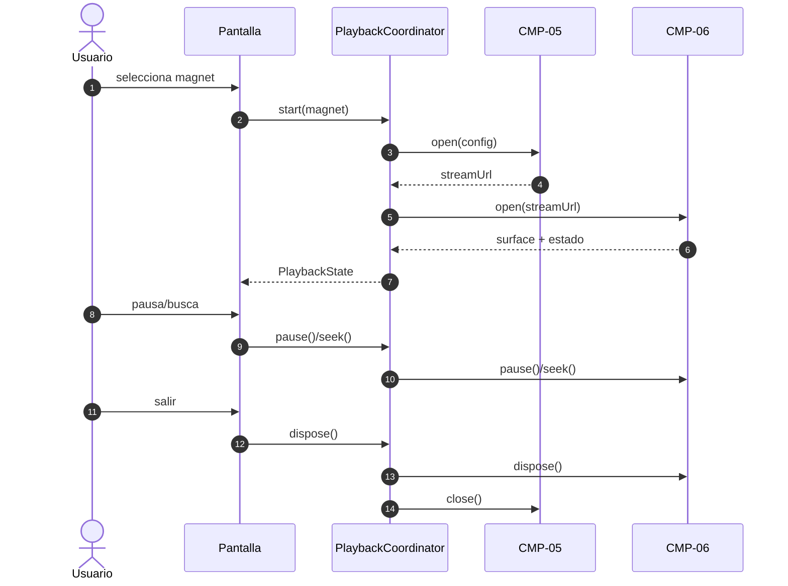
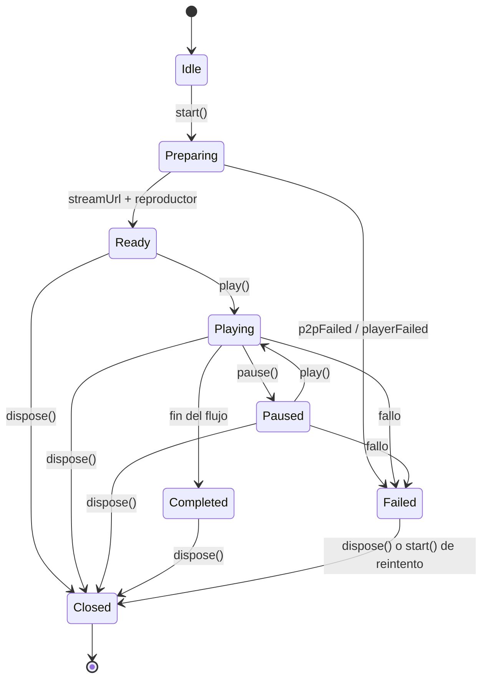

# PRC-01 — Magnet playback

---

spec_id: PRC-01
spec_type: PRC
name: Magnet playback
target: lib/features/tv_experience/application/playback_coordinator.dart
block: playback
status: APPROVED
version: 2.0
owner: Architecture
last_reviewed: 2026-10-25
approved_at: 2026-10-25
approved_by: Product Owner
supersedes: []
superseded_by: []
user_story: user_story.md
trigger: El usuario elige un magnet para reproducir
participants: [CMP-05, CMP-06, CMP-15]
depends_on: []
---

`PRC-01` · `v2.0` · `playback` · `APPROVED`

| 🔄 Tipo | 🚦 Estado | 🧭 Bloque | 🎬 Disparador |
|---|---|---|---|
| `PRC` | `APPROVED` | `playback` | El usuario elige un magnet para reproducir |

> [!IMPORTANT]
> **El proceso orquesta, no reimplementa.** Abre `CMP-05`, entrega su URL a `CMP-06` y cierra ambos en orden inverso.

> [!WARNING]
> **Estado `APPROVED` desde 2026-10-25.** El cierre debe respetar `INV-03`; la pantalla consume `PlaybackSession` y no importa P2P ni `media_kit`.

> [!TIP]
> **Ruta de lectura:** §5 flujo → §6 pasos → §9 contratos → §11 trazabilidad → §12 pruebas.

### 🗺️ Mapa de lectura

| Bloque | Qué encontrarás |
|---|---|
| §1–§4 | Resultado, disparador, alcance y actores |
| §5–§7 | Flujo, pasos, estados y errores |
| §8–§10 | Datos, contratos e invariantes |
| §11–§13 | Trazabilidad, pruebas y BDD |
| §14–§16 | Cierre, decisiones y preguntas |

---

## 🧭 0. Protocolo de lectura y no invención

1. Leer esta spec, `CMP-05` y `CMP-06`.
2. Implementar solo los pasos `ST-*` y los contratos de §9.
3. No duplicar lógica de P2P o de reproducción.
4. Si falta un dato, registrarlo en §16 y detener la implementación.
5. Actualizar §11 y §12 en el mismo cambio que el código.

---

## 🎯 1. Resultado esperado

### 1.1 Objetivo del proceso

Convertir un magnet en una reproducción visible y controlable: abrir la sesión P2P, entregar su
`streamUrl` al reproductor y publicar un estado combinado.

### 1.2 Resultado observable

- La pantalla muestra la superficie de vídeo con `position` avanzando.
- `pause`/`play` y `seek` funcionan sin reabrir el torrent.
- Al salir, el reproductor se destruye y la sesión P2P libera el puerto.

### 1.3 No objetivos

- Resolver catálogo, variantes o carátulas.
- Pintar OSD, carátulas o navegación.
- Persistir progreso o decidir reanudación.
- Implementar P2P ni decodificación (pertenece a `CMP-05`/`CMP-06`).

---

## 🎬 2. Disparador y condiciones

| Elemento | Definición |
|---|---|
| Disparador | El usuario selecciona un magnet y confirma "reproducir" |
| Precondiciones | Magnet con `xt=urn:btih` válido; token de sesión generado; token de UI disponible |
| Postcondiciones | Sesión P2P cerrada y reproductor destruido tras `dispose()` |
| Cancelación | `dispose()` cierra en orden inverso: reproductor → P2P |
| Reintento | Permitido desde estado `failed` creando una sesión nueva |

---

## 📐 3. Alcance y límites

**Incluye:** apertura de P2P, apertura del reproductor, estado combinado, play/pause/seek, cierre ordenado y errores tipados.

**Excluye:** lógica interna de P2P y del reproductor, catálogo, OSD, progreso persistido, navegación entre pantallas.

---

## 👥 4. Actores y participantes

| Actor / componente | Rol en el proceso |
|---|---|
| Usuario | Inicia, pausa, busca y sale |
| `CMP-05` | Entrega el `streamUrl` loopback y su estado |
| `CMP-06` | Reproduce el flujo y expone pistas y posición |
| Pantalla de reproducción | Pinta la superficie y traduce D-Pad |

---

## 🔄 5. Flujo



---

## 🪜 6. Pasos del proceso

| ID | Paso | Delegado en | Resultado |
|---|---|---|---|
| `ST-01` | Validar magnet y construir la configuración P2P | `CMP-05` | `P2pSessionConfig` o `invalidMagnet` |
| `ST-02` | Abrir la sesión P2P y obtener `streamUrl` | `CMP-05` | URL loopback activa |
| `ST-03` | Abrir el reproductor con la URL y publicar la superficie | `CMP-06` | `videoSurface` disponible |
| `ST-04` | Publicar estado combinado (fase, posición, duración, progreso) | Este proceso | `PlaybackState` |
| `ST-05` | Reenviar play, pause y seek al reproductor | `CMP-06` | Estado actualizado |
| `ST-06` | Cerrar reproductor y luego P2P, en ese orden | `CMP-06`, `CMP-05` | Puerto y superficie liberados |
| `ST-07` | Traducir fallos de cualquiera de los dos a `PlaybackFailure` | Este proceso | Estado `failed` |
| `ST-08` | Reintentar desde `failed` creando sesiones nuevas | Este proceso | Nuevo intento limpio |
| `ST-09` | Aplicar la posición inicial al abrir el reproductor | `CMP-06` | Reproducción desde el punto pedido |
| `ST-10` | Propagar pistas y selección al estado combinado | `CMP-06` | `audioTracks`, `subtitleTracks`, ids |
| `ST-11` | Seleccionar audio o subtítulos sin reiniciar el flujo | `CMP-06` | Selección actualizada y posición intacta |
| `ST-12` | Publicar estadísticas P2P (velocidad y bytes disponibles) | `CMP-05` | Campos de estado actualizados |

---

## 🔀 7. Estados y errores

### 7.1 Fases



### 7.2 Errores

| Código | Condición | Resultado |
|---|---|---|
| `invalidMagnet` | Magnet malformado o sin `xt` | `failed` sin abrir P2P |
| `p2pFailed` | `CMP-05` falla (timeout, puerto, límites) | `failed`; se libera lo abierto |
| `playerFailed` | `CMP-06` falla al abrir o reproducir | `failed`; se cierra la sesión P2P |
| `alreadyClosed` | Operación tras `dispose()` | `PlaybackFailure` |

---

## 🗃️ 8. Datos y estado

`PlaybackState` combina el estado de `CMP-05` (progreso, peers) y de `CMP-06` (posición, duración, pistas).

| Campo | Origen |
|---|---|
| `phase` | Este proceso |
| `infoHash`, `progress`, `peers` | `CMP-05` |
| `downloadRateBytesPerSecond`, `availableBytes` | `CMP-05` |
| `position`, `duration`, `status` | `CMP-06` |
| `audioTracks`, `subtitleTracks`, `selectedAudioId`, `selectedSubtitleId` | `CMP-06` |
| `videoSurface` | `CMP-06` (builder opaco) |

---

## 🔌 9. Contratos

```dart
// Ruta canónica: lib/features/tv_experience/application/playback_coordinator.dart
// Spec: PRC-01

enum PlaybackPhase {
  idle,
  preparing,
  ready,
  playing,
  paused,
  buffering,
  completed,
  failed,
  closed,
}

enum PlaybackErrorCode {
  invalidMagnet,
  p2pFailed,
  playerFailed,
  alreadyClosed,
}

final class PlaybackFailure implements Exception {
  const PlaybackFailure({
    required this.code,
    required this.message,
    this.cause,
  });

  final PlaybackErrorCode code;
  final String message;
  final Object? cause;
}

final class PlaybackState {
  const PlaybackState({
    required this.phase,
    required this.infoHash,
    required this.streamUrl,
    required this.position,
    required this.duration,
    required this.progress,
    required this.peers,
    required this.videoSurface,
    required this.failure,
  });

  const PlaybackState.idle()
    : phase = PlaybackPhase.idle,
      infoHash = null,
      streamUrl = null,
      position = Duration.zero,
      duration = Duration.zero,
      progress = 0.0,
      peers = 0,
      videoSurface = null,
      failure = null;

  final PlaybackPhase phase;
  final String? infoHash;
  final String? streamUrl;
  final Duration position;
  final Duration duration;
  final double progress;
  final int peers;
  final MediaSurfaceBuilder? videoSurface;
  final PlaybackFailure? failure;
  final List<MediaTrack> audioTracks;
  final List<MediaTrack> subtitleTracks;
  final String? selectedAudioId;
  final String? selectedSubtitleId;
  final int downloadRateBytesPerSecond;
  final int availableBytes;
}

abstract interface class PlaybackSession {
  PlaybackState get currentState;
  Stream<PlaybackState> get state;
  Future<void> start(String magnet, {Duration initialPosition});
  Future<void> play();
  Future<void> pause();
  Future<void> seek(Duration position);
  Future<void> selectAudioTrack(String trackId);
  Future<void> selectSubtitleTrack(String? trackId);
  Future<void> retry();
  Future<void> dispose();
}

final class PlaybackCoordinator {
  PlaybackCoordinator({
    required P2pEngine p2pEngine,
    required MediaPlayerAdapter Function() adapterFactory,
    required String token,
    required String sessionDirectory,
    int port = kP2pDefaultPort,
  });

  PlaybackState get currentState;
  Stream<PlaybackState> get state;

  Future<void> start(String magnet, {Duration initialPosition = Duration.zero});
  Future<void> play();
  Future<void> pause();
  Future<void> seek(Duration position);
  Future<void> selectAudioTrack(String trackId);
  Future<void> selectSubtitleTrack(String? trackId);
  Future<void> retry();
  Future<void> dispose();
}
```

---

## 🧱 10. Invariantes

| ID | Invariante |
|---|---|
| `INV-01` | El proceso no abre conexiones propias ni descarga contenido. |
| `INV-02` | El reproductor recibe únicamente el `streamUrl` de `CMP-05`. |
| `INV-03` | El cierre destruye primero el reproductor y después la sesión P2P. |
| `INV-04` | Nunca se abren dos sesiones P2P simultáneas desde el mismo coordinador. |
| `INV-05` | Los fallos se publican como `PlaybackFailure`; nunca se propagan tipos de MPV. |

---

## 🗺️ 11. Mapa de implementación y trazabilidad

| Paso | Contrato | Implementación (archivo::símbolo) | Test | Estado |
|---|---|---|---|---|
| `ST-01` | `PlaybackCoordinator.start` | `lib/features/tv_experience/application/playback_coordinator.dart::PlaybackCoordinator.start` | `TC-01` | Verified |
| `ST-02` | `P2pEngine` | `lib/features/tv_experience/application/playback_coordinator.dart::_openP2p` | `TC-02` | Verified |
| `ST-03` | `MediaPlayerSession` | `lib/features/tv_experience/application/playback_coordinator.dart::_openPlayer` | `TC-03` | Verified |
| `ST-04` | `PlaybackState` | `lib/features/tv_experience/application/playback_coordinator.dart::_emit` | `TC-04` | Verified |
| `ST-05` | `MediaPlayerSession` | `lib/features/tv_experience/application/playback_coordinator.dart::play` | `TC-05` | Verified |
| `ST-06` | `PlaybackCoordinator.dispose` | `lib/features/tv_experience/application/playback_coordinator.dart::dispose` | `TC-06` | Verified |
| `ST-07` | `PlaybackFailure` | `lib/features/tv_experience/application/playback_coordinator.dart::_fail` | `TC-07` | Verified |
| `ST-08` | `PlaybackCoordinator.start` | `lib/features/tv_experience/application/playback_coordinator.dart::retry` | `TC-08` | Verified |
| `ST-09` | `PlaybackSession.start` | `lib/features/tv_experience/application/playback_coordinator.dart::start` | `TC-09` | Verified |
| `ST-10` | `PlaybackState` | `lib/features/tv_experience/application/playback_coordinator.dart::_playerSubscription` | `TC-10` | Verified |
| `ST-11` | `PlaybackSession.selectAudioTrack` / `selectSubtitleTrack` | `lib/features/tv_experience/application/playback_coordinator.dart::_syncTracks` | `TC-11` | Verified |
| `ST-12` | `P2pSessionState` | `lib/features/tv_experience/application/playback_coordinator.dart::_p2pSubscription` | `TC-12` | Verified |

---

## 🧪 12. Plan de pruebas

Los tests usan una sesión P2P real con `FakeTorrentSource` y un `FakeMediaPlayerAdapter`: sin red, sin MPV y sin dispositivo.

| ID | Qué verifica | Criterio |
|---|---|---|
| `TC-01` | Magnet inválido | `failed` con `invalidMagnet` y sin abrir P2P |
| `TC-02` | Apertura P2P | Se crea una sesión y se publica `streamUrl` |
| `TC-03` | Apertura del reproductor | Recibe exactamente el `streamUrl` de P2P |
| `TC-04` | Estado combinado | `progress` de P2P y `position` de player se reflejan |
| `TC-05` | Controles | `play`, `pause` y `seek` llegan al reproductor |
| `TC-06` | Cierre | Reproductor cerrado antes que P2P; puerto libre |
| `TC-07` | Fallo del reproductor | `failed` con `playerFailed` y P2P cerrado |
| `TC-08` | Reintento | `start()` desde `failed` abre sesiones nuevas |
| `TC-09` | Posición inicial | El reproductor recibe `startAt` igual a la posición pedida |
| `TC-10` | Pistas | `audioTracks`, `subtitleTracks` y selección se publican |
| `TC-11` | Selección | Audio y subtítulos cambian sin reiniciar; `null` desactiva subtítulos |
| `TC-12` | Estadísticas P2P | Velocidad y bytes disponibles se reflejan en el estado |

**Comandos:** `flutter analyze` · `flutter test test/unit/tv_experience`

---

## 🥒 13. Criterios de aceptación BDD

```gherkin
@ST-02
Scenario: Reproducir un magnet válido
  Given un coordinador sin sesión activa
  When inicio "magnet:?xt=urn:btih:..."
  Then la fase llega a ready
  And streamUrl apunta a 127.0.0.1
  And el reproductor recibe esa misma URL
```

```gherkin
@ST-06
Scenario: Salir de la reproducción
  Given un coordinador reproduciendo
  When invoco dispose()
  Then el reproductor se cierra antes que la sesión P2P
  And el puerto queda libre
  And la fase es closed
```

---

## 🏁 14. Definition of Done

- [x] Todos los `ST-*` tienen contrato, implementación y prueba.
- [x] `flutter analyze` y `flutter test` pasan.
- [x] El cierre respeta el orden reproductor → P2P.
- [x] No hay lógica de P2P ni de decodificación en el coordinador.
- [x] La pantalla mínima pinta la superficie y responde a D-Pad.
- [x] La spec está `APPROVED` y `sync-sdd` no reporta `DIVERGED`.

---

## 🧾 15. Decisiones

| Fecha | Decisión | Motivo | Impacto |
|---|---|---|---|
| 2026-10-24 | El coordinador vive en `tv_experience/application/` y recibe `P2pEngine` y una factoría de adaptadores por inyección. | Evita dependencias ocultas y permite tests sin MPV. | `§9`. |
| 2026-10-24 | La pantalla mínima vive en `tv_experience/presentation/` y solo traduce D-Pad a llamadas del coordinador. | Mantener la UI delgada. | `§3`. |
| 2026-10-24 | El coordinador construye la URL del reproductor añadiendo `?token=`. | `CMP-05` exige token y el reproductor no lo añadía: MPV recibía `401`. | `ST-03`. |
| 2026-10-24 | La app declara `android:usesCleartextTraffic="true"`. | Android bloquea HTTP en claro y el flujo es `http://127.0.0.1`; el endpoint sigue siendo solo loopback. | Manifiesto de `android/`. |
| 2026-10-25 | `PlaybackState` publica pistas, selección y estadísticas P2P; `start` acepta posición inicial y `retry` reutiliza el último magnet. | La pantalla de reproducción necesita esos datos sin duplicar lógica del player. | `ST-09`..`ST-12`, `CMP-15`. |
| 2026-10-25 | `MediaPlayerSession._refreshTracks` construye el estado completo para permitir desactivar subtítulos (`null`). | `copyWith` no podía limpiar un campo nullable. | `ST-11`, `CMP-06`. |

---

## ❓ 16. Preguntas abiertas

| ID | Pregunta | Bloqueante | Responsable | Respuesta |
|---|---|---|---|---|
| `Q-01` | ¿El token de sesión lo genera el coordinador o la pantalla? | No | Architecture | Lo genera el coordinador al iniciar |
| `Q-02` | ¿Se persiste el progreso al cerrar? | No | Product | Fuera del proceso: `CMP-15` notifica por callback; la persistencia real llega con `CMP-02`. |
| `Q-03` | ¿Por qué MPV entra en `playing` pero `position`/`duration` se quedan en 0 con el stream local? | No | Platform | **Resuelta 2026-10-24:** las lecturas nativas bloqueaban el isolate de UI; movidas a un isolate trabajador (`ADR-0005`). Ahora `pos` avanza y `dur=888s` |
| `Q-04` | ¿Por qué la superficie de vídeo sale en negro en el emulador? | No | Platform | **Resuelta 2026-10-24:** `media_kit`/`libmpv` no puede crear su contexto EGL en la imagen `android-36;android-tv` (`EGL_BAD_ATTRIBUTE`, GLES 3.0 máximo). Con el AVD `FLIK_PHONE_30` (`android-30;google_apis;x86_64`, `-gpu host`) la APK reproduce Sintel con imagen y audio |

---

## 🧾 Historial de cambios

| Versión | Fecha | Tipo | Cambio | Aprobado por |
|---|---|---|---|---|
| 1.0 | 2026-10-24 | Inicial | Orquestación magnet → P2P → reproductor y cierre ordenado. | Pendiente |
| 1.1 | 2026-10-24 | Corrección | Token en la URL del reproductor, HTTP en claro y lectura nativa en isolate trabajador; reloj de reproducción verificado. Superficie negra pendiente por `EGL_BAD_ATTRIBUTE` en el emulador. | Architecture |
| 1.2 | 2026-10-24 | Corrección | Precalentamiento del inicio antes de abrir el reproductor (MPV abandonaba a los ~5 s) y vídeo verificado en el AVD API 30; la imagen TV API 36 no soporta el contexto EGL de `libmpv`. | Architecture |
| 2.0 | 2026-10-25 | Ampliación | Posición inicial, pistas y selección, estadísticas P2P, `retry()` y `PlaybackSession`; pruebas TC-09..TC-12. | Product Owner |


