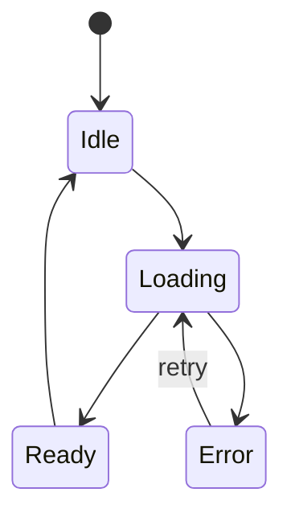

# CMP-<NN> — <Nombre del componente>

---
spec_id: CMP-<NN>
spec_type: CMP
layer: <bootstrap|domain|ui>
name: <Nombre del componente>
target: <ruta/exacta/al/archivo.dart>
block: <feature>
status: DRAFT
version: 1.0
owner: <rol responsable>
last_reviewed: <YYYY-MM-DD>
approved_at: null
approved_by: null
supersedes: []
superseded_by: []
user_story: user_story.md
processes: [<PRC-XX>]
design_ref: .ai-harness/context/ui-design-system.md
depends_on: [<CMP-...>]
consumed_by: [<CMP-...>]
---

`CMP-<NN>` · `v1.0` · `<feature>` · `Flutter` · `DRAFT`

| 🧩 Tipo | 🚦 Estado | 🧭 Feature | 🎯 Target |
|---|---|---|---|
| `CMP` | `DRAFT` | `<feature>` | `<ruta/exacta/al/archivo.dart>` |

> [!IMPORTANT]
> **Contrato de lectura rápida.** Esta spec es la fuente de verdad del comportamiento. El código no puede añadir campos, estados, reglas ni estilos que no estén aquí o en los documentos referenciados.
>
> **Archivo:** `<nombre>.spec.md` · **Plantilla:** Componente · **Diseño:** `ui-design-system.md`

> [!TIP]
> **Ruta de lectura:** §4 requisitos → §8 contratos → §10 trazabilidad → §11 pruebas. Si falta un dato, ve a §15 y detén la implementación.

### 🗺️ Mapa de lectura

| Bloque | Qué encontrarás |
|---|---|
| §1–§3 | Problema, alcance y actores |
| §4–§6 | Requisitos, reglas, estados y errores |
| §7–§9 | UI, contratos y dependencias |
| §10–§12 | Trazabilidad, pruebas y BDD |
| §13–§15 | Cierre, decisiones y preguntas |

---

## 0. Protocolo de lectura y no invención

Antes de escribir código, la IA y el desarrollador deben:

1. Leer completa esta spec y los documentos de `design_ref`/contexto aplicables.
2. Implementar solo lo que aparece en los requisitos funcionales (`FR-*`) y en los contratos (`CT-*`).
3. No inventar campos, estados, errores, tokens, endpoints ni dependencias.
4. Si falta un dato, registrarlo en §15 y **detener la implementación** hasta resolverlo.
5. Actualizar §10 (mapa de implementación) y §11 (pruebas) en el mismo cambio que el código.
6. No declarar una implementación alineada si existe un `FR-*` sin código, prueba o verificación.

**Jerarquía de verdad:** contexto del proyecto → reglas de arquitectura → esta spec → código. Para color, tipografía y foco, la autoridad es `ui-design-system.md`; esta spec solo referencia tokens por nombre.

---

## 1. Contexto y objetivo

### 1.1 Problema

<Qué problema resuelve este componente y por qué existe.>

### 1.2 Objetivo medible

<Resultado verificable. Evitar adjetivos vagos.>

### 1.3 No objetivos

- <Lo que este componente no hace.>
- <Fuera de alcance.>

---

## 2. Alcance y límites

**Incluye:**

- <Responsabilidad concreta.>
- <Comportamiento concreto.>

**Excluye:**

- <Responsabilidad de otro componente.>
- <Comportamiento prohibido.>

**Invariantes de arquitectura aplicables:**

- <Enlace o ID de `architecture_rules.md`.>

---

## 3. Actores e historia de usuario

> **Como** <rol>,
> **quiero** <acción>,
> **para** <beneficio>.

**Actores secundarios:** <sistema, módulo, usuario TV, usuario móvil.>

---

## 4. Requisitos funcionales

Cada requisito es atómico, observable y verificable. Un `FR` no puede agrupar dos comportamientos.

| ID | Requisito | Prioridad | Criterio de aceptación | Regla |
|---|---|---|---|---|
| `FR-01` | <Comportamiento observable.> | Must | `AC-01` | `BR-01` |
| `FR-02` | <Comportamiento observable.> | Should | `AC-02` | `BR-02` |

**Regla:** todo `FR-*` debe aparecer en el mapa de implementación §10 y en al menos un test `TC-*`.

---

## 5. Reglas de negocio e invariantes

| ID | Regla / invariante | Fuente canónica | Verificación |
|---|---|---|---|
| `BR-01` | <Regla de negocio.> | <contexto/scope/spec> | `TC-01` |
| `INV-01` | <Invariante que nunca puede violarse.> | <architecture_rules / ui-design-system> | `TC-02` |

**Regla:** una regla sin fuente canónica no se implementa; se discute en §15.

---

## 6. Estados, comportamiento y errores

### 6.1 Máquina de estados



### 6.2 Tabla de estados

| Estado | Entrada | Salida | UI / efecto observable |
|---|---|---|---|
| `Idle` | <condición> | <evento> | <comportamiento> |
| `Loading` | <condición> | <evento> | <comportamiento> |

### 6.3 Errores y casos borde

| Código | Condición | Resultado | Recuperable |
|---|---|---|---|
| `<error>` | <cuándo ocurre> | <estado/mensaje/acción> | Sí / No |

Casos borde obligatorios: datos vacíos, datos corruptos, cancelación, cierre de sesión, pérdida de red, recurso no disponible.

---

## 7. UX/UI y foco (solo `layer: ui`)

> Para `bootstrap` o `domain`, indicar “No aplica” y eliminar esta sección del documento final.

- **Tokens:** usar exclusivamente los nombres de `ui-design-system.md` (`canvas`, `surface`, `accent`, `textPrimary`, `textSecondary`). Prohibido HEX literales.
- **Jerarquía:** <título, metadatos, acciones.>
- **Foco inicial:** <elemento.>
- **Orden D-Pad:** <left/right/up/down/select/back.>
- **Estado de foco:** <escala, borde, halo, scroll.>
- **OSD:** <tiempo de ocultación, eventos que lo muestran.>
- **Accesibilidad:** <semántica, contraste, escalado.>
- **Responsive:** <TV, móvil, escritorio.>

**Regla:** ninguna decisión visual puede contradecir `ui-design-system.md`. Si falta un token, se actualiza primero el sistema de diseño.

---

## 8. Contratos de datos (`CT-*`)

Todo tipo público del componente se define aquí. Si el código necesita un campo que no está en esta sección, la spec está incompleta: se actualiza primero.

### 8.1 Modelos e interfaces

```dart
// Ruta canónica: <target>
// Spec: CMP-<NN>
// FR cubiertos: FR-01, FR-02

@freezed
class <NombreModelo> with _$<NombreModelo> {
  const factory <NombreModelo>({
    required String id,
    required <Tipo> <campo>,
    <Tipo>? <campoOpcional>,
  }) = _<NombreModelo>;

  factory <NombreModelo>.fromJson(Map<String, dynamic> json) =>
      _$<NombreModelo>FromJson(json);
}
```

### 8.2 Tabla de campos

| Campo | Tipo | Obligatorio | Restricción | Origen / destino |
|---|---|---|---|---|
| `id` | `String` | Sí | <regex/longitud> | <fuente> |
| `<campo>` | `<tipo>` | Sí | <rango/formato> | <fuente> |

### 8.3 Contratos expuestos

| ID | Símbolo público | Entrada | Salida | Errores |
|---|---|---|---|---|
| `CT-01` | `<Interface/metodo>` | <tipos> | <tipos> | <errores tipados> |

**Regla de sincronización:** cualquier cambio en `CT-*` exige actualizar el código, los tests y §10 en el mismo cambio.

---

## 9. Interfaces y dependencias

### 9.1 Dependencias permitidas

- <Paquete/módulo interno y para qué.>
- <SDK de Flutter, si aplica.>

### 9.2 Dependencias prohibidas

- <Backend, proxy, analítica, UI no autorizada.>
- <Importar capas internas de otra feature.>

### 9.3 Ciclo de vida

- **Creación:** <quién y cuándo.>
- **Suscripción:** <streams/eventos.>
- **Cancelación:** <cómo se cancelan timers, sockets y suscripciones.>
- **Destrucción:** <qué recursos se liberan.>

---

## 10. Mapa de implementación y trazabilidad

Este mapa es obligatorio y debe reflejar el código real. Sin él, la implementación no puede considerarse alineada con la spec.

| Requisito | Contrato | Implementación (archivo::símbolo) | Test | Estado |
|---|---|---|---|---|
| `FR-01` | `CT-01` | `lib/.../archivo.dart::Simbolo` | `TC-01` | Pending / Implemented / Verified |
| `FR-02` | `CT-02` | `lib/.../archivo.dart::Simbolo` | `TC-02` | Pending / Implemented / Verified |

**Estados:**

- `Pending`: no existe implementación.
- `Implemented`: existe código, pero falta verificación.
- `Verified`: existe código y test en verde.

**Regla anti-deriva:** si un símbolo del código no aparece en este mapa, está fuera de spec y debe eliminarse o especificarse.

---

## 11. Plan de pruebas

| ID | Tipo | Qué verifica | Fixture / entrada | Criterio |
|---|---|---|---|---|
| `TC-01` | Unit | `FR-01` | <fixture> | <resultado exacto> |
| `TC-02` | Widget | `FR-02` | <fixture> | <resultado exacto> |

**Comandos:**

- `flutter analyze`
- `flutter test <ruta>`

**Prohibido:** red real, trackers públicos, temporizadores reales y expectativas basadas en píxeles fuera de los tokens.

---

## 12. Criterios de aceptación BDD

Cada escenario referencia el `FR-*` que valida.

```gherkin
@FR-01
Scenario: <Nombre del escenario>
  Given <estado inicial verificable>
  When <acción del usuario o del sistema>
  Then <resultado observable>
  And <resultado adicional>
```

```gherkin
@FR-02
Scenario: <Caso borde o error>
  Given <estado inicial>
  When <acción que provoca el error>
  Then <estado de error esperado>
  And <acción de recuperación disponible>
```

---

## 13. Definition of Done

- [ ] Todos los `FR-*` tienen `AC-*`, `TC-*` y entrada en §10.
- [ ] Todos los `CT-*` están implementados y referenciados por código.
- [ ] Los símbolos públicos llevan comentario `/// Spec: CMP-... / FR-...`.
- [ ] `flutter analyze` y `flutter test` pasan.
- [ ] No hay placeholders ni secciones vacías.
- [ ] No hay tokens visuales hardcodeados.
- [ ] No se añadieron dependencias fuera de §9.
- [ ] La spec y el código describen el mismo comportamiento.
- [ ] §15 no tiene preguntas bloqueantes.
- [ ] El contrato está en `APPROVED` y `sync-sdd` no reporta `DIVERGED`.

---

## 14. Decisiones y cambios

| Fecha | Decisión | Motivo | Impacto | Aprobado por |
|---|---|---|---|---|
| <YYYY-MM-DD> | <decisión> | <razón> | <FR/CT afectados> | <rol> |

Toda decisión que cambie comportamiento, contrato o alcance debe registrarse aquí antes de implementarse.

---

## 15. Preguntas abiertas

| ID | Pregunta | Bloqueante | Responsable | Respuesta |
|---|---|---|---|---|
| `Q-01` | <duda concreta> | Sí / No | <rol> | <respuesta y fecha> |

**Regla:** si una pregunta bloqueante no tiene respuesta, el estado máximo permitido es `DRAFT`; no se implementa.

---

## Historial de cambios

| Versión | Fecha | Tipo | Cambio | Aprobado por |
|---|---|---|---|---|
| 1.0 | <YYYY-MM-DD> | Inicial | <Cambio inicial.> | Pendiente |

