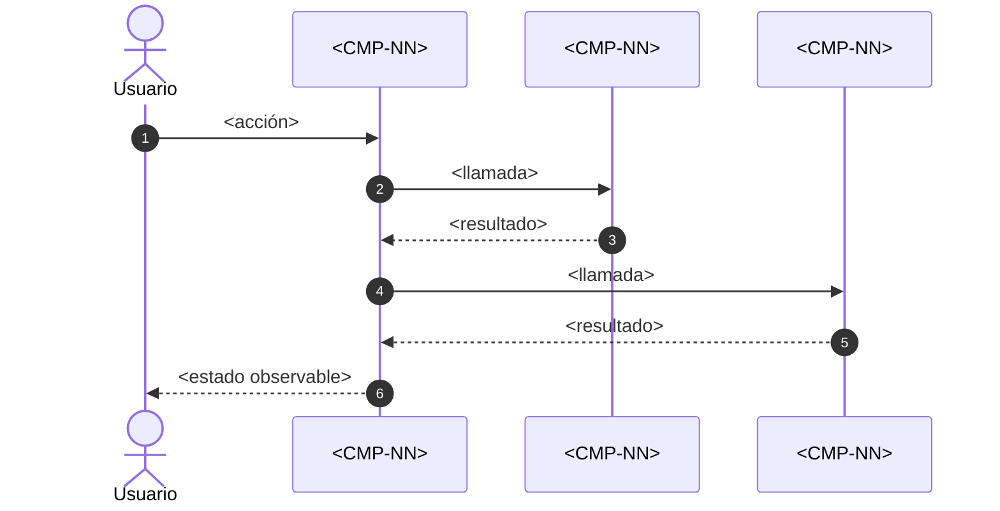
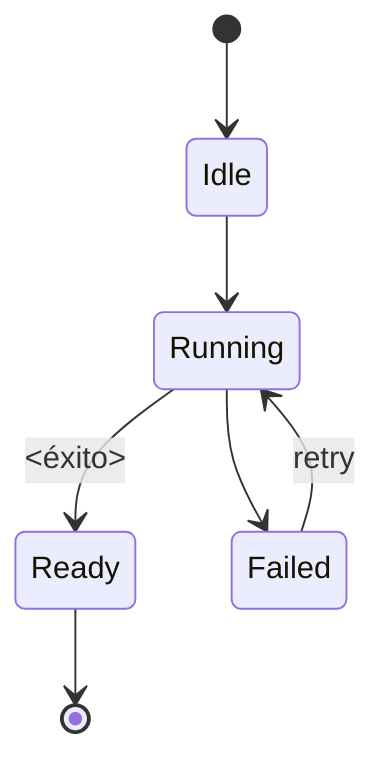

# PRC-<NN> — <Nombre del proceso>

---
spec_id: PRC-<NN>
spec_type: PRC
name: <Nombre del proceso>
target: <ruta/exacta/al/orquestador.dart>
block: <playback|catalog|navigation>
status: DRAFT
version: 1.0
owner: <rol responsable>
last_reviewed: <YYYY-MM-DD>
approved_at: null
approved_by: null
supersedes: []
superseded_by: []
user_story: user_story.md
trigger: <evento que inicia el proceso>
participants: [<CMP-...>]
depends_on: [<PRC-...>]
---

`PRC-<NN>` · `v1.0` · `<block>` · `DRAFT`

| 🔄 Tipo | 🚦 Estado | 🧭 Bloque | 🎬 Disparador |
|---|---|---|---|
| `PRC` | `DRAFT` | `<block>` | `<evento que inicia el proceso>` |

> [!IMPORTANT]
> **El proceso orquesta, no reimplementa.** Cada paso debe delegar en un componente existente o declarar explícitamente el componente que se creará.
>
> **Archivo:** `<nombre>.spec.md` · **Plantilla:** Proceso FLIK · **Participantes:** `<CMP-...>`

> [!TIP]
> **Ruta de lectura:** §5 flujo → §6 pasos → §9 contratos → §11 trazabilidad → §12 pruebas. Si falta un dato, ve a §16.

### 🗺️ Mapa de lectura

| Bloque | Qué encontrarás |
|---|---|
| §1–§4 | Resultado, disparador, alcance y actores |
| §5–§7 | Flujo, pasos, estados y errores |
| §8–§10 | Datos, contratos e invariantes |
| §11–§13 | Trazabilidad, pruebas y BDD |
| §14–§16 | Cierre, decisiones y preguntas |

---

## 0. Protocolo de lectura y no invención

1. Leer esta spec, los componentes participantes y las reglas de arquitectura.
2. Implementar solo los pasos (`ST-*`), estados y contratos aquí definidos.
3. No inventar pasos, eventos, campos, errores ni dependencias.
4. Si falta un dato, registrarlo en §16 y detener la implementación.
5. Actualizar §11 y §12 en el mismo cambio que el código.
6. No declarar una implementación alineada si un `ST-*` no tiene implementación y prueba.

**Jerarquía de verdad:** contexto del proyecto → reglas de arquitectura → specs de componentes → esta spec → código.

---

## 1. Resultado esperado

### 1.1 Objetivo del proceso

<Qué transforma el proceso: entrada → resultado.>

### 1.2 Resultado observable

<Cómo sabe el usuario o el sistema que el proceso terminó correctamente.>

### 1.3 No objetivos

- <Lo que el proceso no hace.>
- <Lógica que pertenece a un componente.>

---

## 2. Disparador y condiciones

| Elemento | Definición |
|---|---|
| Disparador | <acción de usuario, evento de sistema, temporizador.> |
| Precondiciones | <estado necesario antes de iniciar.> |
| Postcondiciones | <estado garantizado al terminar.> |
| Cancelación | <cómo se cancela y qué se libera.> |
| Reintento | <cuándo y cómo se reintenta.> |

**Regla:** si una precondición no se cumple, el proceso no se inicia y devuelve un error tipado; no improvisa un estado alternativo.

---

## 3. Alcance y límites

**Incluye:**

- <Pasos orquestados.>
- <Estados y transiciones.>
- <Errores y recuperación.>

**Excluye:**

- <Lógica interna de componentes.>
- <Comportamiento de otras features.>

---

## 4. Actores y participantes

| Actor / componente | Rol en el proceso |
|---|---|
| <Usuario TV / móvil / escritorio> | <inicia, cancela, navega.> |
| `<CMP-NN>` | <responsabilidad delegada.> |
| `<CMP-NN>` | <superficie o interacción.> |

---

## 5. Flujo



**Regla:** el diagrama debe coincidir con los pasos `ST-*`. Si divergen, la spec está incompleta.

---

## 6. Pasos del proceso

| ID | Paso | Componente | Entrada | Salida | Fallo | Requisito |
|---|---|---|---|---|---|---|
| `ST-01` | <acción atómica.> | `<CMP-...>` | <tipo> | <tipo> | <error/estado> | `FR-01` |
| `ST-02` | <acción atómica.> | `<CMP-...>` | <tipo> | <tipo> | <error/estado> | `FR-02` |

**Reglas:**

- Cada paso tiene una única responsabilidad.
- Un paso no puede acceder a la base de datos, red o sockets si esa responsabilidad pertenece a otro componente.
- Todo paso tiene salida y fallo definidos.
- Los pasos `ST-*` son la unidad de trazabilidad del proceso.

---

## 7. Estados y errores

### 7.1 Estados del proceso



### 7.2 Tabla de errores

| Código | Paso | Condición | Resultado | Recuperable |
|---|---|---|---|---|
| `<error>` | `ST-01` | <cuándo> | <estado/acción> | Sí / No |

**Regla:** todo error se propaga como estado tipado; prohibido silenciar fallos o dejar recursos abiertos.

---

## 8. Mapeo de datos y transformación de estados

| Campo origen | Tipo origen | Campo destino | Tipo destino | Transformación | Paso |
|---|---|---|---|---|---|
| `<campo>` | `<tipo>` | `<campo>` | `<tipo>` | <regla exacta> | `ST-01` |

**Regla:** todo campo que atraviesa el proceso debe aparecer aquí. Si un campo no está en la tabla, no puede añadirse al código.

---

## 9. Contratos de entrada, salida y eventos (`CT-*`)

```dart
// Ruta canónica: <target>
// Spec: PRC-<NN>
// Pasos cubiertos: ST-01, ST-02

sealed class <Proceso>State {
  const <Proceso>State();
}

final class <Proceso>Idle extends <Proceso>State { const <Proceso>Idle(); }
final class <Proceso>Running extends <Proceso>State { const <Proceso>Running(); }
final class <Proceso>Failed extends <Proceso>State {
  const <Proceso>Failed({required this.code, required this.message});
  final String code;
  final String message;
}
```

| ID | Contrato | Tipo | Entrada / salida | Errores |
|---|---|---|---|---|
| `CT-01` | `<Evento/Modelo>` | <tipo> | <campos> | <errores> |

**Regla:** los estados del proceso son inmutables y exhaustivos. Prohibido usar `String` libre para representar estados.

---

## 10. Invariantes y reglas del proceso

| ID | Regla / invariante | Fuente canónica | Verificación |
|---|---|---|---|
| `BR-01` | <regla de negocio del flujo.> | <contexto/spec> | `TC-01` |
| `INV-01` | <invariante que nunca puede violarse.> | <architecture_rules> | `TC-02` |

Ejemplos de invariantes FLIK que deben verificarse si aplican:

- El flujo de vídeo no pasa por backend, proxy ni transcodificación.
- El endpoint local es `127.0.0.1:8888/stream` y responde `206`.
- La sesión P2P se cierra al salir de la reproducción.
- El progreso se guarda localmente y no se envía a terceros.

---

## 11. Mapa de implementación y trazabilidad

| Paso | Contrato | Implementación (archivo::símbolo) | Test | Estado |
|---|---|---|---|---|
| `ST-01` | `CT-01` | `lib/.../archivo.dart::Simbolo` | `TC-01` | Pending / Implemented / Verified |
| `ST-02` | `CT-01` | `lib/.../archivo.dart::Simbolo` | `TC-02` | Pending / Implemented / Verified |

**Regla anti-deriva:** todo paso debe tener un símbolo real y una prueba. Si el código ejecuta pasos que no están en esta tabla, la spec y la implementación están desincronizadas.

---

## 12. Plan de pruebas

| ID | Tipo | Qué verifica | Fixture / entrada | Criterio |
|---|---|---|---|---|
| `TC-01` | Unit | `ST-01` | <fixture> | <resultado exacto> |
| `TC-02` | Integration | `ST-02` | <servidor local / fake> | <resultado exacto> |

**Comandos:**

- `flutter analyze`
- `flutter test <ruta>`
- `flutter test integration_test/<archivo>`

**Prohibido:** red real, trackers públicos, temporizadores reales y dependencia de servicios externos.

---

## 13. Criterios de aceptación BDD

Cada escenario referencia el paso o requisito que valida.

```gherkin
@ST-01
Scenario: <Flujo principal>
  Given <precondición>
  When <disparador>
  Then <paso 1 completado>
  And <paso 2 completado>
  And <resultado observable>
```

```gherkin
@ST-02
Scenario: <Fallo y recuperación>
  Given <precondición>
  When <fallo simulado>
  Then <estado de error tipado>
  And <recursos liberados>
  And <acción de reintento disponible>
```

---

## 14. Definition of Done

- [ ] Todos los `ST-*` tienen contrato, implementación y test.
- [ ] El diagrama y los pasos coinciden.
- [ ] Todos los errores tienen estado y recuperación definidos.
- [ ] Los recursos se liberan en éxito, error y cancelación.
- [ ] `flutter analyze` y `flutter test` pasan.
- [ ] No hay placeholders ni secciones vacías.
- [ ] No se añadieron pasos o campos fuera de esta spec.
- [ ] La spec y el código describen el mismo flujo.
- [ ] §16 no tiene preguntas bloqueantes.
- [ ] El contrato está en `APPROVED` y `sync-sdd` no reporta `DIVERGED`.

---

## 15. Decisiones y cambios

| Fecha | Decisión | Motivo | Impacto | Aprobado por |
|---|---|---|---|---|
| <YYYY-MM-DD> | <decisión> | <razón> | <ST/CT afectados> | <rol> |

Toda decisión que cambie el flujo, los contratos o el alcance se registra aquí antes de implementarse.

---

## 16. Preguntas abiertas

| ID | Pregunta | Bloqueante | Responsable | Respuesta |
|---|---|---|---|---|
| `Q-01` | <duda concreta> | Sí / No | <rol> | <respuesta y fecha> |

**Regla:** si una pregunta bloqueante no tiene respuesta, el proceso no se implementa y el estado máximo es `DRAFT`.

---

## Historial de cambios

| Versión | Fecha | Tipo | Cambio | Aprobado por |
|---|---|---|---|---|
| 1.0 | <YYYY-MM-DD> | Inicial | <Cambio inicial.> | Pendiente |

