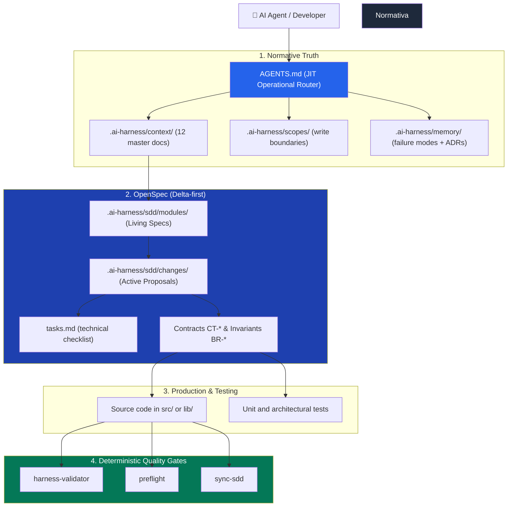

# 🚀 AI Harness Launcher

[](.github/workflows/harness-ci.yml)
[](.gitlab-ci.yml)
[](requirements.txt)
[](docs/05-sdd.md)
[](LICENSE)

[Español](README.md) | **English**

> **Governed, deterministic, and auditable AI-assisted software development environment.**  
> This repository serves a **dual purpose**: it acts as an **educational guide and canonical reference** on how to architect and govern professional AI agent harnesses, and functions as an **interactive generator (launcher)** capable of scaffolding a tailored harness for any tech stack via the `bootstrap-harness` skill.

---

## 🧭 Table of Contents

1. [What is this project?](#-what-is-this-project)
2. [Dual Purpose of this Repository](#-dual-purpose-of-this-repository)
3. [Conceptual Architecture: How the Harness Works](#-conceptual-architecture-how-the-harness-works)
4. [Project Structure and Zones](#-project-structure-and-zones)
5. [End-to-End Walkthrough (From Idea to Production)](#-end-to-end-walkthrough-from-idea-to-production)
6. [Getting Started: Two Ways to Use It](#-getting-started-two-ways-to-use-it)
   - [Mode A: Educational / Reference & Study](#mode-a-educational--reference--study)
   - [Mode B: Launcher for a Real Project (`bootstrap-harness`)](#mode-b-launcher-for-a-real-project-bootstrap-harness)
7. [Deterministic Quality Gates](#-deterministic-quality-gates)
8. [Skills and Workflows Catalog](#-skills-and-workflows-catalog)
9. [Non-Negotiable Golden Rules](#-non-negotiable-golden-rules)
10. [Dual CI/CD Integration (GitHub & GitLab)](#-dual-cicd-integration-github--gitlab)
11. [Contributing](#-contributing)
12. [About the Author](#-about-the-author)
13. [License](#-license)

---

## 💡 What is this project?

When collaborating with autonomous AI models (Antigravity, Claude, Cline, Roo-Code, Cursor, etc.) on real-world codebases, models tend to **hallucinate requirements**, invent unapproved data contracts, degrade software architecture, skip unit tests, or introduce forbidden dependencies.

The **AI Harness** is the containment, contextualization, and validation system surrounding the agent:
- **It is not a prompt:** It is a cohesive system of normative documents, contractual write-boundary scopes, and deterministic Python validation scripts.
- **OpenSpec-First (Delta-Driven Development):** Writing new production code is prohibited without an isolated change proposal in `changes/` consolidated into its living module spec, featuring a dedicated **Fast-Path** tier for minor bugfixes (<3 files).
- **Deterministic verification:** Code approval is never based on LLM "opinion", but on whether it passes automated Python quality gates with `exit code 0`.

---

## 🎯 Dual Purpose of this Repository

```
┌────────────────────────────────────────────────────────────────────────┐
│                        HARNESS-LAUNCHER                                │
├──────────────────────────────────┬─────────────────────────────────────┤
│      1. EDUCATIONAL PURPOSE      │         2. LAUNCHER PURPOSE         │
│         (docs/ + context/)       │         (bootstrap-harness)         │
│                                  │                                     │
│  📖 Explains the "Why":          │  ⚡ Transforms the Canonical Base:  │
│  - Complete harness theory.      │  - Ingests your PRD or brief.       │
│  - How to govern AI agents.      │  - Generates a tailored harness.    │
│  - 14 structured chapters.       │  - Configures scopes & validators.  │
│  - Quick-start reading paths.    │  - Leaves everything verified.      │
└──────────────────────────────────┴─────────────────────────────────────┘
```

1. **Educational reference:** If you want to master how to govern AI agents and avoid technical debt, `docs/` contains 14 structured chapters explaining each component (what it is, what failure it prevents, what breaks if absent).
2. **Interactive Launcher:** If you are bootstrapping a new project (or taming an existing codebase), `bootstrap-harness` scans your brief/PRD, interviews you, and scaffolds a production-ready harness (Flutter, Python, Node/TS, Go, API, CLI, or UI app) with zero hardcoded placeholders.

---

## 🧠 Conceptual Architecture: How the Harness Works

Control flow follows a strict, unidirectional order:



- **`AGENTS.md`:** The Just-In-Time (JIT) operational router. It holds no business rules; it only enforces the mandatory reading order and task dispatch.
- **`harness.config.yaml`:** The **single source of structural truth**. No script hardcodes paths or feature prefixes; everything is declared here.
- **`.ai-harness/context/`:** 12 normative documents defining system identity, architecture, coding standards, testing guidelines, and security policies.
- **`.ai-harness/scopes/`:** Contractual boundaries (`block_*.md`). Each scope specifies which directories it owns, which are strictly forbidden, and which public APIs it exposes.
- **`.ai-harness/sdd/`:** OpenSpec architecture with living consolidated modules (`modules/`), active proposal deltas (`changes/`), and immutable historical memory (`archive/`).

---

## 📁 Project Structure and Zones

```text
.
├── AGENTS.md                          # Mandatory entry-point router for AI agents
├── harness.config.yaml                # Single source of structural truth
├── requirements.txt                   # Python tooling dependencies (PyYAML, Pydantic)
├── MANIFEST.md                        # Canonical list of copyable vs. launcher assets
├── .gitattributes                     # LF line-ending normalization for hash consistency
├── .gitlab-ci.yml                     # Canonical GitLab CI/CD pipeline
├── .aiignore                          # Files excluded from the AI agent's context
├── .gitignore                         # Files excluded from version control
│
├── .github/                           # GitHub Actions CI workflow & PR/Issue templates
├── .gitlab/                           # GitLab Merge Request & Issue templates
│
├── .clinerules/                       # Agent integration rules and '/' slash workflows
│   ├── rules.md                       # Protocol of conduct for coding agents
│   └── workflows/                     # Invocable workflows (propose-change, preflight, etc.)
│
├── .agents/skills/                    # Operational documentation for agent tools
│   └── <skill>/SKILL.md               # Invocation guide and exit-code semantics
│
├── .ai-harness/                       # OPERATIONAL CORE OF THE HARNESS
│   ├── context/                       # 12 normative master documents
│   ├── design-system/                 # tokens.json + 6 design specifications
│   ├── scopes/                        # Write boundaries (block_*.md)
│   ├── sdd/                           # OpenSpec subsystem
│   │   ├── modules/                   # Living consolidated specs
│   │   ├── changes/                   # Active change proposals (deltas)
│   │   ├── archive/                   # Consolidated historical changes
│   │   └── templates/                 # Canonical templates (module, proposal, tasks)
│   ├── memory/                        # failure_modes.md + architectural ADRs
│   ├── fixtures/                      # Deterministic offline test data
│   ├── input/                         # Dropzone for PRDs, user stories, and specs
│   └── skills/                        # Python runners for deterministic quality gates
│
└── docs/                              # EDUCATIONAL ZONE (Full harness theory; not copied)
    ├── 00-indice.md to 12-bootstrap   # Chapter-by-chapter conceptual curriculum
    ├── 13-ejemplo-practico            # End-to-end real-world walkthrough
    └── cheatsheet.md                  # Quick-reference one-pager
```

---

## 🎬 End-to-End Walkthrough (From Idea to Production)

> 📖 **Full detailed tutorial:** [docs/13-ejemplo-practico-paso-a-paso.md](docs/13-ejemplo-practico-paso-a-paso.md)

How does a developer actually build with this harness day-to-day?

1. **The Request:** Developer asks to add *Google OAuth* to an existing authentication module.
2. **The Isolated Delta (OpenSpec):** The agent runs `/propose-change.md` to create `changes/[YYYY-MM]-add-google-oauth/proposal.md` and `tasks.md`. It touches zero source code files.
3. **2-Minute Human Review:** The developer opens `proposal.md`, inspects the additions (`+`), contract alterations (`~`), and edge-case invariants (`BR-03`). The conceptual design is approved in minutes without code noise.
4. **Consolidation:** The `/consolidate-change.md` workflow updates the living spec `modules/auth.md` and archives the proposal into `archive/`.
5. **Implementation & Gates:** The agent writes the code strictly within `scopes/block_domain.md`. Before committing, `harness-validator`, `preflight`, and `sync-sdd` run locally and in CI to guarantee 100% compliance.

---

## 🛠️ Getting Started: Two Ways to Use It

### Mode A: Educational / Reference & Study

If you want to master agentic harness engineering:
1. Open [`docs/00-indice.md`](docs/00-indice.md) and pick your reading path:
   - **Fast track (30 min):** `01-que-es-un-harness.md` → `02-agents-md.md` → `cheatsheet.md`.
   - **Operational track (2 hours):** `01` to `05` → `08-skills-y-validadores.md` → `13-ejemplo-practico-paso-a-paso.md` → `cheatsheet.md`.
   - **Complete curriculum (4 hours):** All 14 chapters in sequence.
2. Review the end-to-end walkthrough in [`docs/13-ejemplo-practico-paso-a-paso.md`](docs/13-ejemplo-practico-paso-a-paso.md).
3. Inspect canonical templates in `.ai-harness/sdd/templates/`.

---

### Mode B: Launcher for a Real Project (`bootstrap-harness`)

To scaffold a custom, fully-configured harness for your real product:

#### 1. Install Tooling Dependencies
```bash
python -m pip install -r requirements.txt
```
*(Requires Python 3.11 or higher).*

#### 2. Agent-Assisted Scaffolding (Recommended)
If you are inside an AI chat session (Antigravity, Cline, Roo-Code, Cursor):
1. Place your PRD, brief, or architectural notes in `.ai-harness/input/`.
2. Ask your agent:
   > *"Analyze the documentation in input/ and scaffold a tailored harness using bootstrap-harness."*
3. The agent will deduce the domain scopes, tech stack, persistence, and privacy constraints, drafting a `manifest.yaml` and compiling the harness:
   ```bash
   python .ai-harness/skills/bootstrap-harness/runner.py --manifest .ai-harness/input/manifest.yaml
   ```

#### 3. Manual Interactive CLI
```bash
python .ai-harness/skills/bootstrap-harness/runner.py --interactive
```
*(Append `--dry-run` to preview generated files without writing to disk).*

---

## 🚦 Deterministic Quality Gates

Before declaring any task complete or pushing to Git, three deterministic quality gates must pass:

```bash
# 1. Audits normative structure, frontmatter, context documents, and scopes
python .ai-harness/skills/harness-validator/runner.py

# 2. Audits linters, architectural boundaries, immutability, tokens, and packages
python .ai-harness/skills/preflight/runner.py --strict

# 3. Audits cryptographic synchronization between living modules, active tasks, and code
python .ai-harness/skills/sync-sdd/runner.py
```

| Quality Gate | What it Audits | Failure Condition |
|---|---|---|
| **`harness-validator`** | Harness structural integrity | Missing context docs, unreplaced placeholders, or invalid frontmatter. |
| **`preflight`** | Source code & architecture quality | Test failures, cross-feature private imports, `any`/`dynamic` leakage, or hardcoded UI literals. |
| **`sync-sdd`** | OpenSpec ↔ Code alignment | Living module targets missing on disk (`MISSING`), baseline divergences (`DIVERGED`), or active proposals with uncompleted tasks. |

---

## 🧰 Skills and Workflows Catalog

All harness capabilities are packaged as executable Python skills and invocable as `/workflow.md` commands:

| Workflow / Skill | Description | Direct CLI Command |
|---|---|---|
| `/bootstrap-harness.md` | Scaffolds and personalizes the harness for a real product | `python .ai-harness/skills/bootstrap-harness/runner.py` |
| `/harness-validator.md` | Validates structural integrity and normative rules | `python .ai-harness/skills/harness-validator/runner.py` |
| `/preflight.md` | Audits code quality, architecture, immutability, and tokens | `python .ai-harness/skills/preflight/runner.py` |
| `/sync-sdd.md` | Audits parity between living specs, tasks, and disk code | `python .ai-harness/skills/sync-sdd/runner.py` |
| `/propose-change.md` | Generates an isolated change proposal (OpenSpec delta) | `python .ai-harness/skills/propose-change/runner.py` |
| `/consolidate-change.md` | Consolidates and archives an approved change proposal | `python .ai-harness/skills/consolidate-change/runner.py` |
| `/launch-app.md` | Launches the application according to its configured stack | `python .ai-harness/skills/launch-app/runner.py` |
| `/git-publish.md` | Runs quality gates and pushes to Git under explicit command | `python .ai-harness/skills/git-publish/runner.py push` |
| `/list-skills.md` | Lists all active and available harness tools | Reads `.ai-harness/skills/registry.yaml` |

---

## ⚖️ Non-Negotiable Golden Rules

1. **OpenSpec-First Mandatory:** Writing new features or altering data contracts is prohibited without an isolated proposal in `changes/` consolidated into its living module (Fast-Path permitted for bugfixes of <3 files).
2. **Zero-Assumption Principle:** If product criteria or requirements are missing, document them as open questions in the proposal and halt implementation.
3. **Single Source of Truth:** Every rule lives in exactly one file; all others reference it. Duplicating norms is strictly forbidden.
4. **Configuration First:** Modifying scopes, layers, or paths always begins in `harness.config.yaml`.
5. **Tamper-Resistance:** Bypassing quality gates with `--no-verify` or muting tests is forbidden. Failures must be fixed at the root cause.
6. **Privacy by Default:** Zero unsolicited telemetry or unauthorized third-party tracking dependencies.
7. **Explicit Git Operations:** `git push` is executed exclusively upon explicit user command.

---

## 🌐 Dual CI/CD Integration (GitHub & GitLab)

The harness provides native feature parity across both **GitHub** and **GitLab** (Cloud or Self-Hosted):

| Feature | GitHub Actions | GitLab CI/CD |
|---|---|---|
| **Pipeline Manifest** | [`.github/workflows/harness-ci.yml`](.github/workflows/harness-ci.yml) | [`.gitlab-ci.yml`](.gitlab-ci.yml) |
| **Review Template** | [`.github/PULL_REQUEST_TEMPLATE.md`](.github/PULL_REQUEST_TEMPLATE.md) | [`.gitlab/merge_request_templates/Default.md`](.gitlab/merge_request_templates/Default.md) |
| **Issue Templates** | `.github/ISSUE_TEMPLATE/` | `.gitlab/issue_templates/` |
| **CI Quality Gates** | `harness-validator` + `preflight` + `sync-sdd` | `harness-validator` + `preflight` + `sync-sdd` |
| **Tamper-Resistance** | Fails PRs if harness validators/rules are altered | Fails MRs if harness validators/rules are altered |

---

## 🤝 Contributing

Contributions are welcome from both human developers and AI agents! Please read our [Contributing Guidelines (CONTRIBUTING.md)](CONTRIBUTING.md) to understand our branching model, OpenSpec change workflow, and mandatory local validation gates.

---

## 👤 About the Author

**Ángel Díaz Gil** is a Product Owner, Product Manager, and specialist in agile frameworks (Scrum, SAFe, Lean), Product Discovery, resilient architecture design, and AI-assisted engineering leadership.

He is the author of the book:
📖 **[*Agile Product Owner: Gestiona productos liderando equipos ágiles: Todo lo que necesitas para convertirte en un Product Owner exitoso*](https://www.amazon.es/stores/%C3%81ngel-D%C3%ADaz-Gil/author/B0DS2TY1BY?language=en&ref=ap_rdr&shoppingPortalEnabled=true)** (published and available on Amazon).

Connect and follow his work:
- 🌐 **Amazon Author Profile:** [amazon.es/author/angel-diaz-gil](https://www.amazon.es/stores/%C3%81ngel-D%C3%ADaz-Gil/author/B0DS2TY1BY?language=en&ref=ap_rdr&shoppingPortalEnabled=true)
- 💼 **LinkedIn:** [linkedin.com/in/angel-diaz-gil](https://www.linkedin.com/in/angel-diaz-gil/)
- 🐦 **X (Twitter):** [@angel_diaz_gil](https://x.com/angel_diaz_gil)

---

## 📄 License

This project is licensed under the **MIT License**. See the [LICENSE](LICENSE) file for details.

