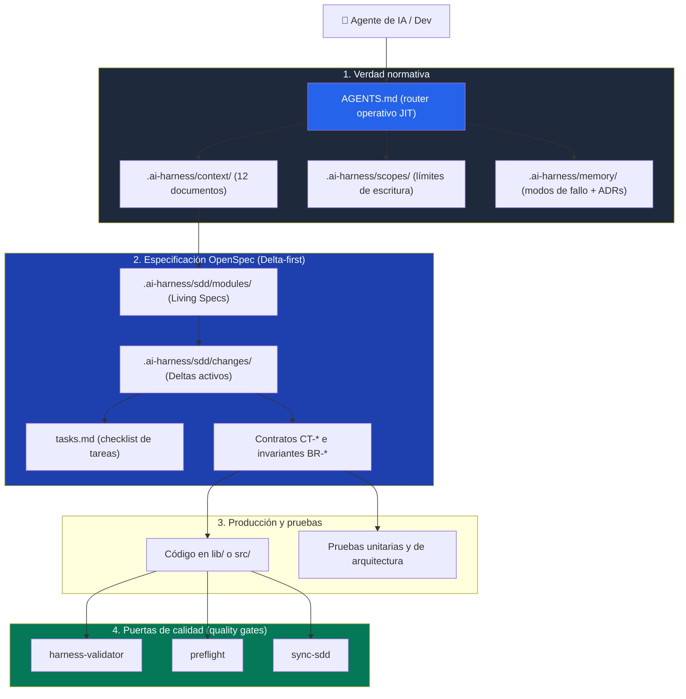

# 🚀 AI Harness Launcher

[](.github/workflows/harness-ci.yml)
[](.gitlab-ci.yml)
[](requirements.txt)
[](docs/05-sdd.md)
[](LICENSE)

**Español** | [English](README.en.md)

> **Entorno de desarrollo asistido por IA gobernado, determinista y auditable.**  
> Este repositorio cumple una **doble función**: es una **guía didáctica y de referencia canónica** sobre cómo diseñar y gobernar un arnés de IA profesional, y al mismo tiempo es una **herramienta generadora (launcher)** capaz de montar un arnés a medida para cualquier stack y producto real mediante la skill `bootstrap-harness`.

---

## 🧭 Tabla de contenidos

1. [¿Qué es este proyecto?](#-qué-es-este-proyecto)
2. [Los dos propósitos del repositorio](#-los-dos-propósitos-del-repositorio)
3. [Arquitectura conceptual: cómo funciona el arnés](#-arquitectura-conceptual-cómo-funciona-el-arnés)
4. [Estructura del proyecto y zonas](#-estructura-del-proyecto-y-zonas)
5. [Ejemplo práctico paso a paso (De la idea a producción)](#-ejemplo-práctico-paso-a-paso-de-la-idea-a-producción)
6. [Guía de uso: dos formas de utilizarlo](#-guía-de-uso-dos-formas-de-utilizarlo)
   - [Modo A: didáctico / estudio y referencia](#modo-a-didáctico--estudio-y-referencia)
   - [Modo B: lanzador de un proyecto real (`bootstrap-harness`)](#modo-b-lanzador-de-un-proyecto-real-bootstrap-harness)
7. [Las puertas de calidad (*quality gates*)](#-las-puertas-de-calidad-quality-gates)
8. [Catálogo de *skills* y flujos de trabajo (*workflows*)](#-catálogo-de-skills-y-flujos-de-trabajo-workflows)
9. [Reglas de oro no negociables](#-reglas-de-oro-no-negociables)
10. [Integración Continua Dual (GitHub & GitLab)](#-integración-continua-dual-github--gitlab)
11. [Cómo Contribuir](#-cómo-contribuir)
12. [Licencia](#-licencia)

---

## 💡 ¿Qué es este proyecto?

Cuando se trabaja con modelos de IA (Antigravity, Claude, Cline, Roo-Code, Cursor, etc.) en bases de código reales, los modelos tienden a **alucinar requerimientos**, inventar contratos de datos, degradar la arquitectura, omitir pruebas o introducir dependencias incompatibles.

El **arnés de IA** es el sistema de contención, contexto y validación que rodea al agente:
- **No es un prompt:** es un conjunto de archivos normativos, contratos de límites de escritura y scripts ejecutables que auditan el código en cada paso.
- **OpenSpec-First (Delta-Driven Development):** se prohíbe programar nuevas features sin una propuesta previa aislada en `changes/` consolidada en su módulo vivo maestro, habilitando a su vez un canal *Fast-Path* para bugfixes y parches de <3 archivos.
- **Verificación determinista:** el código no se aprueba por "opinión", sino porque supera puertas de validación automatizadas en Python.

---

## 🎯 Los dos propósitos del repositorio

```
┌────────────────────────────────────────────────────────────────────────┐
│                        HARNESS-LAUNCHER                                │
├──────────────────────────────────┬─────────────────────────────────────┤
│      1. PROPÓSITO DIDÁCTICO      │       2. PROPÓSITO LAUNCHER         │
│         (docs/ + context/)       │         (bootstrap-harness)         │
│                                  │                                     │
│  📖 Explica el "por qué":       │  ⚡ Transforma la base canónica:    │
│  - Teoría completa del arnés.    │  - Lee tu PRD o idea de negocio.    │
│  - Cómo gobernar un agente.      │  - Genera tu arnés a medida.        │
│  - 14 capítulos estructurados.   │  - Configura scopes y validadores.  │
│  - Rutas de lectura rápida.      │  - Deja todo verificado y listo.    │
└──────────────────────────────────┴─────────────────────────────────────┘
```

1. **Propósito didáctico:** si estás aprendiendo a estructurar proyectos para agentes de IA, `docs/` contiene la explicación paso a paso de cada pieza (qué es, qué problema evita, qué rompe si falta).
2. **Propósito como lanzador (*launcher*):** si vas a iniciar un nuevo proyecto (o gobernar uno existente), la skill `bootstrap-harness` analiza tu documentación o interactúa contigo y genera un arnés a medida (Flutter, Python, Node/TS, Go, API, CLI o app con interfaz de usuario) sin valores prefijados ni sesgos.

---

## 🧠 Arquitectura conceptual: cómo funciona el arnés

El flujo de control de un agente en el repositorio sigue un orden estricto unidireccional:



- **`AGENTS.md`:** es el semáforo y router JIT. No duplica reglas de negocio; solo indica el orden de carga obligatorio.
- **`harness.config.yaml`:** es la **única fuente de verdad estructural**. Ningún script asume nombres de carpetas ni prefijos: todo se lee de este archivo.
- **`.ai-harness/context/`:** 12 documentos normativos que definen identidad, arquitectura, estándares de código, pruebas, privacidad y framework SDD.
- **`.ai-harness/scopes/`:** fronteras modulares (`block_*.md`). Cada módulo define qué rutas posee, cuáles le están prohibidas y qué API pública expone.
- **`.ai-harness/sdd/`:** arquitectura OpenSpec con módulos vivos consolidados (`modules/`), propuestas activas (`changes/`) y memoria histórica (`archive/`) con trazabilidad completa:  
  `FR-* (Requisito) → CT-* (Contrato) → archivo::símbolo → TC-* (Prueba)`.

---

## 📁 Estructura del proyecto y zonas

El repositorio distingue claramente dos zonas:

```
.
├── AGENTS.md                          # Router de entrada obligatorio para agentes
├── harness.config.yaml                # Fuente de verdad de configuración del arnés
├── requirements.txt                   # Dependencias Python del tooling (Pydantic, PyYAML)
├── MANIFEST.md                        # Lista canónica de qué se traslada y qué no
├── .aiignore                          # Archivos excluidos del contexto del agente
├── .gitignore                         # Archivos excluidos de control de versiones
│
├── .clinerules/                       # Reglas de workspace y workflows invocables
│   ├── rules.md                       # Protocolo de actuación del agente
│   └── workflows/                     # Comandos '/' (list-skills, preflight, etc.)
│
├── .agents/skills/                    # Documentación operativa para el agente
│   └── <skill>/SKILL.md               # Cómo invocar y diagnosticar cada herramienta
│
├── .ai-harness/                       # NÚCLEO OPERATIVO DEL ARNÉS
│   ├── context/                       # 12 documentos normativos maestros
│   ├── design-system/                 # tokens.json + 6 especificaciones de diseño
│   ├── scopes/                        # Límites de escritura (block_*.md)
│   ├── sdd/                           # Arquitectura OpenSpec y plantillas
│   │   ├── modules/                   # Módulos vivos consolidados (Living Specs)
│   │   ├── changes/                   # Propuestas activas (deltas en revisión)
│   │   ├── archive/                   # Histórico de cambios completados
│   │   └── templates/                 # Plantillas canónicas (module, proposal, tasks)
│   ├── memory/                        # failure_modes.md (antipatrones) + ADRs
│   ├── fixtures/                      # Datos deterministas para pruebas
│   ├── input/                         # Buzón para depositar PRDs o briefs de entrada
│   └── skills/                        # Runners ejecutables de los validadores
│
└── docs/                              # ZONA DIDÁCTICA (Explicación del arnés; no se copia)
    ├── 00-indice.md a 12-bootstrap    # Guía conceptual capítulo a capítulo
    └── cheatsheet.md                  # Resumen rápido de una página
```

---

## 🎬 Ejemplo práctico paso a paso (De la idea a producción)

> 📖 **Capítulo de referencia completa:** [docs/13-ejemplo-practico-paso-a-paso.md](docs/13-ejemplo-practico-paso-a-paso.md)

¿Cómo se vive en el día a día un desarrollo con este arnés?

1. **La Petición:** El desarrollador pide añadir *Google OAuth* al módulo de autenticación existente.
2. **La Propuesta aislada (Delta OpenSpec):** El agente ejecuta `/propose-change.md` y genera `changes/[YYYY-MM]-add-google-oauth/proposal.md` y `tasks.md`. No toca una sola línea de código fuente.
3. **Revisión en 2 minutos:** El humano abre `proposal.md`, revisa qué se añade (`+`), qué contratos se modifican (`~`) y aprueba el delta conceptual sin ruido técnico.
4. **Consolidación:** Con `/consolidate-change.md`, la verdad viva de `modules/auth.md` se actualiza y la propuesta pasa a `archive/`.
5. **Implementación y Quality Gates:** El agente programa el código respetando los límites de `scopes/block_domain.md`, y antes de publicar se ejecutan `harness-validator`, `preflight` y `sync-sdd`.

---

## 🛠️ Guía de uso: dos formas de utilizarlo

### Modo A: didáctico / estudio y referencia

Si deseas comprender la ingeniería detrás de un arnés de IA gobernado:

1. Abre [`docs/00-indice.md`](docs/00-indice.md) y elige tu itinerario:
   - **Ruta corta (30 min):** `01-que-es-un-harness.md` → `02-agents-md.md` → `cheatsheet.md`.
   - **Ruta operativa (2 horas):** `01` a `05` → `08-skills-y-validadores.md` → `13-ejemplo-practico-paso-a-paso.md` → `cheatsheet.md`.
   - **Ruta completa (4 horas):** Los 14 capítulos (00 a 13) en orden para dominar la arquitectura OpenSpec y gobernanza de agentes.
2. Consulta el **caso práctico real** en [`docs/13-ejemplo-practico-paso-a-paso.md`](docs/13-ejemplo-practico-paso-a-paso.md).
3. Examina las plantillas canónicas en `.ai-harness/sdd/templates/` para entender la anatomía de una especificación viva y un delta de propuesta.

---

### Modo B: lanzador de un proyecto real (`bootstrap-harness`)

Para inicializar y personalizar este arnés para un nuevo producto o repositorio:

#### 1. Preparación de dependencias
```bash
python -m pip install -r requirements.txt
```
*(Requiere Python 3.11 o superior).*

#### 2. Vía recomendada: asistido por modelo de IA (*agent-driven*)
Si estás en una sesión de chat con Antigravity, Cline o Roo-Code:
1. Deposita tu PRD, brief o notas técnicas en `.ai-harness/input/` (o explícale tu producto en el chat).
2. Pídele al agente:
   > *"Por favor, analiza la documentación en input/ e inicializa el arnés adaptándolo a mi proyecto usando bootstrap-harness."*
3. El agente analizará el dominio real, deducirá los módulos (`scopes`), el stack y las políticas de persistencia/privacidad, redactará un manifiesto estructurado (`manifest.yaml`) y compilará el arnés ejecutando:
   ```bash
   python .ai-harness/skills/bootstrap-harness/runner.py --manifest .ai-harness/input/manifest.yaml
   ```

#### 3. Vía manual: entrevista interactiva en terminal
Si prefieres responder tú mismo por consola paso a paso:
```bash
python .ai-harness/skills/bootstrap-harness/runner.py --interactive
```
*(También puedes simular sin escribir en disco añadiendo `--dry-run`).*

---

## 🚦 Las puertas de calidad (*quality gates*)

Antes de dar cualquier tarea por concluida o realizar un commit en Git, deben pasar limpias tres puertas deterministas:

```bash
# 1. Valida integridad estructural, frontmatter, contexto normativo y scopes
python .ai-harness/skills/harness-validator/runner.py

# 2. Valida linters, arquitectura, inmutabilidad, tokens y dependencias prohibidas
python .ai-harness/skills/preflight/runner.py

# 3. Valida sincronización criptográfica entre specs aprobadas y código real
python .ai-harness/skills/sync-sdd/runner.py
```

| Puerta | Qué audita | Criterio de fallo |
|---|---|---|
| **`harness-validator`** | Integridad del arnés | Documentos ausentes, tags `<PROYECTO>` sin rellenar, specs sin historia BDD o frontmatter inválido. |
| **`preflight`** | Calidad del código fuente | Fallo de pruebas, imports cruzados entre features privadas, uso de `any`/`dynamic`, estilos literales o paquetes vetados. |
| **`sync-sdd`** | Alineación spec ↔ código | Módulos vivos cuyo target no existe en disco (`MISSING`), código que diverge de la baseline (`DIVERGED`) o propuestas con tareas pendientes. |

---

## 🧰 Catálogo de *skills* y flujos de trabajo (*workflows*)

Todas las capacidades del arnés están empaquetadas como ***skills* ejecutables** y pueden invocarse como flujos de trabajo `/comando.md` en entornos compatibles:

| Skill / Flujo de trabajo | Función | Comando directo |
|---|---|---|
| `/bootstrap-harness.md` | Inicializa y adapta el arnés al producto real | `python .ai-harness/skills/bootstrap-harness/runner.py` |
| `/harness-validator.md` | Audita la coherencia y normativa del arnés | `python .ai-harness/skills/harness-validator/runner.py` |
| `/preflight.md` | Control de calidad de código y arquitectura | `python .ai-harness/skills/preflight/runner.py` |
| `/sync-sdd.md` | Audita módulos vivos y tareas OpenSpec | `python .ai-harness/skills/sync-sdd/runner.py` |
| `/propose-change.md` | Crea una propuesta de cambio (delta OpenSpec) | `python .ai-harness/skills/propose-change/runner.py` |
| `/consolidate-change.md` | Consolida y archiva un cambio aprobado | `python .ai-harness/skills/consolidate-change/runner.py` |
| `/launch-app.md` | Arranca la aplicación según su stack | `python .ai-harness/skills/launch-app/runner.py` |
| `/git-publish.md` | Publicación protegida en Git bajo demanda | `python .ai-harness/skills/git-publish/runner.py push` |
| `/list-skills.md` | Inventario de capacidades registradas | Lee `.ai-harness/skills/registry.yaml` |

---

## ⚖️ Reglas de oro no negociables

1. **OpenSpec-first obligatorio:** ninguna funcionalidad o modificación de regla se programa sin una propuesta aislada previa en `changes/` consolidada en el módulo maestro (salvo parches bajo el protocolo Fast-Path).
2. **Cero invención (*zero-assumption*):** si falta un dato de producto o requerimiento, se registra como pregunta abierta en la propuesta y se detiene la implementación hasta aclararlo.
3. **Una sola fuente de verdad:** cada regla vive en un único archivo; el resto la referencia. Prohibido duplicar normativas.
4. **Configuración estructural primero:** cualquier cambio de capas, scopes o prefijos empieza en `harness.config.yaml`.
5. **Calidad inquebrantable:** prohibido usar `--no-verify` o silenciar tests para forzar un commit. Los fallos se resuelven en su causa raíz.
6. **Privacidad por defecto:** cero telemetría no consentida ni librerías de rastreo comercial.
7. **Publicación bajo demanda:** `git push` solo se ejecuta ante una instrucción explícita del usuario.

---

## 🌐 Integración Continua Dual (GitHub & GitLab)

El arnés está diseñado para operar con paridad total tanto en **GitHub** como en **GitLab** (Cloud o Self-Hosted):

| Característica | GitHub Actions | GitLab CI/CD |
|---|---|---|
| **Archivo de Pipeline** | [`.github/workflows/harness-ci.yml`](.github/workflows/harness-ci.yml) | [`.gitlab-ci.yml`](.gitlab-ci.yml) |
| **Plantilla de Revisión** | [`.github/PULL_REQUEST_TEMPLATE.md`](.github/PULL_REQUEST_TEMPLATE.md) | [`.gitlab/merge_request_templates/Default.md`](.gitlab/merge_request_templates/Default.md) |
| **Plantillas de Issues** | `.github/ISSUE_TEMPLATE/` | `.gitlab/issue_templates/` |
| **Quality Gates en CI** | `harness-validator` + `preflight` + `sync-sdd` | `harness-validator` + `preflight` + `sync-sdd` |
| **Blindaje (Tamper-Resistance)** | Bloqueo en PRs si se alteran árbitros | Bloqueo en MRs si se alteran árbitros |

---

## 🤝 Cómo Contribuir

Las contribuciones son bienvenidas tanto de desarrolladores humanos como de agentes de IA. Consulta nuestra [Guía de Contribución (CONTRIBUTING.md)](CONTRIBUTING.md) para conocer el protocolo de ramas, propuestas OpenSpec y validación local obligatoria.

---

## 📄 Licencia

Este proyecto se distribuye bajo la licencia **MIT**. Consulta el archivo [LICENSE](LICENSE) para más detalles.
