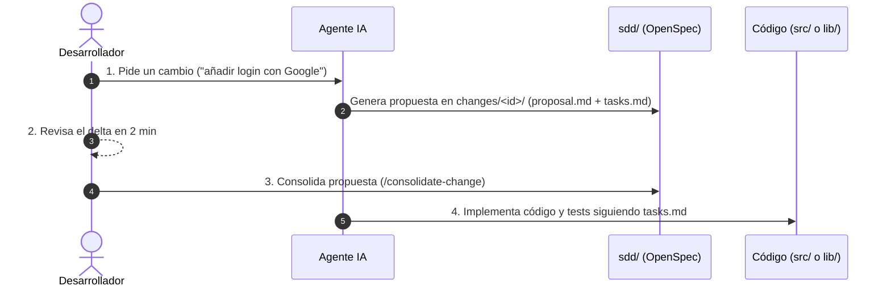

# 05 — SDD: Especificaciones Vivas y Metodología OpenSpec

## Qué es

El subsistema SDD (Spec-Driven Development) adopta el estándar **OpenSpec (Delta-Driven Development)**: un ciclo donde las especificaciones nunca envejecen ni se fragmentan en cientos de archivos obsoletos.

El principio fundamental es la separación entre el **Estado Consolidado Vivo** (`modules/`) y los **Deltas de Cambio** (`changes/`).

---

## Por qué superamos la dicotomía Componentes vs Procesos

En el enfoque anterior (`1_COMPONENTS` y `2_PROCESSES`), la especificación de una misma funcionalidad quedaba artificialmente dividida en carpetas separadas (por ejemplo, el repositorio de autenticación en un componente y el login en un proceso).

En **OpenSpec**:
- Cada capacidad del sistema vive en un único archivo maestro en `modules/<modulo>.md` (ej. `auth.md`).
- El módulo contiene sus entidades, contratos (`CT-*`), reglas de negocio (`BR-*`), flujos de ejecución y mapa de implementación en código.
- Los cambios nunca tocan directamente la spec maestra sin una propuesta previa: se presentan como **deltas aislados** en `changes/` que el desarrollador puede revisar y validar en solo 2 minutos.

---

## Estructura de Directorios

```text
.ai-harness/sdd/
├── modules/                        # Living Specs: la verdad actual consolidada
│   ├── README.md                   # Catálogo de capacidades
│   ├── auth.md                     # Capacidad viva de autenticación
│   └── billing.md                  # Capacidad viva de facturación
│
├── changes/                        # Deltas activos (en revisión o implementación)
│   └── [YYYY-MM]-[slug]/
│       ├── proposal.md             # Qué cambia del módulo maestro (+ / ~ / -)
│       └── tasks.md                # Checklist de tareas técnicas [ ] / [x]
│
├── archive/                        # Memoria histórica inmutable
│   └── [YYYY-MM]-[slug]/           # Cambios ya consolidados e implementados
│
└── templates/                      # Plantillas canónicas
    ├── module.template.md
    ├── proposal.template.md
    └── tasks.template.md
```

---

## El Flujo de Trabajo en 4 Pasos



1. **Paso 1: Proponer el cambio (`/propose-change`):**
   El agente lee `modules/auth.md` y genera exclusivamente el delta en `changes/[YYYY-MM]-add-oauth/proposal.md` y la lista técnica `tasks.md`.
2. **Paso 2: Revisión ágil (2 minutos):**
   El desarrollador revisa solo el diff conceptual. Si algo no encaja, se ajusta el Markdown antes de escribir una sola línea de código.
3. **Paso 3: Consolidar la spec (`/consolidate-change`):**
   Se aplican los cambios al archivo maestro `modules/auth.md` y la propuesta se traslada a `archive/`.
4. **Paso 4: Implementar el código:**
   El agente o programador implementa la funcionalidad y los tests guiado por `tasks.md`.

---

## Gobernanza Graduada (Fast-Path vs Standard vs Core)

No todos los cambios ameritan la misma burocracia. El arnés adapta su exigencia:

| Nivel | Cuándo aplica | Exigencia SDD | Verificación |
|---|---|---|---|
| **Fast-Path** | Hotfixes, tweaks visuales, parches de <3 archivos | Sin propuesta previa obligatoria | Test unitario + `preflight --tier fast` |
| **Standard** | Nuevas funcionalidades, reglas o contratos | Propuesta OpenSpec completa | `propose-change` → `consolidate-change` → `sync-sdd` + `preflight` |
| **Core** | Cambios arquitecturales, base de datos o protocolos | Propuesta OpenSpec + ADR | Nivel Standard + Registro de ADR en `memory/adr/` |

---

## Auditoría Determinista (`sync-sdd`)

El validador `python .ai-harness/skills/sync-sdd/runner.py` audita automáticamente:
1. Que los módulos vivos en `modules/` tengan su contrapartida real en el código (`target_path`).
2. Que no existan tareas pendientes (`[ ]`) en propuestas activas antes de cerrar una entrega.
3. Que no haya divergencia entre el código implementado y la línea base registrada.
