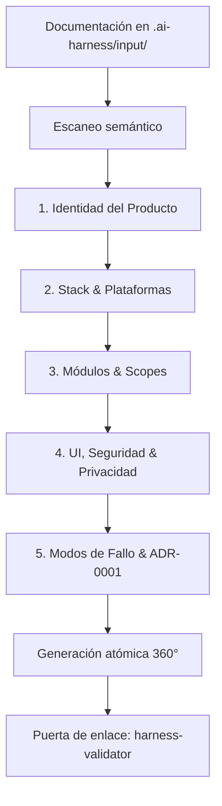

# 12 — bootstrap-harness: Inicializador del arnés

## Qué es

`bootstrap-harness` es la skill que transforma la plantilla neutra ("carcasa")
en un arnés completamente adaptado a un proyecto nuevo. Funciona mediante un
asistente conversacional por fases o mediante la ingesta semántica de documentación
previa depositada en `.ai-harness/input/`.

## Por qué existe

Adaptar manualmente un arnés a un proyecto nuevo exige editar más de 20 archivos:
`harness.config.yaml`, los 12 documentos de contexto, los scopes de escritura,
los ignorados de Git/IA, las decisiones iniciales y la primera spec. Hacerlo a mano:

1. **Provoca omisiones:** quedan textos residuales como `<PROYECTO>` o reglas
   inconsistentes entre archivos.
2. **Exige conocimiento previo:** una persona sin experiencia en la gobernanza
   del arnés no sabe qué valores espera cada validador.
3. **Desaprovecha documentación existente:** si el equipo ya dispone de un PRD
   o especificación técnica, redactar el arnés desde cero es duplicar esfuerzo.

`bootstrap-harness` automatiza todo el proceso garantizando que, al concluir, el
repositorio queda 100% configurado y con todas las puertas de validación en verde.

## Archivos implicados

```
.ai-harness/input/                 # Carpeta para depositar PRDs, briefs o especificaciones
.ai-harness/skills/bootstrap-harness/
├── skill.yaml                     # Manifiesto canónico de la skill
├── runner.py                      # Punto de entrada CLI con validación final
├── models.py                      # Modelos tipados con Pydantic v2
├── input_scanner.py               # Motor de escaneo e ingesta de documentos
├── prompter.py                    # Entrevistador interactivo accesible
├── generator.py                   # Compilador y generador atómico 360°
└── SKILL.md                       # Especificación técnica de la skill

.agents/skills/bootstrap-harness/SKILL.md  # Documentación operativa para agentes y usuarios
.clinerules/workflows/bootstrap-harness.md # Workflow invocable (/bootstrap-harness.md)
```

## Mecánica interna

### 1. Ingesta de contexto previo (Document-Aware)

Antes de iniciar las preguntas, el motor `InputScanner` revisa `.ai-harness/input/`.
Si encuentra archivos `.md`, `.txt`, `.json` o `.yaml`, extrae heurísticamente:

- Nombre comercial y descripción del producto.
- Stack tecnológico sugerido (Flutter, Python, Node, Go, Rust, etc.).
- Módulos funcionales y candidatos a scopes.
- Requisitos de privacidad y persistencia.

### 2. Entrevista accesible en 5 fases

El módulo `Prompter` guía al usuario mediante un formato universal diseñado tanto
para desarrolladores como para perfiles no técnicos:



Cada pregunta incluye:
- **Explicación llana:** *"¿Por qué importa?"* sin jerga innecesaria.
- **Opciones numeradas:** con la opción técnica más recomendada señalada.
- **🤖 Decidir por mí:** la IA deduce la mejor decisión técnica basándose en la
  documentación previa o en el estándar de la industria.
- **✏️ Campo abierto:** permite especificar respuestas personalizadas.

### 3. Generación atómica 360°

`HarnessGenerator` escribe o reescribe en una única pasada coherente:

| Artefacto | Contenido generado |
|---|---|
| `harness.config.yaml` | Nombre, slug, stack, capas SDD, lista de features, scopes y paquetes prohibidos. |
| `AGENTS.md` | Orquestador puro: mantiene la carga JIT estricta y tabla de tareas sin reglas de negocio. |
| `README.md` | Presentación del producto real, prerrequisitos, stack y guía para agentes. |
| `.gitignore` / `.aiignore` | Exclusiones específicas del stack elegido (builds, cachés, virtualenvs) y secretos. |
| `.ai-harness/context/*.md` | Los 12 documentos normativos redactados según las decisiones de la entrevista. |
| `.ai-harness/scopes/block_*.md` | Un archivo de scope por módulo con `path_roots` y `forbidden_paths` explícitos. |
| `.ai-harness/memory/failure_modes.md` | 5 modos de fallo iniciales (`FM-01` a `FM-05`) adaptados al stack. |
| `.ai-harness/memory/decisions/` | `ADR-0001` documentando la elección del stack y arquitectura. |
| `.ai-harness/design-system/tokens.json` | Tokens de color, tipografía y espaciado (o perfil de API si es backend). |
| `.ai-harness/sdd/.../CMP-00-*.spec.md` | Especificación inicial de arranque del sistema (`app-bootstrap`). |

### 4. Modos de ejecución del runner

```bash
# 1. Modo interactivo estándar (recomendado para nuevos proyectos):
python .ai-harness/skills/bootstrap-harness/runner.py --interactive

# 2. Modo simulación (inspecciona qué generaría sin tocar el disco):
python .ai-harness/skills/bootstrap-harness/runner.py --interactive --dry-run

# 3. Modo desatendido mediante manifiesto YAML:
python .ai-harness/skills/bootstrap-harness/runner.py --manifest mi-producto.yaml
```

### 5. Validación en bucle cerrado

Al finalizar la escritura, `runner.py` ejecuta inmediatamente
`harness-validator/runner.py`. Si alguna regla estructural queda insatisfecha,
se reporta el fallo para corregirlo antes de dar por cerrada la tarea.

## Qué valida el arnés

`harness-validator` (`check_skills`) comprueba sobre esta skill:

1. Existencia obligatoria de `skill.yaml` y `runner.py`.
2. Presencia de la documentación canónica en `.agents/skills/bootstrap-harness/SKILL.md`.
3. Registro activo en `.ai-harness/skills/registry.yaml`.
4. Sintaxis válida del runner y correspondencia del comando de ejecución.

## Qué rompe si falta

- Quien hace un fork de la plantilla debe rellenar manualmente más de 20 archivos.
- Quedan referencias cruzadas y marcadores `<PROYECTO>` sin sustituir.
- El arnés tarda horas en configurarse en lugar de minutos.
- Se introducen discrepancias entre `harness.config.yaml` y los archivos de contexto.

## Anti-patrón

Ejecutar la skill sobre la propia plantilla de repositorio antes de distribuirla:
la plantilla debe permanecer neutra para que cada usuario que cree un fork
pueda ejecutar el bootstrap y definir su propio proyecto.

## Referencias

- `08-skills-y-validadores.md` — arquitectura de las skills del arnés.
- `09-workflows.md` — workflow `/bootstrap-harness.md`.
- `MANIFEST.md` — lista canónica de elementos del arnés.

