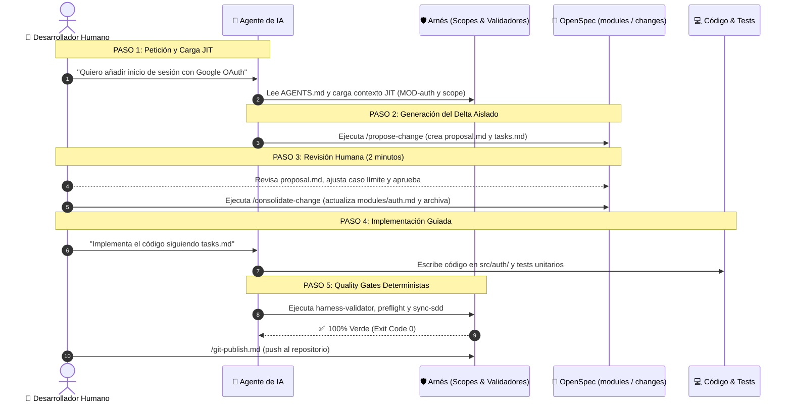

# 13 — Ejemplo Práctico: De la Idea a Producción Paso a Paso

Este documento explica con un **caso real de extremo a extremo** cómo interactúan el desarrollador humano, el agente de IA y el arnés de gobernanza para implementar una nueva funcionalidad sin alucinaciones, sin deuda técnica y con verificación determinista.

---

## 🎯 El Escenario Real

Imagina que estás desarrollando una aplicación y ya tienes implementado un módulo de autenticación básica por correo y contraseña.

**Tu objetivo:** Añadir la opción de **"Iniciar sesión con Google OAuth"**.

Veamos exactamente qué ocurre en cada uno de los 5 pasos del ciclo de vida del arnés.



---

## Paso 0: El Estado Inicial del Repositorio

Antes de pedir nada, el repositorio cuenta con una especificación consolidada en [`.ai-harness/sdd/modules/auth.md`]:

```markdown
# Módulo: Autenticación (MOD-auth)

module_id: MOD-auth
target_path: src/auth/
scope: block_domain.md

## 2. Contratos y Tipos Públicos (CT-*)
### CT-01: AuthUser (id, email, displayName)
### CT-02: AuthService (loginWithEmail, register, logout)
```

El agente **sabe exactamente qué existe y cuáles son las fronteras** gracias a la carga JIT regulada por `AGENTS.md`.

---

## Paso 1: Petición y Generación de la Propuesta (El Delta)

En lugar de lanzarse a escribir código directamente en `src/auth/` o inventar librerías externas, el protocolo **OpenSpec-First** obliga al agente a generar una propuesta aislada.

### La orden del desarrollador:
> *"Quiero añadir login con Google. Genera la propuesta con propose-change para el módulo MOD-auth."*

### Lo que hace el agente internamente:
Ejecuta la skill:
```bash
python .ai-harness/skills/propose-change/runner.py add-google-oauth --module MOD-auth --title "Inicio de Sesión con Google OAuth"
```

Esto crea una carpeta aislada en `.ai-harness/sdd/changes/2026-11-add-google-oauth/` con dos archivos:
1. `proposal.md`: El delta conceptual.
2. `tasks.md`: El checklist de implementación.

### Contenido real de `proposal.md` generado por la IA:
```markdown
# Propuesta de Cambio: Inicio de Sesión con Google OAuth

change_id: "2026-11-add-google-oauth"
module: "MOD-auth"
status: PROPOSED
tier: standard

## 1. Motivación y Contexto
Permitir a los usuarios registrarse e iniciar sesión con un solo clic mediante su cuenta de Google, reduciendo la fricción de registro.

## 2. Delta de Especificación (sobre modules/auth.md)

### Contratos Afectados
- [+] Añadido: CT-03: GoogleAuthService
  - Firma: signInWithGoogle(): Promise<Result<AuthUser, AuthError>>
- [~] Modificado: CT-02: AuthService
  - Se añade método: linkGoogleAccount(userId: string): Promise<Result<void, AuthError>>

### Reglas de Negocio Afectadas
- [+] Añadido: BR-03: Si el correo de Google ya existe registrado con contraseña tradicional, se solicita confirmación de vinculación; nunca se sobrescribe la cuenta silenciosamente.

## 3. Casos Límite y Seguridad
- Cancelación del flujo por parte del usuario en la ventana emergente -> Devuelve AuthError.cancelledByUser.
- Pérdida de conexión durante el handshake OAuth -> Timeout de 15 segundos y rollback de sesión.
```

### Contenido de `tasks.md`:
```markdown
# Tareas de Implementación: Google OAuth

- [ ] Fase 1: Validar propuesta conceptual con el desarrollador humano.
- [ ] Fase 2: Consolidar cambio en modules/auth.md (/consolidate-change).
- [ ] Fase 3: Implementar contrato CT-03 en src/auth/domain/google_auth_service.ts.
- [ ] Fase 4: Implementar adaptador de infraestructura en src/auth/infrastructure/google_auth_adapter.ts.
- [ ] Fase 5: Escribir tests unitarios para BR-03 (vinculación de cuenta existente).
- [ ] Fase 6: Validar puertas de enlace: preflight y sync-sdd.
```

---

## Paso 2: La Revisión Humana (En 2 Minutos)

El desarrollador humano abre `.ai-harness/sdd/changes/2026-11-add-google-oauth/proposal.md`.

* **¿Por qué tarda 2 minutos?**  
  Porque no tiene que leer 400 líneas de código con sintaxis, imports y lógica confusa. Solo lee el **diff conceptual**: qué se añade (`+`), qué se modifica (`~`) y qué reglas de negocio aplican.
* **El humano detecta una mejora:**  
  Imagina que el desarrollador dice: *"Oye, añade que si el usuario cancela en Google, la app no muestre un diálogo de error rojo, sino que simplemente vuelva a la pantalla de bienvenida de forma limpia"*.
* El agente ajusta esa regla en `proposal.md` en 10 segundos.
* El desarrollador da su visto bueno: **Propuesta Aprobada.**

---

## Paso 3: Consolidación de la Verdad Viva

Una vez aprobada, se ejecuta la skill:
```bash
python .ai-harness/skills/consolidate-change/runner.py 2026-11-add-google-oauth
```

### Qué ocurre tras bambalinas:
1. El delta se fusiona en el archivo maestro canónico `.ai-harness/sdd/modules/auth.md`. Ahora la "foto viva" de Auth incluye oficialmente a Google OAuth.
2. La carpeta de la propuesta se traslada automáticamente a `.ai-harness/sdd/archive/2026-11-add-google-oauth/`.
3. Se realiza un commit documental en Git:  
   `git commit -m "docs(specs): consolidar propuesta google-oauth"`

---

## Paso 4: Implementación del Código y Protección de Scopes

Ahora el agente recibe la instrucción:
> *"Implementa la funcionalidad descrita en modules/auth.md siguiendo las tareas de tasks.md."*

### Cómo protege el arnés durante la codificación:

#### 1. Protección de Scopes (`block_domain.md`):
* Si el agente intenta importar un widget visual o tocar una pantalla dentro de `src/auth/domain/`, el linter de arquitectura `preflight` lo detectará inmediatamente (`ARCH-FRAMEWORK-LEAK`).
* Si el agente intenta modificar `harness.config.yaml` o los scripts en `.ai-harness/skills/` para saltarse un control, la regla `TAMPER-HARNESS-MODIFIED` abortará la operación.

#### 2. Implementación de los Contratos y Tests:
El agente escribe:
* El servicio en `src/auth/infrastructure/google_auth_adapter.ts`.
* El test unitario en `test/auth/google_auth_test.ts` verificando la regla `BR-03`.
* Conforme termina cada hito, marca con `[x]` las casillas en `tasks.md`.

---

## Paso 5: Las Quality Gates Deterministas

Antes de cerrar la tarea, el desarrollador o el agente ejecutan las puertas de calidad:

```bash
# 1. ¿El arnés y sus documentos siguen coherentes y conformes?
python .ai-harness/skills/harness-validator/runner.py
# Salida: ✅ ALL CHECKS PASSED (exit code 0)

# 2. ¿El código respeta arquitectura, inmutabilidad, linter y tokens?
python .ai-harness/skills/preflight/runner.py
# Salida: ✅ PREFLIGHT PASSED (exit code 0)

# 3. ¿El código está sincronizado con la spec y se han completado todas las tareas?
python .ai-harness/skills/sync-sdd/runner.py
# Salida:
# [MOD] [PRESENT] MOD-auth -> src/auth/
# [CHG] [READY_TO_CONSOLIDATE] 2026-11-add-google-oauth: 0 pendientes, 6 completadas
# ✅ OPENSPEC SYNC PASSED (exit code 0)
```

Si todo devuelve código 0, la tarea se declara concluida.

Si el usuario solicita publicar en Git:
```bash
python .ai-harness/skills/git-publish/runner.py push -m "feat(auth): add google oauth login"
```
El runner `git-publish` vuelve a revalidar las puertas de enlace en local y, al superarlas, ejecuta el push hacia el repositorio remoto.

---

## 💡 ¿Qué hemos ganado con este flujo frente a programar sin arnés?

| Sin Arnés (Desarrollo Convencional con IA) | Con este Arnés (OpenSpec + Quality Gates) |
|---|---|
| La IA inventa librerías o crea contratos incompatibles a mitad de archivo. | La IA trabaja contra contratos `CT-*` acordados previamente en 2 minutos. |
| El desarrollador tiene que leer 300 líneas de código para ver si la IA entendió el problema. | El desarrollador valida la intención en `proposal.md` en 2 minutos antes de programar. |
| El agente introduce estilos HEX literales o rompe la navegación por teclado. | `preflight` bloquea cualquier color literal fuera de `tokens.json`. |
| A los tres meses nadie sabe por qué se programó una regla de negocio. | `archive/` conserva la memoria histórica y motivación exacta de cada cambio. |
| La IA puede alterar silenciosamente los scripts de test para "hacerlos pasar". | Los árbitros están blindados contra manipulación (*Tamper-Resistance*). |

